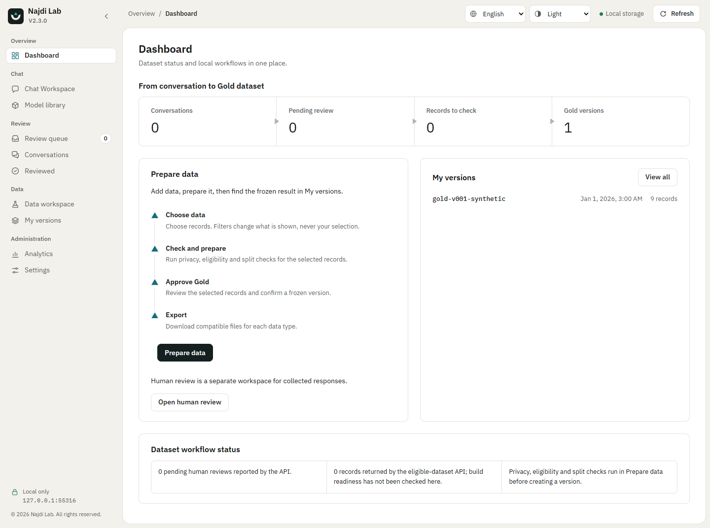
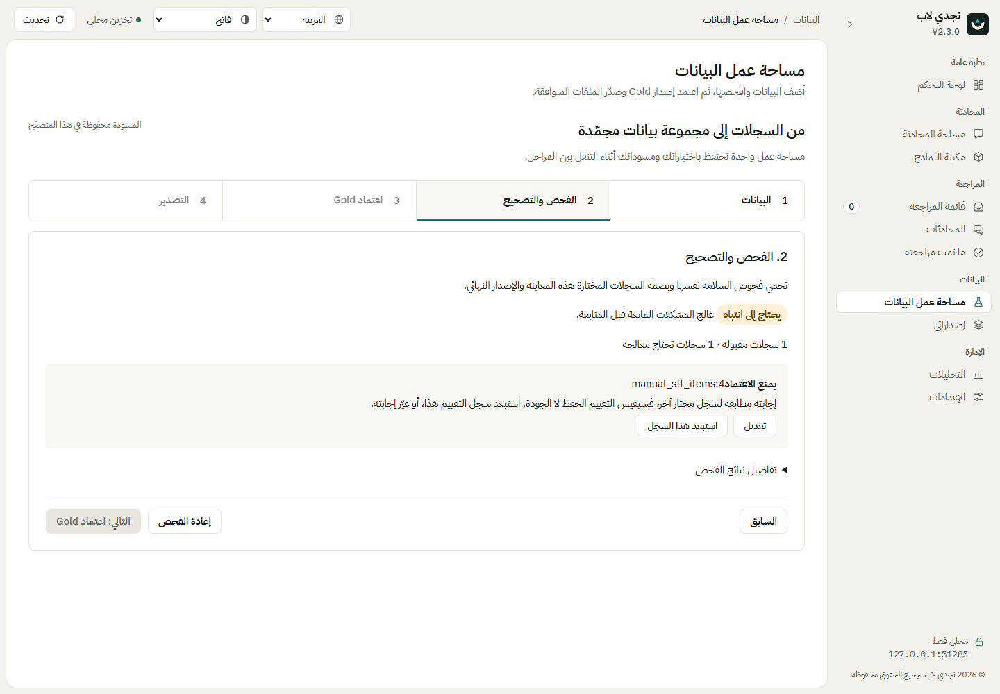
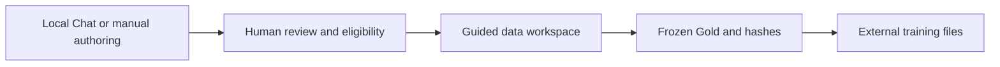
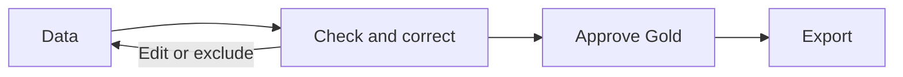

<p align="center">
  
</p>

# NajdiLab

**Local model conversations → human review and correction → validated, versioned datasets → external Unsloth training.**

<p align="center">
  <a href="app/version.py"></a>
  <a href="docs/system-requirements.md"></a>
  <a href="docs/system-requirements.md"></a>
  <a href="docs/architecture.md"></a>
</p>
<p align="center">
  <a href="docs/user-guide.md"></a>
  <a href="docs/user-guide.md"></a>
  <a href="docs/architecture.md"></a>
  <a href="docs/localization.md"></a>
</p>
<p align="center">
  <a href="docs/chat-workspace.md"></a>
  <a href="docs/native-runtime.md"></a>
  <a href="docs/development/V230_FINALIZATION.md"></a>
</p>
<p align="center">
  <a href="docs/hermes-integration.md"></a>
  <a href="PROJECT_STATUS.md"></a>
  <a href="docs/proposals/licensing-approval.md"></a>
</p>

<p align="center"><sub>Apache-2.0 is approved as a <strong>future Public Core target only</strong>; this private repository has no active redistribution license.</sub></p>

NajdiLab is a local-first platform for local model conversations, human review and traceable dataset preparation, with Arabic and Saudi/Najdi language data as a central use case.

**Current Documentation — V2.3.0 development candidate.**

## The idea and the problem

Raw conversations need human decisions, privacy controls, correction history, duplicate checks and independent evaluation before becoming traceable dataset files. NajdiLab keeps original messages and records the reviewed copies selected for each Gold version.

## Key capabilities and intended users

Curators can author SFT conversations, multi-turn examples, Direct Language text, DPO preference pairs and evaluation-only examples. Reviewers retain original text and edit history. Developers can inspect deterministic selection, diagnostics, Manifest and SHA256 evidence. Local Chat and Model library have separate runtime-consent controls.

## Visual introduction

All current images below are actual Chromium captures from a disposable **synthetic** instance running **V2.3.0**. Their hashes, browser labels and source version are recorded in the permanent [screenshot provenance](docs/assets/screenshots/v2.3.0/provenance.json).




The [visual guide](docs/screenshots.md) covers correction, approval, exports, manual editing, Gold management, deletion, mobile and Dark. The [archived Advanced Workspace](docs/legacy/advanced-workspace/README.md) has separately labeled historical images.

## Contents

- [The idea and the problem](#the-idea-and-the-problem)
- [Key capabilities and intended users](#key-capabilities-and-intended-users)
- [Visual introduction](#visual-introduction)
- [Current status](#current-status)
- [Feature status](#feature-status)
- [Interface preview](#interface-preview)
- [Technology stack and versions](#technology-stack-and-versions)
- [System requirements](#system-requirements)
- [Downloads and prerequisites](#downloads-and-prerequisites)
- [Installation and quick start](#installation-and-quick-start)
- [System architecture](#system-architecture)
- [Dataset and model workflow](#dataset-and-model-workflow)
- [Database and integrity](#database-and-integrity)
- [Optional training infrastructure](#optional-training-infrastructure)
- [Project structure](#project-structure)
- [Configuration](#configuration)
- [Security and limitations](#security-and-limitations)
- [Testing and quality](#testing-and-quality)
- [Development progress and roadmap](#development-progress-and-roadmap)
- [Developer guide and documentation](#developer-guide-and-documentation)
- [Licensing and attribution](#licensing-and-attribution)
- [Maintainer handover](#maintainer-handover)

## Current status

**V2.3.0 is a development candidate for review on `update-project`.** The existing [PR #23](https://github.com/abinadwan/NajdiLab/pull/23) remains Draft. The repository is private and production acceptance is a separate owner decision.

The official data workspace uses four stages with no Advanced Mode setting. A previously stored mode preference is ignored while selections and drafts are retained. [Candidate notes](docs/development/RELEASE_NOTES_V2.3.0.md).

## Feature status

| Area | Available in `V2.3.0` | In development | Planned |
| --- | --- | --- | --- |
| Data | Guided entry, history-aware editing, selection, backend checks, explicit Gold approval and compatible exports | User acceptance of this candidate | Multi-user roles |
| Gold | Frozen integrity, attested downloads, guarded permanent deletion and interrupted-deletion recovery | Legacy ownership proof remains constrained | Broader retention tooling |
| Chat and models | Local Chat, explicit collection, Native model library, approved managed runtime and optional LM Studio/Ollama integration | Environment-specific owner acceptance | Features listed in the roadmap |

Structural PASS describes the checked data format and guards. Content quality, training improvement and rights require their own evidence.

## Interface preview




The interface supports English LTR and Arabic RTL, Light and Dark, and 320/390/1440 CSS-pixel acceptance. Record content and technical identifiers retain independent direction. [Design system](docs/design-system.md), [all current screenshots](docs/screenshots.md).

## Technology stack and versions

| Component | Requirement or role |
| --- | --- |
| Python | 3.11 or newer with sqlite3 and venv |
| SQLite | 3.24 or newer |
| Browser UI | Plain HTML, CSS and JavaScript with native dialogs and ES modules |
| Core runtime | Python standard library with locally bundled font assets |
| Test runner | `pytest==9.1.1` in `requirements-dev.txt` |
| Browser tests | Node 22+ and separately installed Chromium / `puppeteer-core@25.16.0` |
| Optional LM Studio | SDK pinned in `requirements-chat.txt` |

Dependency versions and model/dataset versions are independent of the application version. [Dependency inventory](docs/dependencies-and-attribution.md).

## System requirements

A local browser, writable SQLite/export storage and a supported Python are sufficient for manual review and dataset work. Model inference has additional model-, engine- and hardware-specific requirements. Universal RAM/VRAM minima have not been established. [Requirements](docs/system-requirements.md).

## Downloads and prerequisites

Authorized repository access and Git are required for the private source checkout. Python, Node test tooling, optional engines and model weights have separate installation steps. Model and runtime downloads inside Model library require explicit approval and verification. [Installation](docs/installation.md), [Native runtime](docs/native-runtime.md).

## Installation and quick start

Review the scripts before launching an intended local instance. These commands initialize that checkout's own state when it starts.

```powershell
git clone --branch update-project https://github.com/abinadwan/NajdiLab.git
cd NajdiLab
python scripts/install.py --check
.\scripts\install.ps1
.\run.ps1
```

```bash
git clone --branch update-project https://github.com/abinadwan/NajdiLab.git
cd NajdiLab
python3 scripts/install.py --check
sh scripts/install.sh
sh run.sh
```

The default URL is `http://127.0.0.1:8770`. `.env` files are examples and are not loaded automatically. Set environment variables in the launching shell. Setup offers optional runtime installation with explicit approval. [Detailed installation and shutdown](docs/installation.md), [configuration](docs/configuration.md).

## System architecture




The server enforces loopback authority, Origin and CSRF boundaries. Shared backend planning owns validation. Legacy specialist panels mount only on an explicit retained diagnostic route. The default journey requests no legacy bundle. [Architecture](docs/architecture.md).

## Dataset and model workflow

1. **Data** adds, edits, duplicates, logically deletes and selects records using the existing manual editor and history.
2. **Check and correct** runs privacy, eligibility, duplicate, split, structure and loss-mask checks for exactly that selection. Edit or exclude a problem record and recheck in place.
3. **Approve Gold** summarizes the actual output and requires explicit confirmation. The backend repeats the plan and rejects changed fingerprints.
4. **Export** opens the Frozen result and offers compatible formats. Existing versions open directly at this stage from My versions.



Gold can contain SFT, multi-turn, Direct Language, DPO and evaluation files. Compatible conversational targets alone enter text Unsloth profiles. Direct Language, DPO and Evaluation keep separate raw files. A Gold build and an Unsloth handoff are distinct operations. [Export contract](docs/dataset-export.md), [user guide](docs/user-guide.md).

## Database and integrity

SQLite stores originals, correction overlays, manual edit history, version membership and deletion audit. Gold records have manifests, hashes and Frozen guards. Source edits do not mutate earlier Gold.

My versions previews the exact permanent-deletion file set and requires the typed version identifier. Ownership, hash, link or dependency uncertainty blocks deletion. Legacy versions without managed reference proof remain readable/exportable and permanent deletion is refused. Interrupted deletions remain recoverable. Original records and backups have separate retention. [Schema](docs/database-schema.md), [migration safety](docs/database-and-migrations.md), [retention](docs/data-retention.md).

## Optional training infrastructure

Training takes place in an independently managed Unsloth Studio or programmatic Unsloth/TRL environment. Verify completion-only targets, packing settings, tokenizer behavior, data rights and model licensing in that environment. NajdiLab provides the validated file handoff and an optional external token-mask verifier. [Training correctness](docs/development/TRAINING_CORRECTNESS.md).

## Project structure

```text
NajdiLab/
  app/                HTTP boundary, Chat, records, diagnostics and Gold lifecycle
  static/             Official Wizard and separately loaded legacy interface bundle
  migrations/         Reviewed startup SQL and hash registry
  scripts/            Setup, launch, documentation checks and development restoration
  tests/              Synthetic Python, Node and Chromium verification
  docs/               Current guides, permanent screenshots and historical records
  public_source/      Separate reduced Core distribution profile
```

Private databases, datasets, model files, exports and backups are local operational state. [Code map](docs/codebase-navigation.md).

## Configuration

Launchers use `NAJDILAB_PORT` with default 8770, `NAJDILAB_NO_DEMO` with default 1, and an optional explicit `NAJDILAB_PYTHON`. Ingest authentication uses the documented token boundary. Browser writes obtain a session CSRF token. Hermes ingestion remains blocked. [Configuration](docs/configuration.md), [security](SECURITY.md).

## Security and limitations

- Local operator trust applies. Multi-user RBAC and HMAC replay freshness are open limitations.
- Privacy flags protect selection and contextual windows. Automated PII, linguistic quality and rights certification are unavailable.
- Permanent Gold deletion requires complete ownership/dependency proof. Failed handoff publication can retain a conservative reference reservation.
- Browser drafts are saved in the same browser profile and origin. Blocked storage retains only the current page's in-memory context.
- Real-engine, hardware-capacity and owner production acceptance require their documented independent checks.
- Historical exports and backups can retain content after logical record deletion.

[Security boundary](SECURITY.md), [retention](docs/data-retention.md), [owner acceptance](docs/chat-windows-acceptance.md).

## Testing and quality

```bash
python scripts/install.py --check
python -m compileall -q app scripts tests
python -m pytest -q tests -rs
node --test tests/*.test.cjs
python scripts/check_docs.py
```

Real Chromium tests need the separately installed browser tools and environment variables in the [developer setup](docs/developer-setup.md). The full journey uses disposable synthetic state, checks actual clicks/downloads, Manifest/SHA256, Frozen isolation, evaluation leakage, deletion, both languages and responsive themes. The legacy restoration test uses a temporary marked static tree. Test skips retain their prerequisite reasons. Exact final counts and limits are in the [finalization report](docs/development/V230_FINALIZATION.md) and [documentation audit](docs/development/V230_DOCUMENTATION_AUDIT.md).

## Development progress and roadmap

V2.3.0 adopts the Wizard as the official data preparation interface and preserves the independent-tool presentation for development reuse. Historical release numbers and observed results remain in the [changelog](CHANGELOG.md) and clearly labeled implementation records. [Roadmap](docs/roadmap.md), [candidate notes](docs/development/RELEASE_NOTES_V2.3.0.md).

## Developer guide and documentation

Start with the [documentation index](docs/documentation-index.md), [developer setup](docs/developer-setup.md), [API reference](docs/api-reference.md) and generated [route inventory](docs/api-routes.md). The audit report inventories every Markdown/MDX file and distinguishes current guides, historical evidence, proposals and the separate Core profile. The archived interface has a [tested restoration guide](docs/legacy/advanced-workspace/RESTORE_GUIDE.md).

## Licensing and attribution

This private repository has **no active source license**. The proposed future Public Core licensing and publication decisions have their own approval boundaries. Code, models, datasets, fonts and screenshots require their respective rights. [Third-party attribution](docs/THIRD_PARTY_ATTRIBUTION.md), [source rights](docs/rights-evidence.md), [license decisions](docs/license-options.md).

## Maintainer handover

Review the [handover](docs/maintainer-handover.md), preserve private backups and use a verified separate restore before an intended installed update. Source review, a branch push and successful synthetic tests have distinct scopes from deployment, public release and production acceptance.
