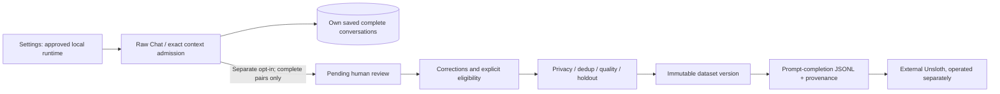

# NajdiLab

Local model conversations → human review and correction → validated, versioned datasets → external Unsloth training.

NajdiLab is a dataset preparation platform, not a trainer or a model runtime. LM Studio and Ollama remain externally managed. **Internal training, WSL worker, model acquisition/merge/GGUF/deployment source and operating guides are removed.** Existing private data, job/log evidence, prior exports and applied migrations are preserved.

## Current development scope

This source cleanup implements the dataset-only scope. It performs no installed update, external-service/configuration change, data/schema rollback, push/PR/merge or publication. Removed execution APIs have no compatibility shim; stored private evidence remains separate.

- **Chat Workspace:** simple text-only multi-turn conversations created inside NajdiLab; no NajdiLab system/developer prompts, tools, RAG, external memory or response rewriting. Complete raw history is retained and sent unchanged through the normal engine template.
- **Exact context admission:** input template/token count + reserved reply must fit the selected budget and loaded context. Overflow closes/preserves the chat and opens an empty one, without silent truncation, summarization or draft replay.
- **Separate collection:** OFF by default/restart. Only newly completed consented pairs enter PENDING review, never training-approved automatically. Saved Chat history is separate; native application chats are not harvested. **Hermes stays BLOCKED.**
- **Review and dataset quality:** immutable originals, manual edits/version history, explicit human eligibility, privacy/exclusion checks, dedup, balance, holdout/leakage validation and immutable dataset versions.
- **External Unsloth handoff:** conversational prompt/completion JSONL, provenance and hashes. Completion contains only the approved final target; external Unsloth/TRL must use completion_only_loss=True, packing=False, and reject overlength records. No trainer is invoked.

## Explicit limits — not a completed dual-engine acceptance

**LM Studio:** implemented against optional pinned Python SDK 1.5.0 and tested with synthetic engine transports. Exact count and prediction bind an existing loaded instance reference; unknown SDK/API behavior fails closed. It never loads/reconfigures a model. Real engine/model compatibility and the owner's Windows acceptance are **NOT TESTED**.

**Ollama:** Chat sending works by proving each turn: history truncation off, a live check that the engine refuses overflow, an exact one-token prompt count and a context clamp check. [Method](docs/chat-workspace.md#ollama-admission). Verified on a real 0.40.13 binary with a synthetic tiny model only. Installed models are **NOT TESTED**. It relies on request fields missing from Ollama's REST reference page, so if a future version changes them, sending blocks instead of truncating. Ollama loads models on request, so each conversation needs explicit load approval.

**Hardware:** explicit read-only device and selected-model evidence, with model maximum, runtime context, measured use and estimated feasibility reported separately. A suggested context is an **unverified estimate**, never a safe limit; without the inputs no number is given. No 64K guarantee or allocation stress test.

Saved text and raw review archives can contain private information. Collection consent is not text anonymization. Archive retains data and old exports while excluding linked reviews from future selection; physical erasure is deferred for a separately reviewed retention decision. New Unsloth handoffs require the new context privacy attestation; preserve historical exports and build a fresh reviewed version instead of rewriting them.

## Run and develop

Core: Python 3.11+, SQLite 3.24+, modern browser, standard library only. Follow [installation](docs/installation.md) and [developer setup](docs/developer-setup.md). Windows launch: `run.ps1` or `run.cmd`; Linux: `sh run.sh`. Default loopback URL: http://127.0.0.1:8770. No network/public/multi-user deployment is supported.

For Chat, the optional `requirements-chat.txt` belongs in NajdiLab's own environment during an approved update. It does not install anything into LM Studio/Ollama. No owner environment has been updated by this PR. [Chat behavior, API, consent, compatibility and rollback](docs/chat-workspace.md).

Development checks:

```text
python -m pip install -r requirements-dev.txt -r requirements-chat.txt
python -m pytest -q tests -rs
node --test tests/chat-ui.test.cjs tests/integrations-ui.test.cjs
python scripts/check_docs.py
```

Tests use synthetic data and disposable servers. Missing private historical artifacts are explicit skips. Cleanup verification and real owner acceptance are separate gates; [prior results and retained failures](docs/verification-evidence.md) are dated evidence, not hosted CI for this change.

## Architecture and project roadmap



- [Current phased roadmap](docs/roadmap.md) · [architecture](docs/architecture.md) · [API](docs/api-reference.md)
- [Dataset/review lifecycle](docs/review-and-quality.md) · [export integrity](docs/review-and-quality.md)
- [Security](SECURITY.md) · [backup/restore](docs/backup-and-restore.md) · [current status](PROJECT_STATUS.md)
- [Current guide](docs/user-guide.md) · [dataset export contract](docs/dataset-export.md) · [screenshots](docs/screenshots.md).

## Source and distribution

This is the private repository. No active redistribution license or publication approval is granted by this change. The separate Public Core source-only candidate remains an independently reviewed scope; see [release decision](docs/public-release-decision.md), [source boundaries](docs/public-private-boundary.md) and [attribution](docs/third-party-attributions.md). Chat/handoff files are not automatically included in that candidate. Reused shared service/privacy/install files are repinned only with candidate regression verification; that is not publication approval.

[Dataset-only cleanup audit and final verification](docs/cleanup-results.md) records the full source/docs inventory, actual test counts and skips, schema compatibility, remaining limits and source-only rollback.
