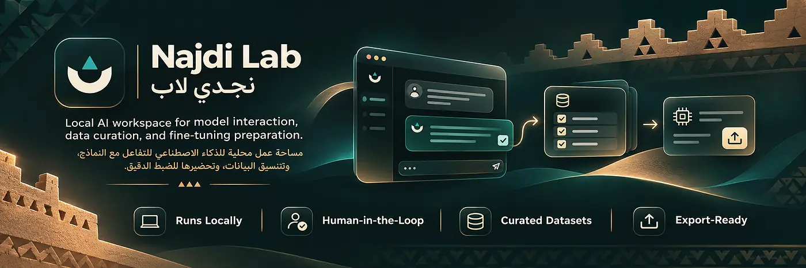
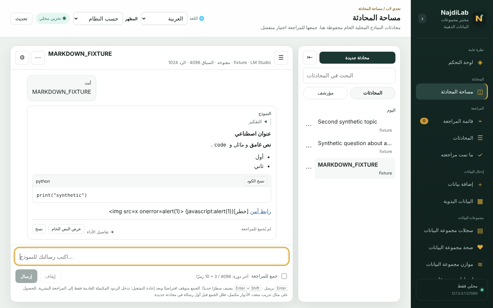
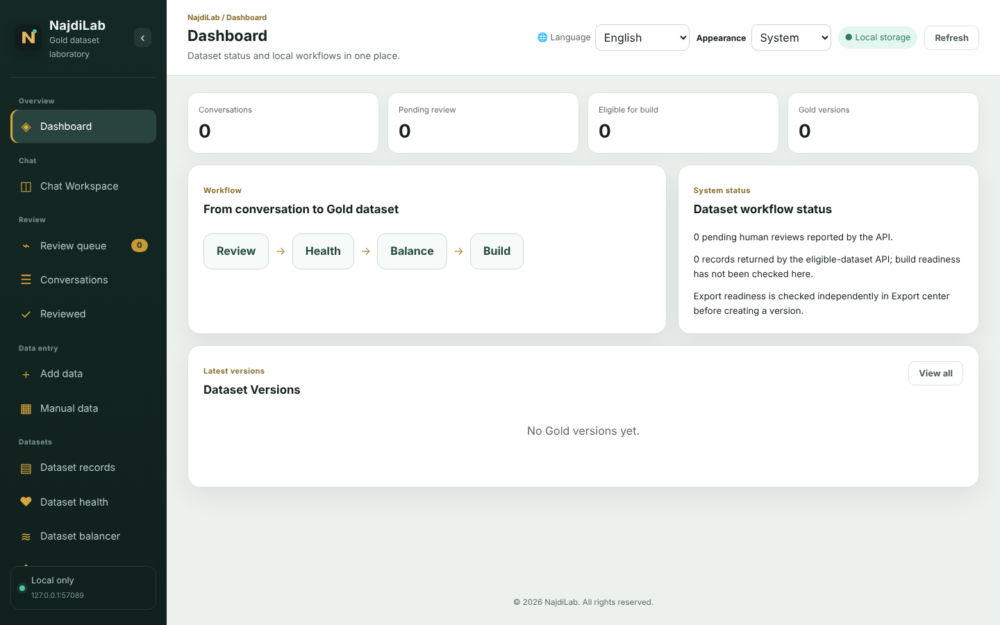
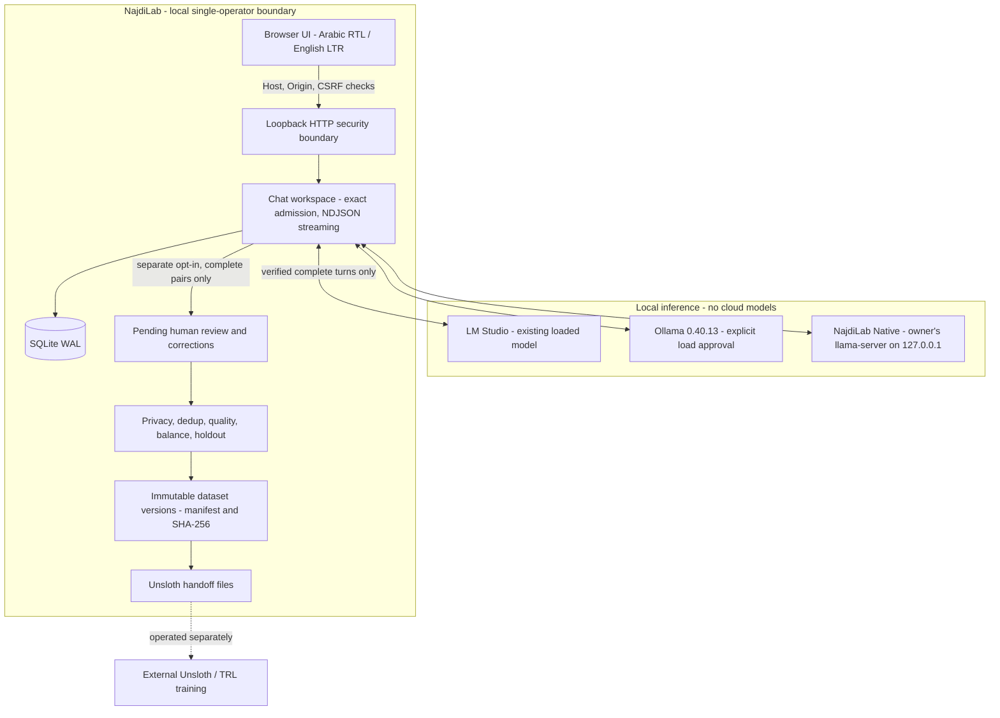
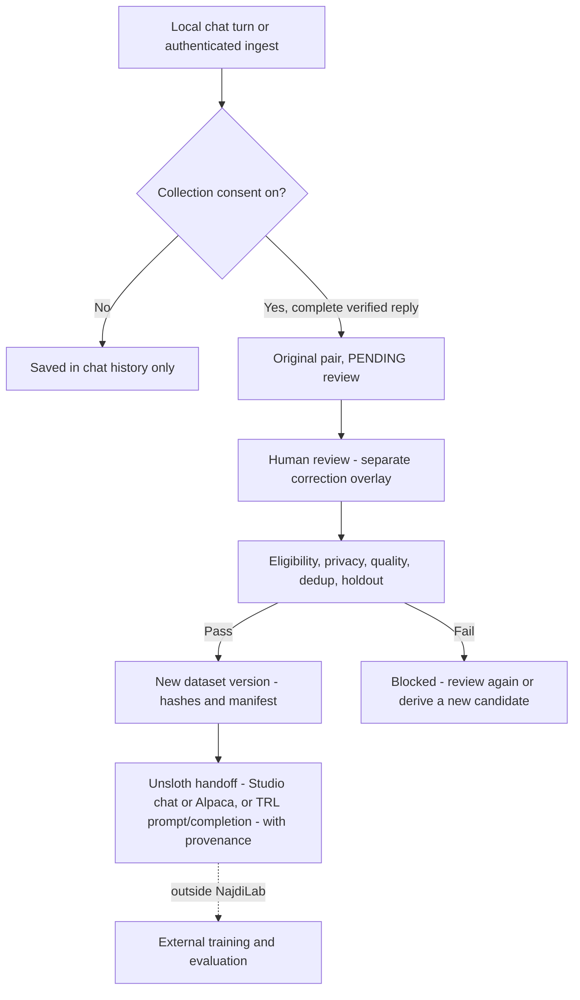

<p align="center">
  
</p>

# NajdiLab

**Local model conversations → human review and correction → validated, versioned datasets → external Unsloth training.**

<p align="center">
  <a href="docs/system-requirements.md"></a>
  <a href="docs/system-requirements.md"></a>
  <a href="docs/architecture.md"></a>
</p>
<p align="center">
  <a href="docs/user-guide.md"></a>
  <a href="docs/user-guide.md"></a>
  <a href="docs/architecture.md"></a>
  <a href="docs/localization.md"></a>
</p>
<p align="center">
  <a href="docs/chat-workspace.md"></a>
  <a href="docs/native-runtime.md"></a>
  <a href="docs/development/CHAT_EXPERIENCE_V2.md"></a>
</p>
<p align="center">
  <a href="docs/hermes-integration.md"></a>
  <a href="PROJECT_STATUS.md"></a>
  <a href="docs/proposals/licensing-approval.md"></a>
</p>

<p align="center"><sub>Apache-2.0 is approved as a <strong>future Public Core target only</strong>; this private repository has no active redistribution license.</sub></p>

NajdiLab is a local-first platform for collecting, reviewing, refining and managing high-quality datasets for artificial intelligence, with a particular focus on Arabic and Saudi/Najdi language data.

Its central idea is to turn raw conversations, human corrections and evaluation evidence into traceable, reproducible datasets without losing the originals. Reviewers work with separate correction overlays; validation and versioning make it possible to understand which data entered a dataset and why.

NajdiLab brings local model chat, human review, quality checks, dataset management and a clean file handoff to external training into one environment. It is for dataset curators, Arabic-language researchers, developers and trusted local operators who need explicit control over model-development decisions.

**NajdiLab is a dataset preparation platform, not an AI model and not a trainer.** Its browser interface and Python backend run without a GPU or model weights. LM Studio and Ollama stay externally managed; the optional NajdiLab Native runtime starts only a `llama-server` the owner already has. Internal training, the WSL worker and model merge/GGUF/deployment code were removed in the dataset-only cleanup (PR #11); training happens outside NajdiLab from its exported files.

## The idea and the problem

Conversation logs alone are not training-ready datasets. They may contain private information, inconsistent corrections, duplicate examples or evaluation material that must not enter training. A dataset also needs provenance, integrity checks and a reproducible selection process.

NajdiLab connects these steps: chat with a local model or ingest a completed turn, collect only what was explicitly consented to, review it, keep the original, check eligibility and quality, then derive a new immutable dataset version and hand it to external training as files.

## Key capabilities and intended users

- **Everyday chat users:** a clean ChatGPT-style workspace for local models, with streaming replies, a separate thinking panel, Markdown, conversation history, search, pin, archive and permanent delete — in Arabic (RTL) or English (LTR).
- **Reviewers and curators:** review queues, correction overlays, explicit eligibility, privacy/exclusion controls; originals are never overwritten.
- **Dataset developers:** deterministic deduplication, quality/balance reports, holdout and leakage checks, version manifests and SHA-256 hashes, single-turn and multi-turn records.
- **Researchers:** preserved historical decisions, immutable dataset evidence and provenance for every collected pair.
- **Maintainers:** framework-free frontend, standard-library Python core, synthetic regression and browser tests, documented approval boundaries.

These are source capabilities, not a claim that every roadmap item is finished. See [feature status](#feature-status) for what is done, in development or planned.

## Visual introduction

All images are captured from a disposable instance with **synthetic data only** (`tests/readme-screenshots.cjs`); no personal conversation appears anywhere. Details: [screenshots](docs/screenshots.md), [asset provenance](docs/asset-provenance.md).

### Chat Experience V2 — synthetic demonstration


The same conversation in the Arabic right-to-left interface; model text keeps its own direction and is never translated:



### NajdiLab dashboard



### System architecture overview


The web platform is independent of external training. SQLite records and filesystem datasets are distinct. [Open full-size SVG](docs/images/architecture/najdilab-system-architecture.svg) for zoom on narrow screens.

### Explore the documentation

[Architecture diagrams](docs/architecture-diagrams.md) · [Screenshots](docs/screenshots.md) · [User guide](docs/user-guide.md) · [Chat workspace](docs/chat-workspace.md) · [NajdiLab Native](docs/native-runtime.md) · [Developer setup](docs/developer-setup.md) · [Source provenance](docs/source-provenance.md) · [Third-party attribution](docs/THIRD_PARTY_ATTRIBUTION.md) · [Asset provenance](docs/asset-provenance.md)

## Contents

- [Visual introduction](#visual-introduction)
- [Current status](#current-status)
- [Feature status](#feature-status)
- [Interface preview](#interface-preview)
- [Technology stack and versions](#technology-stack-and-versions)
- [System requirements](#system-requirements)
- [Downloads and prerequisites](#downloads-and-prerequisites)
- [Installation and quick start](#installation-and-quick-start)
- [System architecture](#system-architecture)
- [Dataset and model workflow](#dataset-and-model-workflow)
- [Chat Experience V2](#chat-experience-v2)
- [NajdiLab Native](#najdilab-native)
- [Data retention and permanent deletion](#data-retention-and-permanent-deletion)
- [Database and integrity](#database-and-integrity)
- [Optional training infrastructure](#optional-training-infrastructure)
- [Project structure](#project-structure)
- [Configuration](#configuration)
- [Security and limitations](#security-and-limitations)
- [Testing and quality](#testing-and-quality)
- [Development progress and roadmap](#development-progress-and-roadmap)
- [Developer guide and documentation](#developer-guide-and-documentation)
- [Licensing and attribution](#licensing-and-attribution)
- [Maintainer handover](#maintainer-handover)

## Current status

**NOT READY FOR RELEASE.** The repository is private and requires authorized access. The current development candidate is **V2.2.0** (`update-project`, Draft PR #23); it is not a release or production approval ([release notes](docs/development/RELEASE_NOTES_V2.2.0.md); [V2.1.0](docs/development/RELEASE_NOTES_V2.1.0.md); [V2.0.0](docs/development/RELEASE_NOTES_V2.0.0.md)). No active source license has been approved. Do not redistribute source or research artifacts.

`main` holds the dataset-only platform (PR #11 cleanup and Phase A). Phase B (UX, bilingual operations — Draft PR #19) and Phase C (AI engine acceptance — Draft PR #20) are combined on `integration/pr19-pr20-local-20261102`. **Chat Experience V2 and NajdiLab Native are developed on `feature/chat-experience-v2`, stacked on that integration branch, in a separate Draft PR.** Nothing here is merged to `main` or accepted by the owner yet. [PROJECT_STATUS.md](PROJECT_STATUS.md) is the authoritative status reference; the [release decision](docs/public-release-decision.md) records publication gates.

## Feature status

| Area | ✅ Available on `main` | 🛠️ In development (draft branches, not merged) | 📋 Planned / not started |
|---|---|---|---|
| Review and datasets | Review queue, correction overlays, eligibility, privacy/exclusion, dedup, balance, holdout/leakage, immutable versions, Unsloth handoff | Phase B/C acceptance items (Draft PRs #19/#20); **V2.2.0:** Unsloth Studio SFT export (chat or Alpaca) that trains only the approved answer, a token-level check with the trainer's own code, diagnostics stored when a version is created, separate structure / training / evaluation readiness, source-diversity statistics, language · dialect · style · domain metadata, one **Prepare training data** page from records to a frozen version and export, customization-model manager ([training correctness](docs/development/TRAINING_CORRECTNESS.md), [language metadata](docs/development/LANGUAGE_METADATA.md)) | Reviewer identity and multi-user roles |
| Chat | Raw chat with exact context admission (LM Studio, Ollama) | **V2:** sidebar history, titles, search, pin, archive/restore, streaming, Stop, thinking panel, safe Markdown, Enter to send, phase timings, context usage indicator with 70/85/95 % notices; **V2.1.0:** model and context chosen in the message box, New chat without a dialog, one approved runtime-preparation path, read-only Chat information ([composer](docs/development/CHAT_COMPOSER.md)); **V2.2.0:** NajdiLab Native first (LM Studio and Ollama conversations stay readable; an opt-in offers them again), memory checked before a running model is stopped | Editing or regenerating earlier turns |
| Local runtimes | LM Studio (pinned SDK 1.5.0), Ollama 0.40.13 | **NajdiLab Native** (llama.cpp `llama-server`, GGUF discovery, streaming); **Managed llama.cpp runtime** (pinned official build b12059, SHA-256-verified install on approval, GPU probe, rollback; CUDA 13.4 build verified on an RTX 5070; real-model chat accepted with Qwen2.5-0.5B and Gemma 4 E4B on that GPU); **Hugging Face Direct** (GGUF discovery, *Recommended for your device* ranked by the Smart Model Advisor, *Trending* in Hugging Face's own order with provenance labels and a 12B total-parameter limit, storage-safe verified downloads, model library) | Split (multi-file) GGUF, gated repositories, real models above about 8B (Qwen2.5-0.5B and Gemma 4 E4B accepted) |
| Data retention | Logical delete, exclusion, archive | **Permanent chat deletion** with a declared scope and content-free tombstones | Erasure across frozen exports and backups |
| Dataset collection | Consented single pairs, PENDING review only | **Segments:** single-turn and linked multi-turn records with context metadata; incomplete-context segments are review-only (PR #21 rule) | Automatic 60/40 multi/single balancing (experimental idea only) |
| Interface | English and Arabic | Arabic for every new chat message | Second-speaker review of Arabic wording |
| Hermes | — | — | **Blocked** until sender filtering and disconnect are verified |

## Interface preview

The interface carries the **Najdi Lab | نجدي لاب** identity: an original mark (the letter ن with a triangular Najdi wall opening as its dot), IBM Plex Sans and IBM Plex Sans Arabic bundled locally, a framed-sheet layout, and equal Arabic (RTL) and English (LTR) light and dark themes. See the [design system](docs/design-system.md) and the [redesign record](docs/development/NAJDI_LAB_REDESIGN.md). The **Model library** (Hugging Face Direct) finds single-file GGUF models, checks them against this computer, downloads them only with approval and verified SHA-256, and hands them to NajdiLab Native: [Hugging Face Direct](docs/development/HUGGING_FACE_DIRECT.md). Its default tab, *Recommended for your device*, ranks models by how they fit this computer, and *Trending* shows Hugging Face's own ranking with verified-publisher, community, modified and unverified labels: [Trending and recommended](docs/development/MODEL_DISCOVERY.md). Real GPU acceptance (managed CUDA runtime + official Qwen2.5-0.5B and Gemma 4 E4B on an RTX 5070, streaming, Stop, exact context admission, consent): [record](docs/development/REAL_MODEL_ACCEPTANCE.md). NajdiLab can also install its own verified llama.cpp build for NajdiLab Native, only with approval: [Managed llama.cpp runtime](docs/development/MANAGED_RUNTIME.md).


This earlier preview comes from a disposable synthetic-only instance, not the private corpus. English controls use LTR and Arabic content keeps its own direction. On phones (390px) the conversation list becomes an overlay and the composer keeps a large Send button:

<p align="center"></p>

## Technology stack and versions

“Supported” below describes enforced requirements or a tested scope, not universal certification.

| Technology | Role | Minimum / supported version | Tested version | Required or optional | Official link |
|---|---|---|---|---|---|
| Python | Core backend and scripts | **3.11+ enforced** | 3.13.18 (Linux, this branch); CI matrix uses 3.12 | Required | [Python](https://www.python.org/downloads/) |
| SQLite | Local database and registry | **3.24+ enforced**; WAL and foreign keys | Bundled with the tested Python | Required via Python | [SQLite](https://www.sqlite.org/) |
| Python http.server | Loopback HTTP API, static files and NDJSON streaming | Standard library | Same as Python | Required | [HTTP server docs](https://docs.python.org/3/library/http.server.html) |
| HTML5 / CSS / JavaScript | Browser interface; no build step | Modern browser | Chromium 1243 build (Playwright bundle) in this branch's browser tests | Required | [Web platform docs](https://developer.mozilla.org/en-US/docs/Web) |
| Git | Clone/update/development | No measured minimum | — | Required for Git workflow | [Git](https://git-scm.com/downloads/) |
| Windows / PowerShell | Setup and launch | Windows 11 previously tested | Not re-tested for this branch | Optional host | [PowerShell](https://learn.microsoft.com/powershell/) |
| Linux / Ubuntu | Setup and launch | Python/SQLite requirements above | Linux container (this branch) | Optional host | [Ubuntu](https://ubuntu.com/download) |
| LM Studio SDK | Optional chat runtime client | `lmstudio==1.5.0` pinned | Synthetic engine transport only | Optional | [LM Studio](https://lmstudio.ai/) |
| Ollama | Optional chat runtime | **0.40.13 only** (unverified versions fail closed) | Fake server and an earlier real-binary synthetic test | Optional | [Ollama](https://docs.ollama.com/) |
| llama.cpp `llama-server` | NajdiLab Native runtime (owner-supplied) | Builds with `/apply-template`, `/tokenize`, `--reasoning-format`, `--no-context-shift` | Tag `b12059`, commit `1b6935b`, CPU build, synthetic GGUF | Optional | [llama.cpp](https://github.com/ggml-org/llama.cpp) |
| NVIDIA GPU / CUDA | Optional acceleration for external runtimes | Runtime- and model-specific | **Not tested in this branch** (no GPU available) | Optional | [CUDA](https://docs.nvidia.com/cuda/) |
| Unsloth / TRL | External training consumer of the handoff files | Operated separately | Not run by NajdiLab | Optional, external | [Unsloth](https://docs.unsloth.ai/) |
| pytest | Test runner | `requirements-dev.txt` pins **9.1.1** | 9.1.1 | Development only | [pytest](https://docs.pytest.org/) |
| Node.js + puppeteer-core | UI unit and browser tests | Node 22 in CI; `puppeteer-core@25.16.0` | Node 22.23.4 | Development only | [Node.js](https://nodejs.org/) |

The core needs no pip packages, GPU or frontend toolchain. **Version names are independent:** NajdiLab has no release number; v008/v009 name datasets; phases name development tracks; package versions name tools.

## System requirements

| Core web platform | Evidence |
|---|---|
| CPU, RAM and disk | No measured universal minimum. Keep writable space for the database, exports and a separate verified backup. |
| Python and SQLite | Python 3.11+, sqlite3 with SQLite 3.24+, venv support |
| OS and browser | Windows and Linux; a modern browser. Other platforms not verified. |
| Network | Loopback only; default `127.0.0.1:8770`. NajdiLab Native also listens on 127.0.0.1 only. |
| Permissions | Ordinary user; no administrator rights for setup or run |
| Local models (optional) | Memory depends on the model and context. Device and model details in Chat show measured, reported and **estimated** values separately; estimates are never guarantees. |

See [full requirements](docs/system-requirements.md).

## Downloads and prerequisites

1. Install [Python](https://www.python.org/downloads/) with sqlite3/venv and [Git](https://git-scm.com/downloads/) from official sources.
2. Obtain authorized access to [NajdiLab source](https://github.com/abinadwan/NajdiLab). Cloning downloads source only; it does not restore private data.
3. Optional runtimes are installed separately by the owner: LM Studio, Ollama, or a llama.cpp `llama-server` for NajdiLab Native. **NajdiLab never downloads programs or model weights.**
4. Check each model's own license before use; it is separate from any runtime's license.

## Installation and quick start

Use a fresh disposable checkout first. Review [installation](docs/installation.md) for update, reinstall and recovery.

### Windows PowerShell

```powershell
git clone https://github.com/abinadwan/NajdiLab.git
cd NajdiLab
python --version
Get-Content .\scripts\install.ps1
.\scripts\install.ps1
.\run.ps1
```

If local script policy blocks a reviewed script, use `python .\scripts\install.py` then `.\.venv\Scripts\python.exe .\scripts\launch.py`; do not weaken machine-wide policy.

### Linux / Ubuntu / WSL2

```bash
git clone https://github.com/abinadwan/NajdiLab.git
cd NajdiLab
python3 --version
cat scripts/install.sh
sh ./scripts/install.sh
sh ./run.sh
```

Open **http://127.0.0.1:8770**. Ctrl+C stops the instance. For Chat with LM Studio, install the optional `requirements-chat.txt` into NajdiLab's own environment. For an isolated test instance use a separate checkout and port, for example `NAJDILAB_PORT=8870 sh ./run.sh`; a different port alone does not isolate data.

**First launch applies the registered migrations** (including `008_chat_experience_v2.sql` on this branch). Before updating an existing installation, take and verify a backup, test the migration on a copy, and keep the rollback steps in [Chat Experience V2 — rollback](docs/development/CHAT_EXPERIENCE_V2.md#rollback) at hand. Never reset away work. [Backup and restore](docs/backup-and-restore.md) · [troubleshooting](docs/troubleshooting.md).

## System architecture



`app/server.py` routes after Host/Origin/CSRF and request validation. `app/chat_workspace.py` owns turns, consent and deletion; `app/chat_engine.py` and `app/native_runtime.py` talk to runtimes; `app/service.py` owns review and export transactions. Details: [architecture](docs/architecture.md), [API reference](docs/api-reference.md), [route inventory](docs/api-routes.md).

## Dataset and model workflow



Thinking text, partial, stopped and failed replies are never collected. Collection never applies to earlier turns. Nothing is training-approved automatically. A collected segment that did not start at the chat's first turn stays review-only: it can never be selected for training or evaluation. See [review and quality](docs/review-and-quality.md), [dataset export](docs/dataset-export.md) and [collection segments](docs/chat-workspace.md#collection-segments-single-turn-and-multi-turn).

## Chat Experience V2

Developed on this branch (not merged). Full design, decisions and test log: [CHAT_EXPERIENCE_V2.md](docs/development/CHAT_EXPERIENCE_V2.md).

- **History sidebar:** collapsible (remembered per browser), grouped by Today / Yesterday / 7 / 30 days / Older, pinned first, search over titles and text, archived view, per-chat menu.
- **Titles:** suggested locally from the first message — nothing is sent anywhere — and renameable.
- **Streaming:** the reply appears as it is generated with a clear status (checking runtime → verifying context → waiting for first token → thinking → answering → final check). **Stop** is always available; partial replies are visibly marked and never saved.
- **Thinking:** shown in its own panel when the model sends it separately, collapsed when the answer starts; never saved, logged or collected.
- **Markdown:** headings, lists, emphasis, links, tables and code blocks with copy buttons, rendered safely (no HTML from model output; only http/https/mailto links). The stored text is unchanged.
- **Keyboard:** Enter sends, Shift+Enter adds a line, no sending during IME composition, no empty or duplicate sends.
- **Context presets:** Light 4096/1024, Balanced 8192/2048, Long 16384/3072, or custom values — starting points, not guarantees.
- **Clear errors:** each refusal keeps its technical code (for example `INCOMPLETE_RESPONSE · STOP_REASON_LENGTH`) next to a plain explanation in Arabic or English.

## NajdiLab Native

Run a local GGUF model from inside NajdiLab without Ollama or LM Studio, using the owner's own llama.cpp `llama-server`. NajdiLab discovers `.gguf` files in a configured folder, validates their headers, hashes the selected file, starts **one** child process on `127.0.0.1` with a per-start API key and `--offline`, and stops only that process. Admission is exact (the server's own template and tokenizer), streaming and separate thinking are supported. **Tested only on CPU with a synthetic random-weight model; no RTX 5070 or real-model acceptance is claimed.** [How to set it up and its limits](docs/native-runtime.md).

## Data retention and permanent deletion

| Action | What happens |
|---|---|
| Archive | Hidden from the list, collected pairs excluded from future selection; restorable. |
| Permanent delete (this branch) | Removes the chat, its turns and receipts, and its collected review copies from the database, with a typed `DELETE` confirmation. Reviewed copies with immutable audit events are blanked (only content-free events remain). Refused while a reply runs or if the chat is already in NajdiLab exports. Backups and copies on other devices are **not** changed and the dialog says so. |

Full policy and QA-08 impact: [data retention](docs/data-retention.md).

## Database and integrity

SQLite connections enable WAL, foreign keys and a busy timeout. Composite writes use transactions; migrations are registered by hash and applied atomically with their ledger row. Migration 008 rebuilds `chat_sessions` losslessly (counted and compared before the old table is dropped). Original messages are preserved; corrections are overlays. Dataset versions carry manifests and hashes. [Schema](docs/database-schema.md), [migration guide](docs/database-and-migrations.md), [backup guide](docs/backup-and-restore.md).

## Optional training infrastructure

Training is **outside** NajdiLab. The internal trainer, WSL worker and model acquisition/merge/GGUF/deployment code were removed in PR #11; existing private evidence and applied migrations were preserved. NajdiLab produces an Unsloth handoff (JSONL, provenance, manifest) for the tool you train with: **Unsloth Studio** (chat or Alpaca layout, each record's only training target is its approved answer; keep "Train on completions" on and packing off) or **Unsloth/TRL in Python** (prompt/completion with `completion_only_loss=True`). `scripts/verify_unsloth_studio.py` checks with your Unsloth Studio install which tokens it will train. Inference and training use different files: a **GGUF** model runs in NajdiLab Native (llama.cpp); training needs the matching **Safetensors** checkpoint (config, tokenizer and weights), which Model library → Customization models can check and download with your approval (NajdiLab does not fine-tune). Reject over-length records rather than truncating them. Model weights, data rights and evaluation are the external operator's responsibility. [Dataset export contract](docs/dataset-export.md).

## Project structure

```text
NajdiLab/
  app/          HTTP API, chat workspace, runtimes (incl. NajdiLab Native), review, datasets
  static/       HTML/CSS/JS interface, Arabic catalog, safe Markdown renderer
  config/       Tracked tool-capability configuration
  migrations/   Registered startup SQL migrations (hash-pinned)
  plans/        Proposed SQL and designs; not startup migrations
  scripts/      Setup/launch, backup, audit utilities
  tests/        Synthetic unit, integration, security, Node and Chromium tests
  docs/         Guides, development logs, decisions and evidence
  public_source/ Separate reduced Public Core candidate (independently reviewed)
  run.ps1 / run.cmd / run.sh   Launchers
```

`app/server.py` is the HTTP entry point; `app/db.py` owns connections and migrations; `app/chat_workspace.py`, `app/chat_engine.py`, `app/native_runtime.py`, `app/chat_deletion.py` hold the chat stack. [Code map](docs/codebase-navigation.md).

Ignored `data/`, `datasets/`, `exports/`, `reports/` and `backups/` hold private runtime data. See [separation policy](docs/dataset-model-distribution-policy.md).

## Configuration

| Variable | Meaning |
|---|---|
| `NAJDILAB_PORT` | Loopback port; default 8770 |
| `NAJDILAB_PYTHON` | Explicit interpreter for the launchers |
| `NAJDILAB_NO_DEMO` | Launchers default to no demo data |
| `NAJDILAB_INGEST_TOKEN` | Private Ingest bearer/HMAC secret; never committed |
| `NAJDILAB_NATIVE_SERVER` | Path to an existing llama.cpp `llama-server` for NajdiLab Native (default `data/native/bin/llama-server`) |
| `NAJDILAB_NATIVE_MODELS` | Folder of local GGUF files (default `data/models`) |

Set variables in the launching shell; `.env` is a reference and is not loaded automatically. [Full configuration](docs/configuration.md).

## Security and limitations

Host/port and Origin/Fetch-Metadata checks resist cross-origin and DNS-rebinding access; CSRF protects browser writes; native Ingest needs bearer or HMAC authentication. Runtime calls use numeric loopback sockets with size and time limits, no proxy or redirects. Model output is rendered without HTML. NajdiLab Native binds to 127.0.0.1 with an API key and never fetches files.

This is a **trusted local single-operator service**, not a hardened public-network application. There is no multi-user RBAC; local programs on the same account can read local files. Never expose the port through tunnels or shared hosting. [Security policy](SECURITY.md).

## Testing and quality

```bash
python -m pip install -r requirements-dev.txt -r requirements-chat.txt
python -m pytest -q tests -rs
node --test tests/*.test.cjs
python -m pytest -q public_source/tests/test_builder.py
python scripts/check_docs.py
```

Browser suites (`tests/chat-browser.cjs`, `chat-enhancements-browser.cjs`, `i18n-browser.cjs`, `a11y-browser.cjs`, `review-restrictions-browser.cjs`) need Chromium and `puppeteer-core`; `tests/ux-audit.cjs` (optional, needs `axe-core`) audits every view for WCAG 2 A/AA and overflow; the NajdiLab Native lifecycle tests run only when `NAJDILAB_NATIVE_TEST_SERVER` points at a `llama-server`. All tests use synthetic data and disposable servers; missing private artifacts are explicit skips, and **skips are not passes**. Exact counts, the tested commit and what was not tested: [test log](docs/development/CHAT_EXPERIENCE_V2.md#test-results). Hosted GitHub Actions results are not claimed for this branch.

## Development progress and roadmap

| Track | Current evidence | Next gate |
|---|---|---|
| Platform (Phase A) | Data integrity and security on `main` | — |
| UX and bilingual operations (Phase B) | Draft PR #19, local acceptance | Hosted Windows/Ubuntu run and owner review |
| AI engine acceptance (Phase C) | Draft PR #20, synthetic acceptance | Owner Windows acceptance with installed models |
| Chat Experience V2 + NajdiLab Native | This branch: implemented and tested on synthetic data (Linux) | Windows run, owner acceptance, real-model and GPU tests, safe local update |
| Public Core | Separate reduced candidate | Rights, history and license decisions |

Roadmap items are not delivered capabilities. [Phased roadmap](docs/roadmap.md) · [remediation roadmap](docs/remediation/REMEDIATION_ROADMAP.md).

## Developer guide and documentation

Start with [developer setup](docs/developer-setup.md), [code navigation](docs/codebase-navigation.md) and [architecture](docs/architecture.md). When extending an endpoint follow its layer: route/validation, service operation, synthetic regression, API inventory and documentation. [CONTRIBUTING.md](CONTRIBUTING.md) defines review and the Definition of Done.

| Need | Guide |
|---|---|
| Install, configure, troubleshoot | [Installation](docs/installation.md), [configuration](docs/configuration.md), [shell commands](docs/shell-commands.md) |
| Chat and runtimes | [UX/UI review](docs/UX_UI_DESIGN_REVIEW.md), [security review](docs/development/CHAT_V2_SECURITY_REVIEW.md), [deletion audit](docs/development/PERMANENT_DELETION_AUDIT.md), [Windows acceptance](docs/development/WINDOWS_ACCEPTANCE.md), [Chat workspace](docs/chat-workspace.md), [NajdiLab Native](docs/native-runtime.md), [Chat V2 development log](docs/development/CHAT_EXPERIENCE_V2.md), [PR #21/#22 reconciliation](docs/development/PR21_PR22_RECONCILIATION.md), [PR #21 workflow record](docs/chat-review-workflow-results.md), [collection context audit](docs/chat-dataset-context-audit.md) |
| Extend API/data behavior | [API reference](docs/api-reference.md), [database/migrations](docs/database-and-migrations.md) |
| Retention and privacy | [Data retention](docs/data-retention.md), [privacy history review](docs/privacy-history-review.md) |
| Readiness and rights | [Release decision](docs/public-release-decision.md), [dependency matrix](docs/dependency-licensing-matrix.md), [data/model policy](docs/dataset-model-distribution-policy.md) |
| Find every guide | [Documentation index](docs/documentation-index.md) |

## Licensing and attribution

**Actual status: no active source license.** The owner approved Apache-2.0 (2026-10-28) as the **target license for a future, separate clean Public Core repository only**; this does not activate a LICENSE, NOTICE or redistribution permission. Alternatives are recorded in [license options](docs/license-options.md); the [licensing proposals](docs/proposals/licensing-approval.md) are inactive.

Third-party projects used or studied, with their exact revisions, licenses and obligations: [THIRD_PARTY_ATTRIBUTION.md](docs/THIRD_PARTY_ATTRIBUTION.md) (Chat V2 and Native) and the older [attribution register](docs/third-party-attributions.md). No third-party code or assets were copied for Chat V2; llama.cpp (MIT) is an owner-installed external program. Model weights carry their own licenses. Data, weights, adapters and templates have separate rights.

Original project: **NajdiLab** — https://github.com/abinadwan/NajdiLab

## Maintainer handover

Read [PROJECT_STATUS.md](PROJECT_STATUS.md), the [maintainer handover](docs/maintainer-handover.md), [CHANGELOG](CHANGELOG.md) and [release decision](docs/public-release-decision.md). Record revision and status, reproduce the available tests, identify the next authorized gate and preserve original evidence. Roll back source with an ordinary revert; state recovery needs a verified private backup restored into a separate location. No automatic merge, publication, license activation, migration of the owner's installation, training or deployment follows from this repository.
