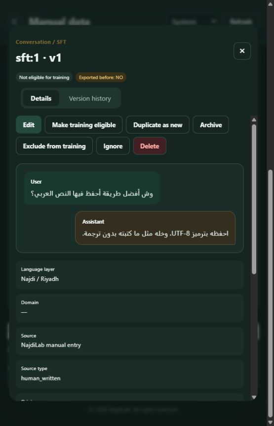

# NajdiLab

Public release remains blocked. See the [release decision](docs/public-release-decision.md) for privacy/history, protected data, dependency rights and inactive license proposals. No source license has been activated.

NajdiLab is a local workbench for reviewing conversation data, creating reproducible Gold datasets, checking training/evaluation separation and controlling explicit fine-tuning workflows. It began with Arabic and Saudi/Najdi data; the application interface and operator documentation are in English. Arabic corpus text, linguistic examples and model protocol tokens retain their original meaning.

Original messages stay immutable. Human review creates a separate decision/correction overlay. Eligibility, privacy, quality, holdout and loss-mask gates determine what may enter a new dataset version. Historical datasets and rejected model evidence are preserved.

**Publication status: NOT READY.** No source-code license has been approved or added. Repository history, data rights and third-party/model terms still require owner decisions before public release. See [open-source readiness](docs/open-source-readiness.md) and [license options](docs/license-options.md). Availability of this preparation branch is not permission to redistribute it.


## Development status

[PROJECT_STATUS.md](PROJECT_STATUS.md) is the authoritative multi-track handover. Historical model training produced a rejected adapter; Round 2 reached a 66-record zero-step Dry Run, **not retraining**. v008/v009 have distinct quality histories. Corpus v1.1 Phase 1 design is approved; Phase 1A, migrations and adapter reconciliation retain separate gates. No public release, production deployment or final license is authorized.

## Verified interface preview



This preview was captured from a disposable synthetic-only instance. English controls use LTR; Arabic data uses its own direction. Light/dark contrast and exact Arabic save/readback were verified; this is not a screenshot of private corpus content.

## Quick start

Use a fresh source checkout and Python 3.11+. The local web application uses the Python standard library; GPU and ML packages are optional runtime dependencies.

```bash
git clone https://github.com/abinadwan/NajdiLab.git
cd NajdiLab
git switch dev/english-open-source-readiness
python --version
```

Private repository access is required. This preparation is unmerged; the branch-selection command above is intentional. On Windows, review and run:

```powershell
.\scripts\install.ps1
.\run.ps1
```

On Linux or WSL:

```bash
sh ./scripts/install.sh
sh ./run.sh
```

Open [http://127.0.0.1:8770](http://127.0.0.1:8770). Launch initializes local storage and applies SQL already in `migrations/`; use a fresh checkout for evaluation, and back up an existing instance before an upgrade. Do not move proposed SQL from `plans/` into `migrations/` as a setup step. The app does not automatically read `.env` files. Collection fails closed until a private `NAJDILAB_INGEST_TOKEN` and matching client credential are configured; see [integration setup](docs/hermes-integration.md). Launchers disable demo seeding by default. Explicit `NAJDILAB_NO_DEMO=0` enables samples only in a disposable instance; direct module launch retains its historical default.

See [installation](docs/installation.md), [configuration](docs/configuration.md), [security](SECURITY.md) and [troubleshooting](docs/troubleshooting.md).

## Workflow

`Collect → Review → Quality → Balance → Dataset version → Model selection → Preflight → Explicit training → Evaluation → Human decision → Separately approved release`

- Review and training cannot replace original conversation text or frozen datasets.
- Evaluation-only, sensitive, excluded, archived, ignored and deleted records are gated out of training.
- Exact duplicates use deterministic priority; near duplicates are reported for review.
- Training supervises intended assistant targets; context and authoritative tool results are masked.
- READY, a dry run and historical approval do not authorize optimizer work. Smoke and Full Training are separate explicit actions.
- The historical Phase 3 adapter was rejected. Model-release Phase 4 remains blocked. Corpus v1.1 Phase 1 is approved design only; its implementation needs separate authorization.

A source-only checkout does not include the operational database, datasets, weights, adapters, reports, job registry or private runtime. Missing evidence must remain unknown/blocked rather than implying success. Dated engineering states, measurements and decisions are preserved in the [historical record](docs/historical-project-status.md), [execution board](docs/master-execution-board.md) and [Corpus v1.1 design package](docs/corpus-v1.1/README.md).

## Project layout

| Path | Purpose |
|---|---|
| `app/` | Local HTTP server, SQLite service, dataset/review/training controls |
| `static/` | HTML, CSS and JavaScript; no frontend build step |
| `migrations/` | Applied-in-order startup schema migrations |
| `plans/` | Proposed SQL; not automatically applied |
| `scripts/` | Backups, audits, validation and controlled ML utilities |
| `tests/` | Unit/integration and interface-contract checks |
| `docs/` | Guides, dated audits, design decisions and runbooks |
| `data/`, `datasets/`, `exports/`, `training/`, `reports/`, `checkpoints/`, `backups/` | Local generated/private state; excluded from source distribution |

The web app and SQLite database should live in the same operating-system filesystem. Exchange verified immutable exports between Windows and WSL; do not concurrently write one database from both.

## Documentation

- [Architecture](docs/architecture.md), [database schema](docs/database-schema.md), [training export](docs/training-export.md)
- [Hermes integration](docs/hermes-integration.md), [tool runtime contract](docs/tool-runtime-contract.md)
- [Model selection](docs/model-selection-guide.md), [training preflight](docs/training-preflight-runbook.md)
- [Backup and restore](docs/backup-and-restore.md), [contributing](CONTRIBUTING.md)
- [Dependencies and attribution](docs/dependencies-and-attribution.md), [readiness checklist](docs/open-source-readiness.md)

## Verification

Run in a disposable clone: some historical tests and utilities expect private dataset/runtime fixtures, and a fresh source checkout cannot reproduce all historical integration results.

```bash
python -m pytest -q tests -rs
```

Install the optional runner using [developer setup](docs/developer-setup.md). Specific historical checks report an explicit SKIP when required private artifacts are absent; corrupt present fixtures still fail. Read all skips separately from code regressions. Never manufacture private Gold/holdout data to make a test pass, and do not run dataset-specific training/export scripts as onboarding steps. See the [current verification report](docs/verification-and-readiness-report.md); historical counts are not a claim about this checkout.

## Requirements, usage and limitations

Core: Python 3.11+ with SQLite and writable local storage, modern browser, loopback port 8770. No GPU/CUDA, Hermes/Ollama or model is needed for review UI. Windows 11 and isolated Ubuntu/WSL checks are scoped in [installation verification](docs/installation-verification.md); native Linux breadth and other platforms are unverified. No universal RAM/disk/VRAM minimum is measured. [Full requirements](docs/system-requirements.md) separate optional AI training from core use.

Use Review for overlays, Dataset Platform for health/derive/freeze checks, Training Setup for explicit model/runtime evidence and Evaluation for locked human comparison. [Dataset/training guide](docs/dataset-and-training.md) distinguishes planned features, Dry Run, Smoke and Full authorization. This is a trusted single-local-operator service: no multi-user RBAC or public network hosting. Existing migrations auto-apply on launch; future guarded migrations remain blocked.

## Developer documentation and roadmap

- [Beginner shell reference](docs/shell-commands.md), [developer setup](docs/developer-setup.md), [component map](docs/codebase-navigation.md)
- [Implemented API reference](docs/api-reference.md), [database/migration guide](docs/database-and-migrations.md)
- [Maintainer handover](docs/maintainer-handover.md), [current status/next approval gates](PROJECT_STATUS.md)
- [Contribution standards](CONTRIBUTING.md), [conduct](CODE_OF_CONDUCT.md), [unreleased changes](CHANGELOG.md)

Roadmap: owner review and rights/privacy/license disposition; separately approved migration/auth deployment; then scoped Corpus baseline/loader/lifecycle work following its dependency gates. No automatic downloads/training/deployment. The [GitHub presentation proposal](docs/github-presentation.md) is a recommendation, not changed repository metadata.

## License and original project

Original project: **NajdiLab** — https://github.com/abinadwan/NajdiLab . Source license and copyright-holder identity are pending owner approval. Apache-2.0 is recommended; MIT and BSD-3-Clause are compared in [license options](docs/license-options.md). No LICENSE is granted by this preparation branch. The proposed NOTICE remains inactive. Once compatible terms are approved, redistributions must preserve their required legal notices; a visible original-project link is recommended credit, not a universal homepage obligation or endorsement of derivatives. Model/data/dependency rights remain separate.
