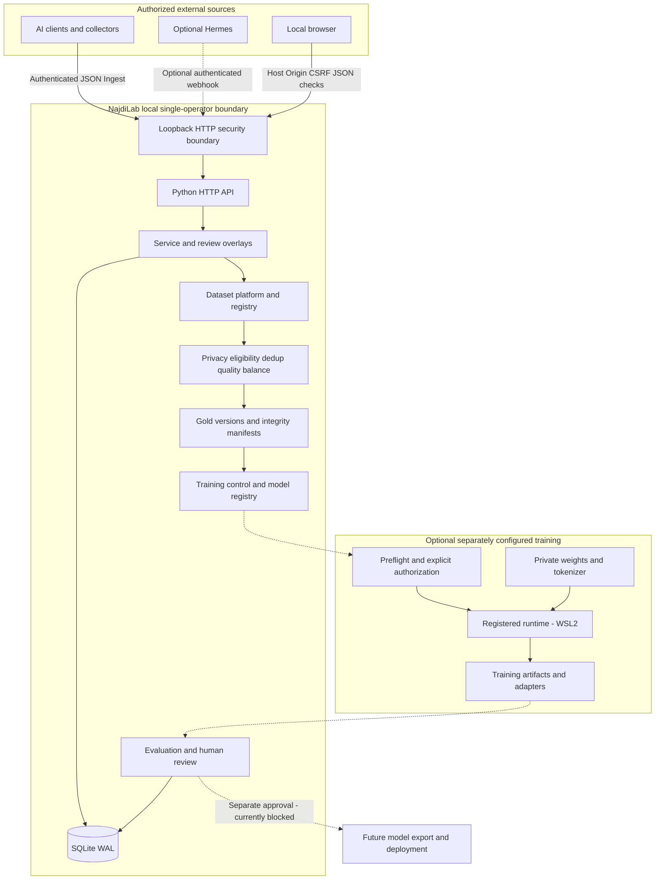
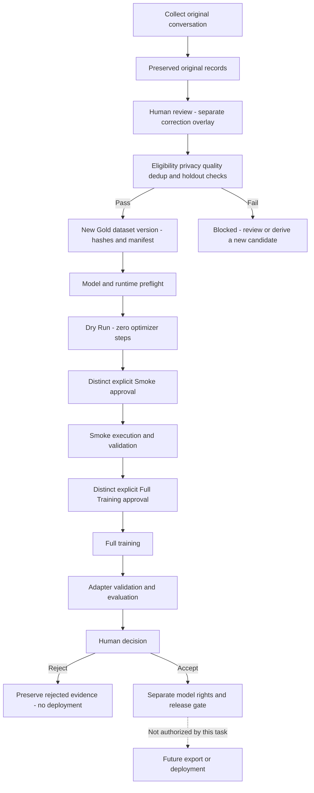

# NajdiLab

NajdiLab is a local-first platform for collecting, reviewing, refining and managing high-quality datasets for artificial intelligence, with a particular focus on Arabic and Saudi/Najdi language data.

Its central idea is to turn raw conversations, human corrections and evaluation evidence into traceable, reproducible datasets without losing the originals. Reviewers work with separate correction overlays; validation and versioning make it possible to understand which data entered a dataset and why.

NajdiLab brings collection, human review, quality checks, dataset management, training preparation and controlled evaluation workflows into one environment. It is for dataset curators, Arabic-language researchers, developers and trusted local operators who need explicit control over model-development decisions.

**NajdiLab is a platform, not an AI model.** Its browser interface and Python backend run independently of Hermes, Ollama, GPUs and model weights. Actual model training uses separately configured external runtimes and requires its own evidence and approval.

## The idea and the problem

Conversation logs alone are not training-ready datasets. They may contain private information, inconsistent corrections, duplicate examples or evaluation material that must not enter training. A dataset also needs provenance, integrity checks and a reproducible selection process.

NajdiLab connects these steps: collect a completed turn, review it, retain the original, assess eligibility and quality, then derive a new dataset version. Training preparation binds that version to model/runtime evidence; evaluation and human decisions remain separate gates.

## Key capabilities and intended users

- **Reviewers and curators:** English interface, Arabic RTL content, review queues, correction overlays and eligibility controls.
- **Dataset developers:** privacy/exclusion checks, deterministic deduplication, quality/balance reports, holdout separation, version manifests and hashes.
- **Researchers:** preserved historical decisions, immutable dataset evidence and controlled training/evaluation lineage.
- **Maintainers:** framework-free frontend, standard-library Python core, synthetic regression tests and documented approval boundaries.

These are source capabilities, not a claim that every historical research artifact is included or every roadmap item is implemented. The conceptual flow is collection → review → validation → dataset version → controlled training preparation → evaluation → human decision.

## Visual introduction

**Profile scope:** the screenshots, architecture and full-interface guides below describe the preserved original application. The isolated source-only candidate has a smaller UI/API. See the [feature comparison](docs/public-core-feature-parity.md) and [proposed public core scope](docs/public-core-release-scope.md); neither is publication approval.

### NajdiLab interface — real synthetic demonstration


Captured in a disposable instance using synthetic data only. Explore the [screenshot gallery](docs/screenshots.md) and [practical user guide](docs/user-guide.md). The previous interface preview below is preserved.

### System architecture overview


The web platform is independent of external training. SQLite records and filesystem datasets are distinct; optional runtime and blocked future workflows have different line styles. [Open full-size SVG](docs/images/architecture/najdilab-system-architecture.svg) for zoom on narrow screens.

### Explore the documentation

[Architecture diagrams](docs/architecture-diagrams.md) · [Screenshots](docs/screenshots.md) · [User guide](docs/user-guide.md) · [Developer setup](docs/developer-setup.md) · [Source provenance](docs/source-provenance.md) · [Third-party attribution](docs/third-party-attributions.md) · [Asset provenance](docs/asset-provenance.md)

The [owner-supplied conceptual illustration](docs/architecture-diagrams.md#b-original-owner-supplied-conceptual-illustration) is preserved alongside the new SVG. Existing Mermaid diagrams and all technical sections remain available below.

## Contents

- [Visual introduction](#visual-introduction)

- [Current status](#current-status)
- [Interface preview](#interface-preview)
- [Technology stack and versions](#technology-stack-and-versions)
- [System requirements](#system-requirements)
- [Downloads and prerequisites](#downloads-and-prerequisites)
- [Installation and quick start](#installation-and-quick-start)
- [System architecture](#system-architecture)
- [Dataset and model workflow](#dataset-and-model-workflow)
- [Database and integrity](#database-and-integrity)
- [Optional training infrastructure](#optional-training-infrastructure)
- [Project structure](#project-structure)
- [Configuration](#configuration)
- [Security and limitations](#security-and-limitations)
- [Testing and quality](#testing-and-quality)
- [Development progress and roadmap](#development-progress-and-roadmap)
- [Developer guide and documentation](#developer-guide-and-documentation)
- [Licensing and attribution](#licensing-and-attribution)
- [Maintainer handover](#maintainer-handover)

## Current status

**NOT READY — BLOCKERS REMAIN.** The repository is Private and requires authorized access. No software release number or active source license has been approved. Do not redistribute source or research artifacts based on this preparation.

[PROJECT_STATUS.md](PROJECT_STATUS.md) is the authoritative multi-track status reference. The [release decision](docs/public-release-decision.md) records current evidence and owner decisions. PR #1 was previously merged; this combined preparation uses `dev/open-source-final-readiness` and a separate Draft PR. Historical draft/main statements in dated reports describe the earlier work.

## Interface preview


This existing preview comes from a disposable synthetic-only instance, not the private corpus. English controls use LTR and Arabic content retains independent direction. Earlier browser verification covered themes and Arabic save/readback; current verification scope and image provenance limits are in [the unified report](docs/unified-readiness-verification.md).

## Technology stack and versions

“Supported” below describes enforced requirements or a tested scope, not universal certification. Historical training observations are not an installation recipe or compatibility guarantee.

| Technology | Role | Minimum / supported version | Tested version | Required or optional | Official link |
|---|---|---|---|---|---|
| Python | Core backend and scripts | **3.11+ enforced**; other versions need checks | Current Linux 3.12.14; prior Windows 3.12.10 / Ubuntu-WSL 3.12.3 | Required | [Python](https://www.python.org/downloads/) |
| SQLite | Local database and registry | **3.24+ enforced**, UPSERT; sqlite3, WAL and foreign keys | Current 3.53.1; prior Windows 3.49.1 / WSL 3.45.1 | Required via Python | [SQLite](https://www.sqlite.org/) |
| Python http.server | Loopback HTTP API/static service | Standard library of supported Python | Python 3.12.14 suite | Required | [HTTP server docs](https://docs.python.org/3/library/http.server.html) |
| HTML5 / CSS / JavaScript | Browser interface; no build step | Modern browser; no pinned language-engine minimum | Prior real-browser verification; no engine-version guarantee | Required | [Web platform docs](https://developer.mozilla.org/en-US/docs/Web) |
| Git | Clone/update/development | No measured minimum | Current 2.52.0 | Required for Git workflow; source archive alone does not need Git | [Git](https://git-scm.com/downloads/) |
| Windows / PowerShell | Core setup and launch | Windows 11 previously tested; broader versions NOT_VERIFIED | Prior Windows 11; shell version not recorded | Optional host choice | [PowerShell](https://learn.microsoft.com/powershell/) |
| Linux / Ubuntu | Core setup and launch | Python/SQLite requirements above | Current Linux container; prior Ubuntu 24.04 WSL2 and hosted Ubuntu source CI | Optional host choice | [Ubuntu](https://ubuntu.com/download) |
| WSL2 | Optional Linux host / external training runtime | Existing approved distribution; not installed by NajdiLab | Prior Ubuntu 24.04 WSL2 core smoke | Optional | [WSL](https://learn.microsoft.com/windows/wsl/install) |
| NVIDIA GPU / CUDA | External GPU training | Model/runtime-specific; no universal supported GPU/VRAM minimum | Historical RTX 5070 / CUDA 13.2 only; NOT freshly certified | Optional | [CUDA](https://docs.nvidia.com/cuda/) |
| PyTorch | Tensor training | Not pinned for onboarding | Historical 2.12.1+cu132 | Optional | [PyTorch](https://pytorch.org/get-started/locally/) |
| Transformers | Model/tokenizer/Trainer | Not pinned for onboarding | Historical 5.5.0 | Optional | [Transformers](https://huggingface.co/docs/transformers/) |
| Unsloth | Optimized training | Exact artifact terms/compatibility NOT_VERIFIED | Historical 2026.9.12 | Optional | [Unsloth](https://docs.unsloth.ai/) |
| PEFT | Adapter training | Not pinned for onboarding | Historical 0.21.1 | Optional | [PEFT](https://huggingface.co/docs/peft/) |
| Accelerate | Runtime support | Not pinned | NOT_VERIFIED | Optional | [Accelerate](https://huggingface.co/docs/accelerate/) |
| bitsandbytes | Quantization/optimizer | Runtime-specific | Historical 0.50.2 | Optional | [bitsandbytes](https://huggingface.co/docs/bitsandbytes/) |
| Hugging Face Hub | Explicit model acquisition | Not pinned | NOT_VERIFIED | Optional | [Hub client](https://huggingface.co/docs/huggingface_hub/) |
| Model / tokenizer / template | External training inputs | Exact approved revision and terms required | No model execution in current checks | Optional | [Model selection](docs/model-selection-guide.md) |
| Hermes / Ollama | External collector / inference integration | Independent installation; no pinned core requirement | Current integration runtimes NOT_VERIFIED | Optional | [Hermes integration](docs/hermes-integration.md), [Ollama](https://docs.ollama.com/) |
| pytest | Test runner | requirements-dev.txt pins **9.1.1** | Current 9.1.1 | Development only | [pytest](https://docs.pytest.org/) |

Sources: [requirements](docs/system-requirements.md), [prior installation evidence](docs/installation-verification.md), [current verification](docs/unified-readiness-verification.md), [historical runtime observation](docs/training-preflight-runbook.md), [licensing matrix](docs/dependency-licensing-matrix.md). The core needs no pip packages, GPU or frontend toolchain.

**Version names are independent:** NajdiLab has no approved software release number; v008/v009 identify datasets; Corpus v1.1 identifies a specification; phases describe development tracks; Python/package versions identify tools; model revisions identify immutable upstream model snapshots. None is a substitute for another.

## System requirements

| Core web platform | Evidence |
|---|---|
| CPU, RAM and disk | No measured universal minimum. **RECOMMENDED:** writable local space for DB/WAL, exports and a separate verified backup/restore copy. Capacity depends on data size |
| Python and SQLite | **VERIFIED requirements:** Python 3.11+, sqlite3 with SQLite 3.24+, venv support for setup |
| OS and browser | **TESTED scopes** above; modern JS/CSS browser. Legacy browsers/macOS/other distributions NOT_VERIFIED |
| Network | Local IPv4 loopback; default `127.0.0.1:8770`; free port required. Acquisition needs separate network access |
| Permissions | Read source and write checkout-local state. Administrator/sudo is not needed for ordinary setup/run |
| Tooling | Git/Python prerequisites; pytest optional. No Hermes/Ollama/model required |

Training requirements are separate: selected GPU/driver/CUDA/PyTorch compatibility, sufficient model-specific VRAM, dataset/holdout storage, weights/tokenizer storage, staging/checkpoints/adapters, evaluation outputs and recovery snapshots. True minima are **NOT_VERIFIED**. WSL2 is the recorded external runtime design, not a prerequisite for the web platform. See [full requirements](docs/system-requirements.md).

## Downloads and prerequisites

1. Install [Python](https://www.python.org/downloads/) with sqlite3/venv and [Git](https://git-scm.com/downloads/) using official sources.
2. Obtain authorized access to [NajdiLab source](https://github.com/abinadwan/NajdiLab). Cloning downloads source; it does not restore private data or install NajdiLab.
3. Review the local setup scripts, then run setup and launch separately as below. There is no advertised binary installer, public package or released model.
4. Only if separately needed, follow official [WSL](https://learn.microsoft.com/windows/wsl/install), [NVIDIA driver](https://www.nvidia.com/Download/index.aspx), [CUDA](https://docs.nvidia.com/cuda/), [PyTorch](https://pytorch.org/get-started/locally/) and Hugging Face links above. Do not install arbitrary latest training stacks into the web environment.

External-link checks and access limits are recorded in [verification](docs/unified-readiness-verification.md). Setup never downloads CUDA, WSL distributions, Hermes, Ollama or models. No remote shell pipe, elevated execution or third-party mirror is required.

## Installation and quick start

Use a fresh disposable checkout first. Review [installation](docs/installation.md) for update/reinstall/recovery details.

### Windows PowerShell

```powershell
git clone https://github.com/abinadwan/NajdiLab.git
cd NajdiLab
git switch dev/open-source-final-readiness
python --version
Get-Content .\scripts\install.ps1
.\scripts\install.ps1
.\run.ps1
```

If local script policy blocks a reviewed script, use `python .\scripts\install.py` followed by `.\.venv\Scripts\python.exe .\scripts\launch.py`; do not weaken machine-wide policy. Current Windows execution availability is distinguished from prior Windows proof in the verification report.

### Linux / Ubuntu / WSL2

```bash
git clone https://github.com/abinadwan/NajdiLab.git
cd NajdiLab
git switch dev/open-source-final-readiness
python3 --version
cat scripts/install.sh
sh ./scripts/install.sh
sh ./run.sh
```

Open **http://127.0.0.1:8770**. Ctrl+C stops the instance in that terminal. The branch-selection step applies while this Draft PR is unmerged. Do not use the deleted former preparation branch.

Setup creates an isolated `.venv` without downloading pip packages, verifies the interpreter and creates local state directories. It copies `.env.example` only when `.env` is absent; existing settings/databases and complete environments are preserved. An incomplete environment fails rather than being silently replaced. Re-running setup is supported; it does not initialize the database.

**Launch is different:** the first actual launch initializes local storage and applies existing SQL in `migrations/`. Proposed SQL under `plans/` remains blocked. `.env` is a reference and is **not loaded automatically**. Launchers disable demo seeding by default. Ingest fails closed until its private credential is configured. A fresh clone contains no private datasets, weights or checkpoints.

For an isolated test instance, use a separate checkout and port, for example `NAJDILAB_PORT=8870 sh ./run.sh` or PowerShell `$env:NAJDILAB_PORT='8870'` before `.\run.ps1`. A different port alone does not isolate data: each checkout owns its local state. Never target production or a live training directory.

Before updates: verify a private [backup and restore](docs/backup-and-restore.md), preserve local edits, inspect incoming migrations and use `git pull --ff-only` on the intended clean branch only after operational approval. Never reset away work. For missing Python/venv, denied permissions, incomplete environments or port conflicts, use [troubleshooting](docs/troubleshooting.md); do not kill unknown listeners or overwrite private state.

## System architecture



`app/server.py` routes after Host/Origin/CSRF and request validation; native Ingest uses bearer/HMAC authentication. `app/service.py` owns ingestion/review transactions. Dataset modules implement registry/quality gates; training/runtime modules manage explicit evidence and actions. External clients supply completed turns; the web app is not a required generation provider. Detailed module/error/frontend boundaries are in [architecture](docs/architecture.md) and [API reference](docs/api-reference.md).

## Dataset and model workflow



READY and Dry Run are not optimizer-training permission. Frozen originals remain preserved; corrections/derivations do not rewrite them. Evaluation-only data stays outside training. Historical rejected adapters are not deployment candidates. See [dataset/training guide](docs/dataset-and-training.md) for concrete gates and current limitations.

## Database and integrity

SQLite connections enable WAL, foreign keys and a busy timeout. Composite writes use transactions. Original messages and original responses are preserved; review decisions/corrections are separate overlays. Dataset versions carry manifests and hashes; freeze and holdout rules preserve evidence. These controls do not establish privacy consent or research publication rights.

The startup migration loader still has non-atomic/unguarded limitations. Never edit an applied migration or move proposed SQL into startup migrations during setup. Keep SQLite and writers on the same OS filesystem; do not concurrently write a live DB from Windows and WSL. Use a consistent SQLite backup and verify recovery separately. [Schema](docs/database-schema.md), [migration guide](docs/database-and-migrations.md), [backup guide](docs/backup-and-restore.md).

## Optional training infrastructure

Model selection, registry identity/revision, runtime configuration, preflight, staging fingerprints and authorization are distinct from installing the web app. Tokenizer/template compatibility, loss masks, data rights, model terms and live runtime evidence must be checked before execution. Smoke and Full Training require distinct authorization; restoration does not renew an old approval.

Historical Phase 3 produced a rejected adapter. Phase 3.11 / Round 2 recorded a 66-record zero-step Dry Run; actual retraining and model deployment are not claimed. Export scripts in source do not mean model merging/GGUF/deployment is approved or completed. See [model selection](docs/model-selection-guide.md) and [preflight](docs/training-preflight-runbook.md).

## Project structure

```text
NajdiLab/
  app/          HTTP API, service, SQLite, review, dataset and training controls
  static/       English HTML/CSS/JS interface; Arabic content direction
  config/       Tracked tool-capability configuration
  migrations/   Existing startup SQL migrations
  plans/        Proposed SQL and designs; not startup migrations
  scripts/      Setup/launch, backup, audit and controlled research utilities
  tests/        Synthetic unit/integration/security/UI-contract checks
  docs/         Guides, historical records, proposals and decision evidence
  .env.example  Generic configuration reference
  run.ps1       Windows launcher
  run.sh        POSIX launcher
```

`app/server.py` is the HTTP entry point; `app/db.py` owns connections; `app/service.py` owns service operations; `scripts/install.py` and `scripts/launch.py` implement setup/launch wrappers. [Code map](docs/codebase-navigation.md) explains extension points.

Ignored `data/`, `datasets/`, `exports/`, `reports/`, `training/`, `checkpoints/` and `backups/` contain runtime/private assets. Weights/adapters and credentials are not source dependencies. **Some historical research content is still embedded in tracked Python source**; ignored directories alone do not make the tree or its history public-safe. See [separation policy](docs/dataset-model-distribution-policy.md).

## Configuration

| Variable | Meaning |
|---|---|
| `NAJDILAB_PORT` | Loopback port; default 8770 |
| `NAJDILAB_PYTHON` | Explicit interpreter selection for wrappers |
| `NAJDILAB_NO_DEMO` | Launchers default to no demo; `0` opts into samples only in a disposable instance |
| `NAJDILAB_INGEST_TOKEN` | Private native Ingest bearer/HMAC secret; no committed value |
| `NAJDILAB_ALLOW_LEGACY_INGEST` | Explicit warned compatibility weakening; not a recommended normal configuration |

Set variables in the launching shell. Direct `python -m app.server` retains historical demo defaults; prefer reviewed launchers. Never put secrets in URLs, examples or Git. [Full configuration](docs/configuration.md), [Ingest contract](docs/hermes-integration.md).

## Security and limitations

Host/port and Origin/Fetch Metadata checks resist browser cross-origin/DNS-rebinding access. CSRF protects browser/request intent; native Ingest additionally requires bearer or raw-body HMAC authentication. JSON/body framing limits, escaped rendering, path containment, parameterized database operations and operation-specific training gates provide further boundaries.

This is a **trusted local single-operator service**, not a hardened public-network application. Local programs can obtain request-intent sessions. There is no general multi-user RBAC; HMAC does not provide replay freshness; diagnostics can contain private paths. Migration-loader safeguards and production Ingest credential transition remain pending. Optional model execution is trusted code, not a malicious-model sandbox. Never expose the port through public tunnels or shared hosting. [Security policy](SECURITY.md) and [release decision](docs/public-release-decision.md) describe verified scope and risks.

## Testing and quality

Run in a disposable checkout. Core setup intentionally omits pip; install only test tooling separately:

```bash
.venv/bin/python -m ensurepip
.venv/bin/python -m pip install -r requirements-dev.txt
.venv/bin/python -m pytest -q tests -rs
.venv/bin/python scripts/check_docs.py
```

On Windows use `.\.venv\Scripts\python.exe` for the same commands. The suite covers English UI contracts, Arabic preservation, review/dataset integrity, security and controlled training authorization using synthetic/mocked state. Historical private-fixture checks explicitly SKIP when absent; corrupt present fixtures still fail. Skips are not historical success. Do not train, download models or reconstruct private data to satisfy onboarding.

Fresh commands, counts, warnings, installation/diagram/link checks and CI evidence: [unified verification](docs/unified-readiness-verification.md). Older [verification](docs/verification-and-readiness-report.md) remains a dated evidence record.

## Development progress and roadmap

| Track | Current evidence | Next gate |
|---|---|---|
| Platform | Review/quality/versioning and local request controls implemented | Proposed registry/events migrations, loader safeguards and reviewer identity remain gated |
| Training/evaluation | Historical rejected adapter; Round 2 zero-step Dry Run | Adapter reconciliation, fresh evidence and distinct Smoke/Full approvals |
| Corpus v1.1 | Phase 1 design complete | Phase 1A approval, prerequisites and native linguistic validation; no generated corpus claimed |
| Open-source preparation | English UI, core setup and developer guides; combined README/rights review | Private-data separation, history disposition, ownership/license and distribution rights |

Use [PROJECT_STATUS.md](PROJECT_STATUS.md) for exact OA/PRQ dependencies. Roadmap items are not delivered capabilities. The smallest next work is owner rights/history decisions followed by an isolated public-source replacement for protected historical modules. Production rollout and Corpus implementation need separate scopes.

## Developer guide and documentation

Start with [developer setup](docs/developer-setup.md), [code navigation](docs/codebase-navigation.md) and [architecture](docs/architecture.md). Follow the owning layer when extending an endpoint: route/validation, service operation, synthetic regression, API inventory and documentation. Preserve API fields, Arabic processing, original records and approval gates. [CONTRIBUTING.md](CONTRIBUTING.md) defines the review workflow and Definition of Done.

| Need | Guide |
|---|---|
| Install, configure, troubleshoot | [Installation](docs/installation.md), [configuration](docs/configuration.md), [shell commands](docs/shell-commands.md) |
| Extend API/data behavior | [API reference](docs/api-reference.md), [database/migrations](docs/database-and-migrations.md) |
| Understand research workflows | [Dataset/training](docs/dataset-and-training.md), [model selection](docs/model-selection-guide.md) |
| Review readiness and rights | [Release decision](docs/public-release-decision.md), [dependency matrix](docs/dependency-licensing-matrix.md), [data/model policy](docs/dataset-model-distribution-policy.md) |
| Find every guide | [Documentation index](docs/documentation-index.md) |

## Licensing and attribution

**Actual status: no active source license; owner approval is pending.** Apache-2.0 is recommended subject to ownership and compatibility checks; MIT and BSD-3-Clause alternatives are assessed in [license options](docs/license-options.md). The [license/NOTICE/copyright/contributor proposals](docs/proposals/licensing-approval.md) are inactive. No permission to redistribute is asserted here.

Original project: **NajdiLab**. Original repository: https://github.com/abinadwan/NajdiLab . Preserve legally required notices once applicable terms are approved. Visible README/About credit is recommended; Apache-2.0 does not universally mandate a homepage backlink. Data, weights, adapters, templates and third-party components have separate rights. Current source cleanup does not remove historical disclosures; the [history review](docs/privacy-history-review.md) recommends a separately approved clean snapshot after all other gates close.

## Maintainer handover

Read [PROJECT_STATUS.md](PROJECT_STATUS.md), the [maintainer handover](docs/maintainer-handover.md), [CHANGELOG](CHANGELOG.md) and [release decision](docs/public-release-decision.md). Record revision/status, reproduce available tests, identify the next authorized gate and preserve original evidence. Roll back source through an ordinary revert; state recovery needs a verified private backup restored into a separate location. No automatic merge, public conversion, license activation, migration, training or deployment follows from this preparation.
