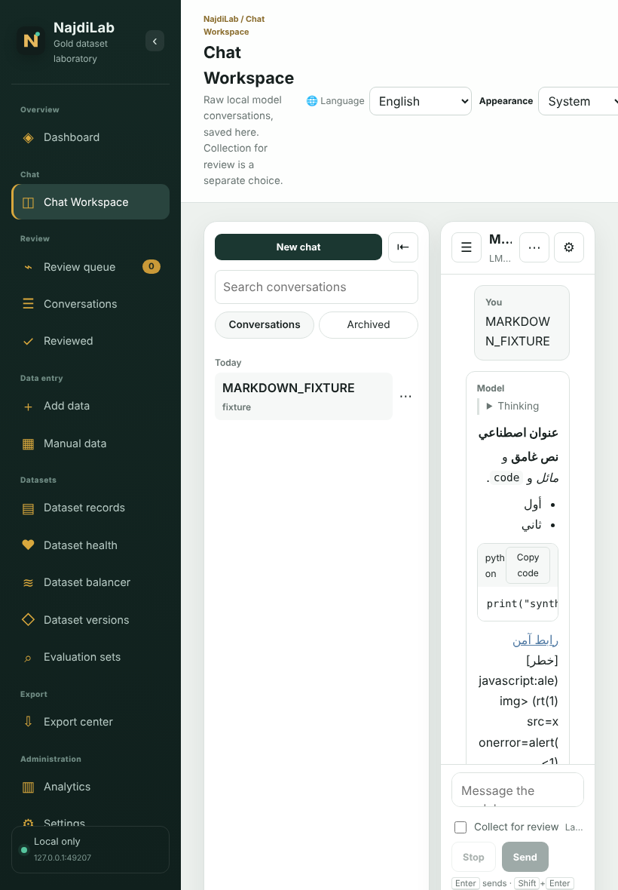
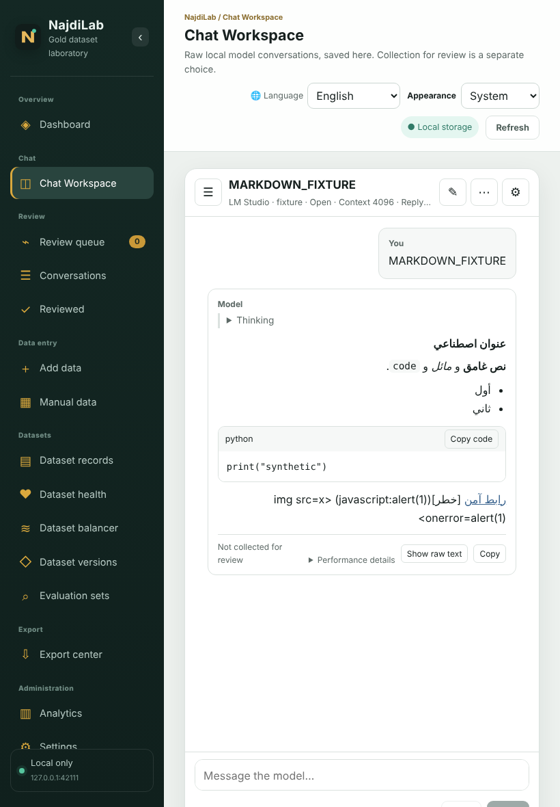
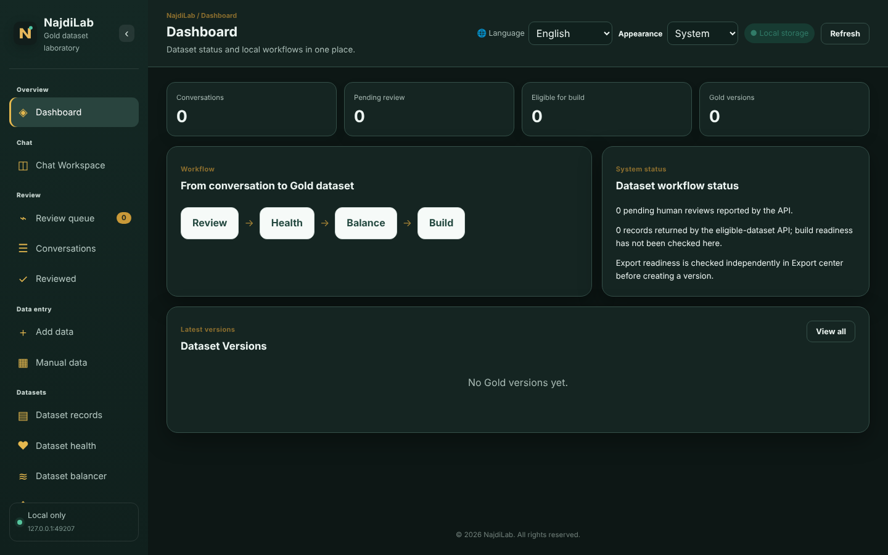
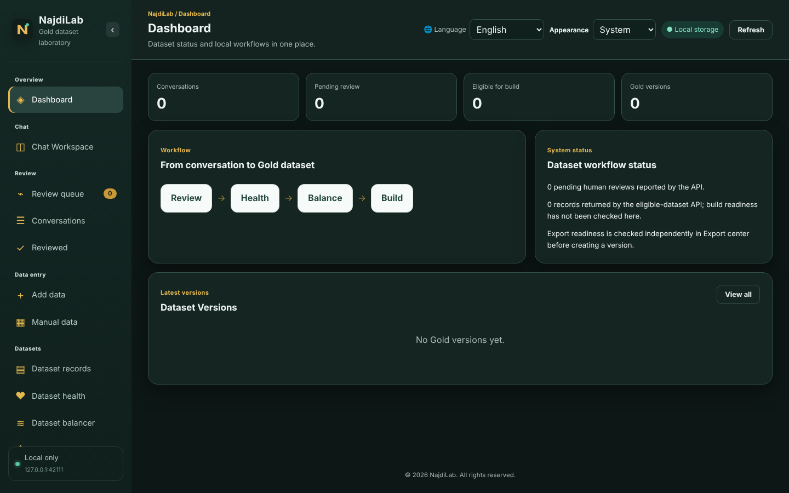
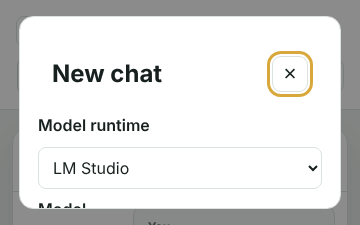
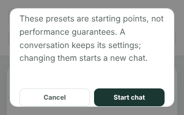
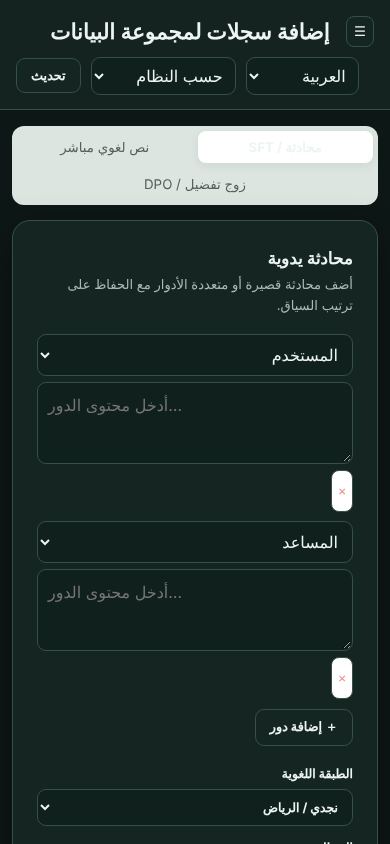
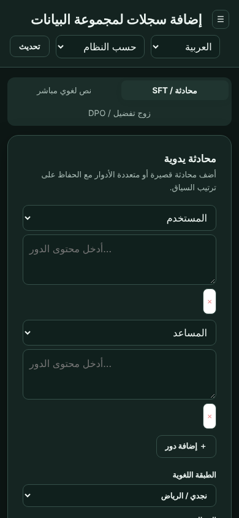

# Phase UX/UI — design audit, refinement and acceptance

| | |
|---|---|
| Date | 2026-11-03 |
| Branch | `feature/chat-experience-v2` |
| Scope | The whole interface: all 15 views, the chat setup dialog, chat settings drawer, delete dialog and action menu |
| Data | Synthetic browser fixture only (`tests/chat_browser_fixture.py`); no personal conversation, credential or real model |
| Gate status | **Automated and screenshot review: PASS after fixes.** Owner visual sign-off, real screen readers, real IMEs, other browsers and Windows rendering: **NOT TESTED**. |

## Tools and their limits

- The requested Claude Code skills **`frontend-design` and `web-design-guidelines` were not available** in this session (`Unknown skill` for both). No skill was used; this review was done manually with the tools below.
- **axe-core 4.10.3** (MPL-2.0, Deque Systems; test-time only, not shipped) run by `tests/ux-audit.cjs` against WCAG 2.0/2.1 A and AA rules in headless Chromium (build 1243).
- Real browser screenshots of every state, read one by one. axe does not judge layout or design, so the screenshots were reviewed separately; two problems below were found only that way.
- Matrix: 6 sizes (desktop 1440×900, tablet 820×1180, phone 390×844 and 320×700, 200 % zoom ≈ 720×450, 400 % zoom ≈ 360×225) × light/dark × English (LTR)/Arabic (RTL). All 15 views at desktop-light and 390-dark; dashboard, chat, review and settings plus the three chat dialogs everywhere: **212 page states** per run.

## Results

| Measure | Before | After |
|---|---:|---:|
| axe WCAG 2 A/AA violations (rule × state) | 148 (`color-contrast` 140, `aria-required-children` 4, `scrollable-region-focusable` 4) — 586 affected nodes | **0** |
| States with horizontal page overflow | 28 (every tablet state, up to 173 px) | **0** |
| Screenshot-only findings | 4 (UX-2, UX-3, UX-13, UX-14) | 0 open |

Existing acceptance suites after the changes: `a11y-browser.cjs` (keyboard, names, 200 %/400 % zoom) 13/13, `i18n-browser.cjs` (Arabic RTL, no untranslated text, 390 px) 10/10, `chat-browser.cjs` and `chat-enhancements-browser.cjs` PASS, `review-restrictions-browser.cjs` 12/12. Counts and commit: [test results](development/CHAT_EXPERIENCE_V2.md#test-results).

## Findings and fixes

| ID | Where | Finding | Evidence | Fix |
|---|---|---|---|---|
| UX-1 | All views, tablet (820 px) | Page overflowed horizontally by up to 173 px; the chat pane was squeezed to ~200 px between the app navigation and the conversation list. | axe audit overflow; screenshot | Below 1100 px the conversation list becomes an overlay and the top bar wraps (`static/ux-refinements.css`, `static/chat.js` breakpoint). |
| UX-2 | Phones, tablets, collapsed list | "New chat" was only inside the hidden conversation list. | Screenshot; the audit script could not click it at 390 px | ✎ "New chat" button in the chat header whenever the list is hidden. |
| UX-3 | Chat dialogs at 400 % zoom / short screens | The New chat dialog was cut off with no scroll, so Start was unreachable. Not detectable by axe. | Screenshot `before-zoom-400…` | Dialogs scroll inside themselves; regression check in `chat-browser.cjs`. |
| UX-4 | Global footer (light and dark) | Text #71807b: 3.62:1 on light, 4.41:1 on dark. | axe | Theme token `--muted`; 5.01:1 light. |
| UX-5 | Muted labels (light) | #697572: 4.48:1 (chat roles, list metadata, many labels). | axe | `--muted` → #5d6966 (5.35:1). |
| UX-6 | Markdown links (light) | #547da6: 4.32:1. | axe | #3d6690 (6.0:1); dark uses `--blue`. |
| UX-7 | Status chips | `.status-neutral` 4.31:1 light; `.status-ok`, privacy chip unreadable in dark. | axe | Theme-aware colors. |
| UX-8 | Dark mode labels | Eyebrow labels, breadcrumb, version tags, health cards #8a6d2e: 3.26:1. | axe | `--gold` (7.3:1). |
| UX-9 | Add data tabs, dark | Active tab text on a white background: **1.1:1**. | axe; `before-mobile-390-dark-ar-add-data` | Theme surface background. |
| UX-10 | Dark mode filters/notes/code | #52615d / #6b7773 on dark panels: 2.44–3.41:1; export warning used the light warning background. | axe | Theme tokens. |
| UX-11 | Add data tabs | `role="tablist"` without `role="tab"` children (screen readers announce an empty tab list). | axe `aria-required-children` | `role="tab"`, `aria-selected` (kept in sync), `aria-controls`, `aria-label`. |
| UX-12 | Markdown code blocks | Horizontally scrolling `<pre>` not reachable by keyboard. | axe `scrollable-region-focusable` | `tabindex="0"`, label "Code", visible focus ring. |
| UX-14 | Add data tab bar, dark | The tab bar kept a light background in dark mode (contrast passed, but inconsistent). | Screenshot | Theme surface; inactive tabs use `--muted`. Quick re-audit after this change: 36 states, 0 violations, 0 overflow. |
| UX-13 | Chat after reload | A stale error notice hid the "bound to original model" warning. | Ported PR #21 browser test | Notices reset on reload (`static/chat.js`). |

## Before and after

| Finding | Before | After |
|---|---|---|
| UX-1 tablet overflow |  |  |
| UX-8 dark contrast |  |  |
| UX-3 400 % zoom dialog |  |  |
| UX-9 Arabic dark tabs |  |  |

All images come from the synthetic fixture (titles like "MARKDOWN_FIXTURE", synthetic Arabic sample text); none contains personal conversations, credentials or paths beyond the temporary loopback address.

## Reviewed and kept as is

- **Navigation and hierarchy:** existing app navigation, breadcrumb and page titles are clear; Chat V2 keeps its own list beside the conversation on desktop.
- **Chat composition and streaming:** large composer, Send/Stop always visible (≥40 px targets), live status line per phase, dashed border while streaming, red dashed "not saved" state.
- **Thinking and Markdown:** thinking collapses when the answer starts and is visually secondary; Markdown has a raw-text toggle; code blocks are LTR inside RTL text.
- **Model selection and context:** presets show the reason they are locked; budget breakdown below; Ollama consent box only for Ollama.
- **Hardware and Native:** tables label Measured / Reported / Estimate / Unknown; Native panel explains it never downloads anything.
- **Archive and delete:** archive uses a confirm; delete needs the typed word, lists what is deleted, kept and unreachable, and reports a busy journal.
- **Review and dataset screens:** contrast fixed; layouts unchanged (they already passed the earlier 390 px acceptance).
- **States:** empty, loading ("Waiting for the model…"), error (message + code + hint), disabled (presets with reason, Send without text).
- **Architecture:** vanilla HTML/CSS/JS kept; one new stylesheet, no framework or build step.

## Remaining limitations (not tested here)

- Real screen readers (NVDA, Narrator, VoiceOver) and real IMEs (Arabic, CJK).
- Firefox, Safari and Windows font rendering.
- Owner's visual approval of the refined colors.
- The interface still needs a GPU for presets to unlock (PR #21 rule; see [reconciliation](development/PR21_PR22_RECONCILIATION.md)).

## Reproduce

```bash
npm install --prefix ../chat-browser-tools --ignore-scripts --no-audit --no-fund puppeteer-core@25.16.0 axe-core@4.10.3
NAJDILAB_BROWSER_EXECUTABLE=/path/to/chromium NODE_PATH=../chat-browser-tools/node_modules node tests/ux-audit.cjs ux-audit-output
```

The run writes `ux-audit.json` (violations, overflow per state) and one screenshot per state.
