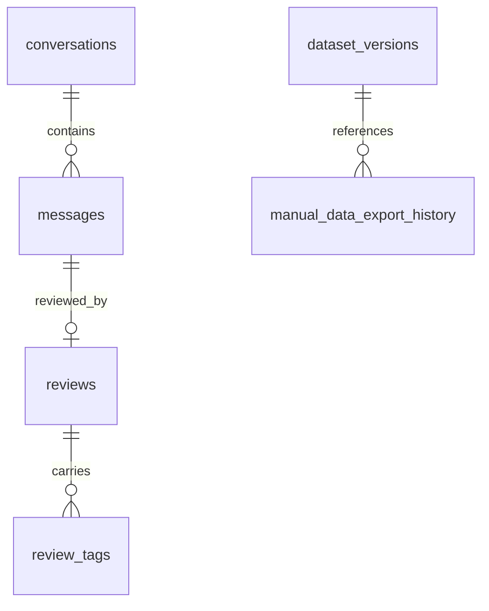

# Dataset architecture diagrams

[Editable generator](images/architecture/generate_architecture.py) · [full SVG](images/architecture/najdilab-system-architecture.svg). Regenerate with `python docs/images/architecture/generate_architecture.py`. It writes only the sibling SVG and imports no application code. Simple vector shapes/text use system fonts and no external resources. Open/zoom on narrow displays; do not infer mobile fit from the SVG dimensions.

The external engine boundary is inference only. Chat collection is separately OFF by default/restart; only completed consented pairs enter pending review. Manual data and authenticated completed-turn ingestion share review/privacy gates. Quality, deduplication and holdout separation precede immutable version publication; external Unsloth receives selected prompt/completion/provenance files. Backup remains private and restore uses a new location. See [architecture](architecture.md), [export](dataset-export.md), [security](../SECURITY.md) and [migration caveats](database-and-migrations.md).

This is a verified schema subset, not a claim that dataset bytes all live in SQLite. Dataset files/manifests and database metadata are distinct. Foreign keys/transactions do not establish consent or complete audit history. Prior training diagrams and screenshots have been removed from the working source; their provenance observations remain in [asset provenance](asset-provenance.md). Ownership and publication approval remain separate.
