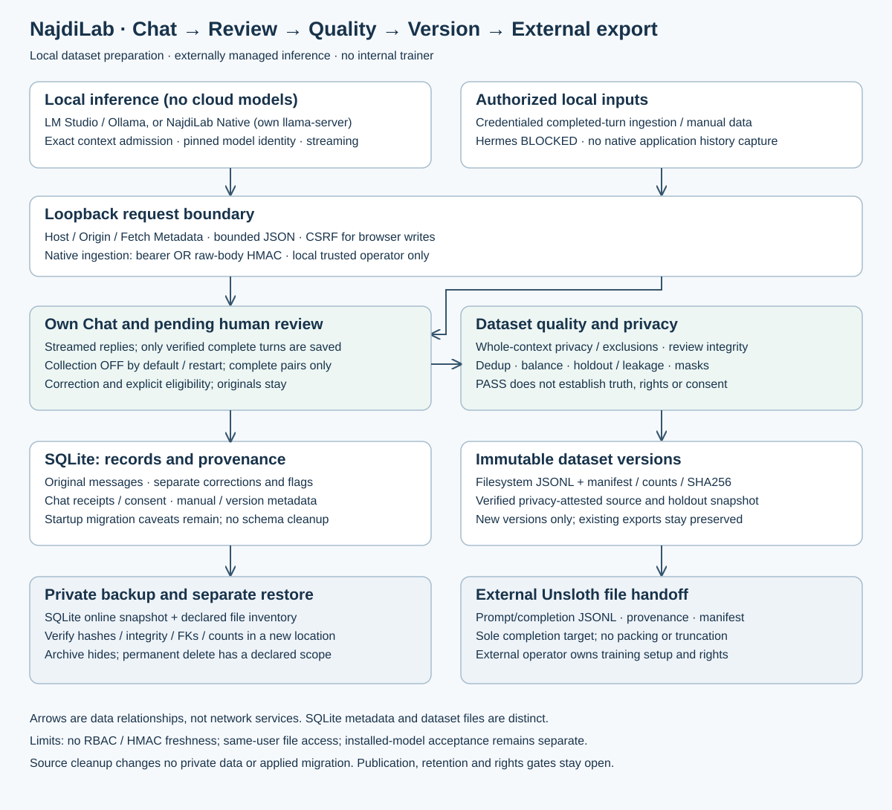
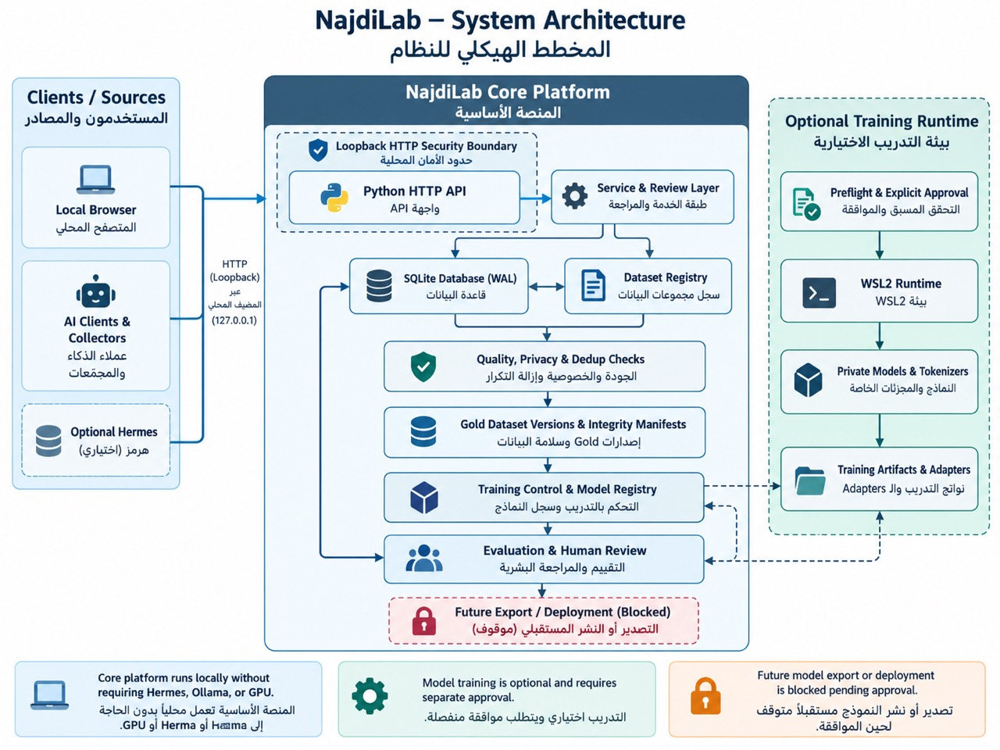
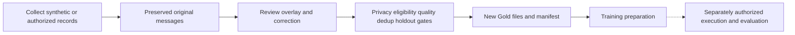
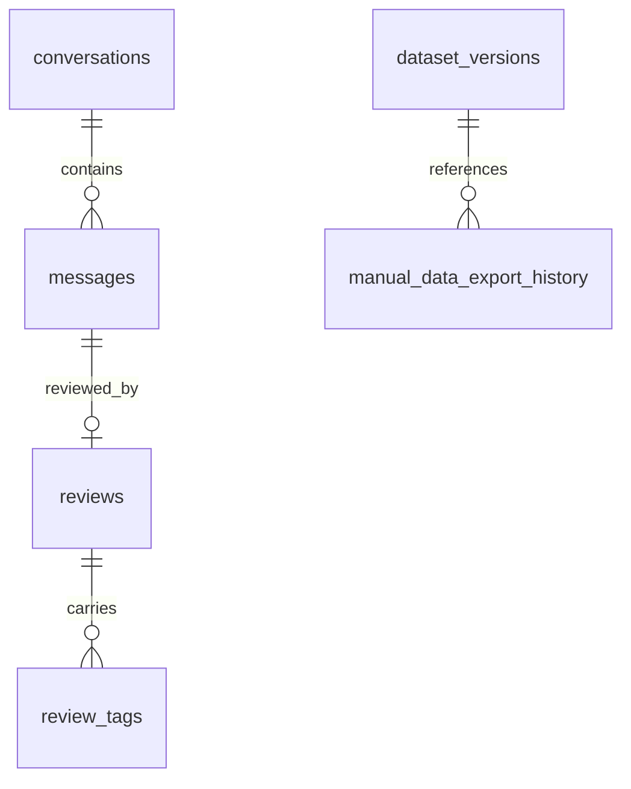
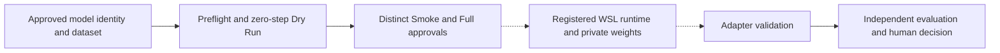
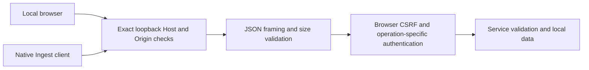

# Architecture diagram gallery

These views explain the implementation at `15c7517` and this documentation continuation. They do not authorize training, production deployment or publication. Keep [architecture](architecture.md) as the technical reference and [PROJECT_STATUS](../PROJECT_STATUS.md) as status authority. Visual provenance is recorded in [asset register](asset-provenance.md).

## A. System overview — editable SVG

[Open full-size SVG](images/architecture/najdilab-system-architecture.svg) · [PNG preview](images/architecture/najdilab-system-architecture-preview.png) · [editable generator](images/architecture/generate_architecture.py)

**Purpose:** distinguish local web operation from external model execution. A–G show clients; loopback security/API; Python services/review/dataset checks; persistent data; training/evaluation control; optional WSL2 runtime; blocked model operations. Core use needs no GPU, model, Hermes or Ollama.

**Status/source:** implemented source relationships from `app/server.py`, `http_security.py`, `service.py`, `db.py`, `dataset_platform.py`, `dataset_quality.py`, `dataset_balancer.py`, `training_control.py`, `runtime_control.py`, `evaluation_guard.py`, `phase3_review.py` and frontend `static/app.js`. Solid connections depict local implemented relationships, dashed connections optional external integration/execution, rust dotted connections blocked progression. Connections terminate at layer boundaries where a layer aggregates several controls; cards are not independent network services. Training/runtime arrows describe available controlled paths, not current production execution.

**Limits:** filesystem registry/discovery and database export metadata coexist; proposed canonical registry SQL is not automatically activated. SQLite does not store every dataset file, weight or manifest. Secret-key redaction is not consent/privacy clearance. A registered runtime and selected model are required before optional execution; no runtime was operated here. Native Ingest needs credentials; browser mutations also need CSRF. Solid lines do not remove operation-specific approval requirements.

**Accessibility/maintenance:** title/description embedded in SVG; plain text explanation here; no external fonts, icons or resources. At 1200px labels were visually reviewed. A 390px native SVG viewport requires horizontal navigation; GitHub scales images, making detailed text small. Open the SVG and zoom, or use this text on a narrow screen. Do not claim mobile fit-to-width readability. Regenerate with `python docs/images/architecture/generate_architecture.py`; recheck affected source relationships and render the SVG after edits. The PNG is derived, not the editable authority.

## B. Original owner-supplied conceptual illustration

**Purpose/origin:** supplied with the visual documentation task; preserved byte-for-byte. AI-assistance and underlying icon rights are **not established** by the attachment. It is a conceptual illustration, not a source-verified topology or a rights grant. See [asset register](asset-provenance.md).

**Discrepancies:** the bidirectional registry/SQLite relationship is broader than verified core behavior: discovery uses filesystem versions plus DB metadata, while proposed registry schema activation remains gated. The control-to-artifact arrow bypasses preflight/runtime execution conceptually; weights are runtime inputs, not a sequential output produced by the runtime. Evaluation is an independent guarded workflow rather than a guarantee that every new training artifact has already been evaluated. Optional/runtime and blocked connections must not be read as deployment completion. The historical model release remains blocked.

**Maintenance:** retain the original unchanged. Correct source relationships in the new SVG and explain discrepancies here; do not silently redraw the owner original. Owner must confirm creation method, source artwork and redistribution authority.

## C. Preserved technical Mermaid views

The existing [README system architecture](../README.md#system-architecture), [dataset/model workflow](../README.md#dataset-and-model-workflow) and [technical architecture flow](architecture.md#developer-entry-points-and-request-flow) remain unchanged as Mermaid sources.

**Purpose/status:** developer-readable logical flow; implementation source references are in those pages. The README diagram's evaluation-to-DB edge summarizes decision persistence; Phase 3 human-comparison state also uses report files. The new SVG's evaluation card intentionally avoids claiming that all evaluations reside in SQLite. Mermaid is a conceptual dependency view, not process/network deployment topology.

**Maintenance/limits:** preserve old sources; review `server.py`, service/dataset/runtime modules and report paths when changing relationships. Existing Mermaid blocks are covered by no-loss hash comparison; a new diagram does not supersede historical approval records.

## D. Data flow — originals and overlays

**Purpose:** explain how collection becomes a derived candidate without rewriting original messages. **Status/source:** local ingestion/review/export in `service.py`; integrity/quality/version checks in `review_integrity.py` and dataset modules. **Limits:** a passed gate is not data-publication consent; this showcase created no Gold version. **Maintenance:** update when eligibility/manifest contracts change, preserving frozen historical evidence.

## E. Database architecture — verified relationship subset

**Purpose:** show a small actual-schema subset rather than an invented full ER model. **Status/source:** `migrations/001_initial.sql`, `003_manual_data_manager.sql` and `004_review_lifecycle.sql`; foreign keys `messages.conversation_id`, unique `reviews.message_id`, `review_tags.review_id`, and `manual_data_export_history.dataset_version_id`. Other tables/self references are intentionally omitted. Dataset files/manifests are on disk, with metadata in `dataset_versions`; there is no claimed FK to every record in a Gold file.

**Integrity/limits:** WAL, FKs, explicit transactions and immutable-original service rules differ from a complete DB-level immutability guarantee. Existing startup migrations run automatically; proposed `plans/` SQL remains gated. **Maintenance:** verify against actual migrations/schema before adding relationships; see [database schema](database-schema.md) and [migration guide](database-and-migrations.md).

## F. Optional training architecture

**Purpose/status:** separate web control from external execution. `training_control.py` and `runtime_control.py` implement registry, preflight, staging and execution gates; evaluation components validate identity and human decisions. **Limits:** arrows summarize stages, not a claim of available live runtime, completed optimizer training or universally supported GPU stack. Rejected adapters remain rejected. **Maintenance:** follow [training guide](dataset-and-training.md), preflight contracts and approval changes.

## G. Security architecture

**Purpose:** describe controls on local requests; diagram order groups controls, not exact per-line execution. **Status/source:** `http_security.py`, `server.py`, `service.py`, `db.py`. Native Ingest uses bearer/HMAC; CSRF alone is not native Ingest authorization. **Limits:** no general RBAC; HMAC lacks replay freshness; local programs can obtain intent sessions. **Maintenance:** align with [SECURITY.md](../SECURITY.md) and security regressions. No public-network service certification.

## H. Future / blocked architecture

Model merging, quantization/GGUF, export and deployment are distinct owner-gated operations. Existing utility scripts/designs do not establish that the rejected historical adapter may be released. Corpus v1.1 registry/reviewer-event/RBAC plans are not this task's implementation. **Purpose/status:** preserve roadmap distinctions; [PROJECT_STATUS](../PROJECT_STATUS.md) and [release decision](public-release-decision.md) govern. **Maintenance:** change labels only after the relevant implementation, rights and approval evidence is recorded.
