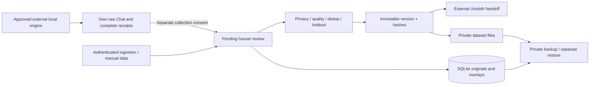

# Architecture

NajdiLab's local workflow is Chat → Review/correction → Quality/dedup → Dataset version → external Unsloth export. No training control plane, WSL worker, trained-model registry, model benchmark or deployment implementation belongs to the active application. The Native GGUF acquisition path is **Hugging Face Direct**: explicit, revision-pinned, SHA-256-verified downloads of single-file GGUF models into a managed folder that NajdiLab Native can load after a separate approval (`hf_hub.py`, `model_store.py`, `model_advisor.py`, `model_service.py`; [record](development/HUGGING_FACE_DIRECT.md)). The one program-acquisition path is the **managed llama.cpp runtime**: a pinned official `llama-server` build, installed on approval, verified (SHA-256, identity, GPU probe) and switched atomically (`runtime_catalog.py`, `managed_runtime.py`; [record](development/MANAGED_RUNTIME.md)).

`server.py` validates loopback authority/origin, framing, JSON and CSRF before dispatch. `integrations.py` owns bounded fixed-loopback discovery and session-only consent. `chat_workspace.py` owns complete-turn receipts, consent epochs, revisions and one active turn per runtime/session. `chat_engine.py` and its bounded child helper provide exact-count text inference against separately managed engines; [engine and privacy limits](chat-workspace.md).

`service.py` and `db.py` own ingestion, immutable originals, review overlays, manual items and export metadata. `review_integrity.py` enforces export readiness. `dataset_platform.py`, quality/balancer modules and shared `dataset_masks.py` / `dataset_validation.py` / pure `dataset_tools.py` manage local dataset selection, validation, versions, manifests and diagnostics. `platform_state.py` retains only dataset catalog support. Dataset-specific phase38/39/remediation/freeze modules preserve local dataset workflows and private review evidence.

SQLite stores records and metadata; files/manifests remain on disk. `unsloth_export.py` requires current context-privacy attestation, verifies every quality/holdout input under a locked source snapshot and atomically publishes immutable prompt/completion JSONL, provenance and manifest. Only the final approved target receives external completion loss; [contract](dataset-export.md).

Corrections never overwrite original text. Privacy flags apply to whole contextual windows. Archive prevents future selection but retains text/backups/old exports; erasure requires a separate decision. No automated PII/linguistic/rights certification is claimed. The application trusts the local operator: no multi-user RBAC, HMAC replay freshness or protection from same-user direct filesystem access. Reviewed hash-registry and transaction rules are [documented](database-and-migrations.md).

Removed `/api/v1/training/**`, `/api/v1/evaluation/verify-adapter`, `/api/v1/phase3/**` and platform-status endpoints have no compatibility execution shim. Dataset eligibility is `/api/v1/dataset-records`; manual creation is `/api/v1/manual-data/{sft|direct|preference}`. [API](api-reference.md), [code map](codebase-navigation.md), [diagram](architecture-diagrams.md).

## V2.3.0 workspace and lifecycle

The official four-stage Wizard owns manual entry, selection, in-place correction, explicit Gold approval and compatible export. `static/prepare-data.js` reuses shared APIs and the existing history-aware editor. The default HTML contains no legacy launcher, mode controls or specialist panels. `static/app.js` imports `advanced-workspace.js` only for an explicit retained diagnostic route. Templates, CSS and event bindings mount once on demand. A delayed mount is guarded against a newer navigation.

`gold_management.py` owns attested download options, typed-confirmation deletion, quarantine/recovery and deletion audit. `gold_lifecycle.py` serializes public filesystem mutations across threads and processes, reserves deleted identities and records handoff dependencies. Migration 011 retains dataset ownership/history as tombstones. Readable legacy versions can lack deletion ownership proof and are refused for permanent deletion.

Model library supports approved GGUF downloads for Native and separate Safetensors customization-model downloads for external training through `training_models.py`. The latter does not execute training. [Preserved interface](legacy/advanced-workspace/ARCHITECTURE.md).
