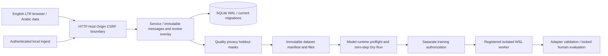

# Architecture

NajdiLab runs locally: clients send completed turns to a Python HTTP server, human reviewers create overlays, and gated exports produce immutable training versions. The original v1 scope covered collection, review, Gold management and data export; later phases added explicit training controls and evaluation workflows. Model merge, GGUF/Ollama release and deployment remain separately gated work.

```text
Model / provider -> POST /api/v1/turn -> loopback collector
    -> SQLite transaction: conversation + user + assistant + pending review
    -> review UI -> separate human decision/correction
    -> eligibility + privacy gates -> deduplication / holdout / balance
    -> exports/gold-vNNN + manifest + SHA-256
```

## Components

- `app/server.py`: standard-library HTTP server, JSON routes and static assets.
- `app/service.py`: transactions, ingestion, review, context reconstruction and exports.
- `app/dataset_platform.py`: version discovery, health, candidate balancing, hashes and locked-evaluation leakage detection; reuses the trusted window selector.
- `app/dataset_balancer.py` and `app/dataset_quality.py`: read-only balance and deterministic quality reports.
- `app/db.py`: SQLite connections, WAL, migrations and credential-field redaction.
- `app/training_control.py`: explicit model registry, configuration, quality gates and jobs.
- `app/runtime_control.py`: runtime evidence, worker/staging gates, dry runs and authorized execution.
- `static/`: framework-free HTML, CSS and JavaScript; see current README for interface language.
- `migrations/`: ordered schema changes. Proposed SQL in `plans/` is deliberately outside automatic startup migrations.

## Integrity and security boundaries

The server binds only to `127.0.0.1`. Request bodies are limited to 2 MB, and response headers restrict framing and content sniffing. See [SECURITY.md](../SECURITY.md) for current browser-write protections and remaining limitations. Historical security proposals describe their state at the date of each audit.

Secret-like keys in metadata and generation settings are replaced with `[REDACTED]`; this does not guarantee that conversation text is free of personal information. Composite writes use `BEGIN IMMEDIATE` and roll back on failure. Corrections never replace `messages.content` or `reviews.original_response`. Evaluation-only and excluded records cannot become training-eligible. Exports write into a temporary directory before atomic rename.

## Model independence

Provider, model and version are metadata rather than a fixed relationship. `parent_message_id`, `candidate_group_id`, `judge_result_json` and `comparison_records` support future candidate/critic/judge workflows without implicitly running generation. Stored conversational content stays template-free; the selected runtime applies its tokenizer template and proves loss masks.

Training snapshots bind model identity/revision, dataset/staging fingerprints, runtime and execution evidence. READY or a browser confirmation alone does not authorize training. Training, evaluation and model release are independent workflows; restoring a runtime does not refresh authorization.

## Corpus v1.1 design track

The [Phase 1 design package](corpus-v1.1/README.md) was approved on 2026-10-23. It makes NajdiLab the authoritative platform and UI, with NajdiTrain serving only as the training runtime. It defines the Najdi assistant behavior, Gold/Silver/Bronze provenance, G1–G4 gates, human approval of generated manual items, security prerequisites and migration review 005–007. Approval covered documentation only: no code, schema, data or runtime changes were authorized. Phase 1A remains separately gated. These historical decisions do not assert that the later implementation is complete.

## Developer entry points and request flow



Setup uses scripts/install.py with platform wrappers; launch uses scripts/launch.py, then app.server. Browser JS obtains a process CSRF session and sends JSON; server boundary runs before route handling, domain services enforce data/job gates. UI uses no bundler. SQLite migrations are automatic only for files already in migrations, with known loader limitations. Filesystem dataset registry is implemented; proposed canonical SQL registry/event activation remains blocked. Evaluation uses locked provenance and human decisions; model release is separately gated.

Extend the responsible component in [code map](codebase-navigation.md); preserve API fields/protocol masks and tests before introducing an extension. [API](api-reference.md), [migration guide](database-and-migrations.md), [training guide](dataset-and-training.md) and [handover](maintainer-handover.md) describe implementation versus plans.
