# Najdi Lab | نجدي لاب — premium bilingual interface redesign

| | |
|---|---|
| Date | 2026-11-03 |
| Branch | `update-project` (Draft PR #23, `main` untouched) |
| Method | `design-taste-frontend` skill (tasteskill v2), app-screen run: data and job inventory → dealt style → shell → screens → states → `lint.mjs --app` / `inspect.mjs --app` → screenshot critique |
| Dealt style | `framed-sheet` (light), seed `611835743`, kind `devtools`. No redraws. Its face: the frame tinted with Najd limestone; the move kept intact: one tinted L-frame and a white sheet, a 2 px accent tab line |
| Data | Synthetic browser fixture only (`tests/chat_browser_fixture.py`). The installed Windows instance, its database, models and third-party services were not touched |
| Architecture | Unchanged: vanilla HTML/CSS/JS, no framework, no build step, no new runtime dependency. API contracts, routes, element IDs and privacy controls unchanged |

Design reference: [design system](../design-system.md). Earlier UX phase: [UX/UI design review](../UX_UI_DESIGN_REVIEW.md).

## 1. Audit of the interface before the redesign

The audit used the existing `tests/ux-audit.cjs` (212 states: 6 sizes × light/dark × English/Arabic, every view, and the chat dialogs) plus a screenshot-by-screenshot review. Accessibility was already clean (**0 axe WCAG 2 A/AA violations, 0 overflowing states**), so the problems were design problems:

| Area | Finding before |
|---|---|
| Identity | A generic gold "N" tile. The Latin wordmark "NajdiLab" appeared in the Arabic interface too; the name was spelled "NajdiLab", not the brand's "Najdi Lab". |
| Hierarchy | A 108 px top bar holding the title, two labelled selects, a chip and a button on every screen. Small gold uppercase-like labels ("Workflow", "System status", "Latest versions") above every heading. |
| Navigation | A saturated dark-green sidebar against a light canvas; Unicode glyph icons (◈ ◫ ⌁ ♥ ≋ ⚙) of mixed weight, in gold; an active item marked by a gold inner bar. At 900 px high the last five destinations sat under the "Local only" box. |
| Layout | Cards with 18 px radii and soft shadows everywhere; the dashboard's workflow card held four buttons in a large empty white area, and the versions panel was a full-width empty block. |
| Typography | System fallbacks (Segoe UI, Tahoma); no designed Arabic face, so Arabic and Latin did not match; many labels at 10–11 px. |
| Colour and themes | About 186 distinct hard-coded colours across ten stylesheets; dark mode worked by dozens of per-component overrides. |
| Status | PASS/FAIL/BLOCKED/REVIEW/PENDING used unrelated colours per screen and relied on colour alone; raw codes such as `NOT_DETECTED` in monospace. |
| Defects found | Analytics and Balancer bars set widths with `style="…"` attributes, which the app's own CSP (`style-src 'self'`) blocks: the bars never showed their real length. Emoji (🔒 📌 🌐 ✓) used as icons. |

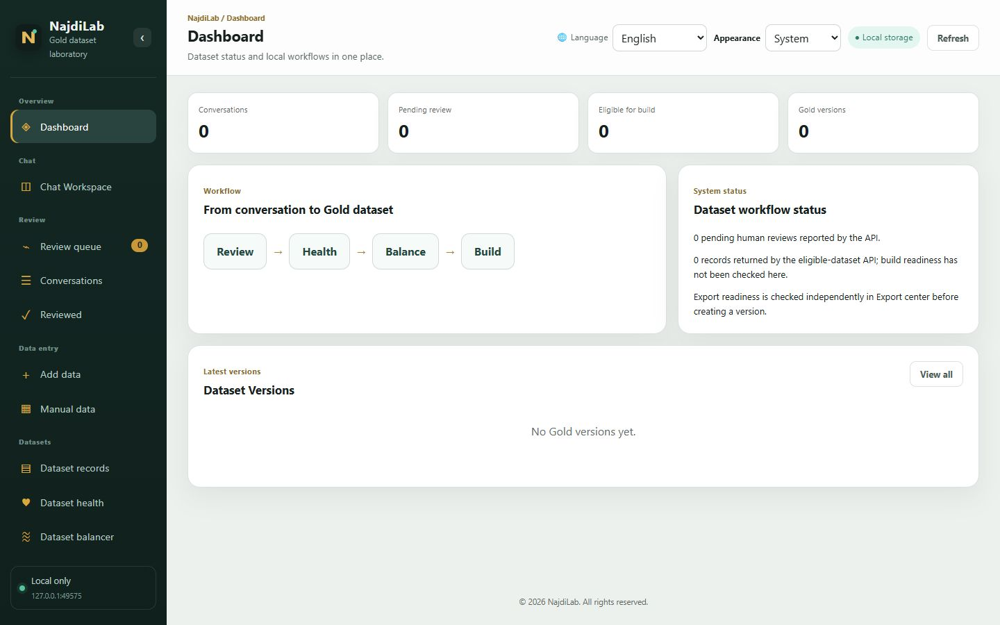

## 2. Product inventory and the screen's question

- **Objects:** chat sessions and turns, collected responses, review decisions (approve, three correction types, exclude, delete), manual SFT/direct/DPO records, frozen Gold dataset versions with SHA-256 files, health and balance reports, the locked evaluation holdout, local runtimes (LM Studio, Ollama, NajdiLab Native).
- **People and use:** one owner or a small review team, long sessions, desktop first, Arabic and English.
- **The dashboard's question:** *"Where is my data on its way from conversation to Gold, and what do I do next?"* The answer is the product's own pipeline, so the KPI strip *is* the pipeline: Conversations → Pending review → Eligible for build → Gold versions, each cell opening the screen where that number is worked on. The most frequent job (review) is one click away.
- **Signature element:** the Najdi triangle, shared by the logo, the pipeline hand-off arrows, the workflow step markers and the empty states.

## 3. Brand and logo

The mark is **ن** (the first letter of نجدي) as one geometric bowl; its dot is the triangular wall opening of Najdi mud-brick architecture. Bowl = the dataset held intact; triangle = the precise, human-placed point of review; tile = one structured unit. Rejected concepts (prototyped and screenshotted): a 3-2-1 triangle pyramid (too close to a famous game emblem), a crenellated block with data cells (read as a castle or crown), triangles over text lines (read as a menu), and smooth crescent bowls (read as a smiling face). Full rationale, files and usage: [design system › Brand](../design-system.md#brand).

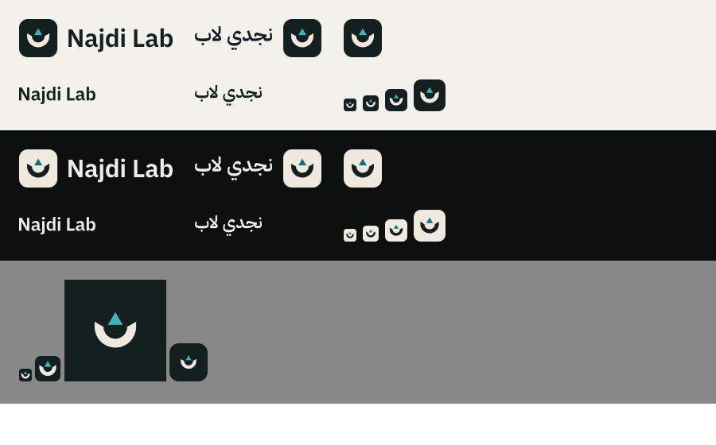

Delivered: main symbol (light and dark), Arabic wordmark نجدي لاب, English wordmark Najdi Lab (light and dark each), Arabic and English lockups, compact sidebar logo (inline, theme-aware), an optically adjusted favicon, and a 512 px app icon. The interface shows the Arabic wordmark in Arabic and the English one in English.

## 4. Design decisions

1. **One token file.** `static/theme.css` now defines every colour, status pair, radius, shadow and type role for light and dark. A scripted sweep replaced all hard-coded colours in the ten legacy stylesheets with tokens by role (text, background, border, focus), and the dark-mode per-component overrides that tokens made redundant were deleted.
2. **One design-system layer.** `static/najdi.css`, loaded last, holds the fonts, base type, the framed-sheet shell, every shared component, the status vocabulary and the screen compositions. Legacy rules that targeted removed markup were deleted rather than overridden.
3. **Type:** IBM Plex Sans and IBM Plex Sans Arabic (designed together) joined as one family by `unicode-range`; IBM Plex Mono only for identifiers, hashes and code. Bundled locally; the CSP forbids font CDNs.
4. **Palette:** Najd limestone frame `#f3f1ec`, white sheet, brand ink `#14201f`, teal accent `#136f78`; true neutral darks (no navy or slate). Colour sits on data, status, focus and the one primary action.
5. **Status:** PASS (circle), WARNING (triangle), FAIL (square), BLOCKED (bar), REVIEW (diamond), PENDING (ring). Each is a pale tint with dark same-hue text, plus a shape, so colour is never the only cue.
6. **No ornament at rest:** no shadows except on what floats, no gradients, glass or emoji. Small labels above headings were turned into sublines under them.

## 5. Screens and components changed

| Screen | Change |
|---|---|
| Shell (all) | Framed sheet; quiet sidebar on the frame tint with outline SVG icons, sentence-case groups, white active pill with teal icon, neutral review count, a scrolling nav that always reaches Settings; 56 px top bar with breadcrumb (workflow group / screen), icon-led language and theme selects, local-storage status, Refresh; page title moved onto the sheet. |
| Dashboard | Pipeline KPI strip with stage hand-off triangles and click-through; "Next steps" ordered list (Review, Health, Balance, Build) with descriptions; latest versions with an empty state that offers Export center; workflow status as a divided strip. |
| Chat | Calmer conversation list on a soft well; user messages as soft bubbles, assistant replies on the sheet without a box; Plex type with longer Arabic leading; code blocks on a code ground; SVG header icons in place of ☰ ✎ ⚙ ⋯ ⇤; a "Pinned" chip in place of 📌; drawer and dialogs with float shadow and entrance. |
| Review queue | Original response well with a lock icon (no emoji); correction-type buttons with a teal selected state; status-paired action buttons; tag chips; empty state with the brand triangle and "Open Chat Workspace". |
| Conversations, Reviewed, Manual data | Toolbars and filters on the shared control system; tables with grey headers, row rules and tabular figures; KPI strips that size their columns to the item count. |
| Datasets: records, health, balancer, versions, evaluation sets | Shared status vocabulary on health cards and gate badges; teal data bars that now render at their true width (CSP fix); version list with a teal selected state; evaluation lock icon in place of 🔒; long status words wrap inside their card. |
| Export center | Padded Unsloth handoff panel, create and history panels on one gap, file types as monospace chips. |
| Analytics | KPI strip 5 + 5; bar lists in the accent; the per-model table scrolls inside a labelled, focusable region on phones. |
| Settings and integrations | Integration cards with state-aware badges (CONNECTED = ready, BLOCKED = hold); settings as one divided list of rows; icon tiles removed. |
| Dialogs, notices, toast, loading, empty | One system: 14 px dialogs with float shadow and dimmed backdrop; info, warning, error and success notices; inverted toast; flat skeletons; dashed empty frames. |

Code changes outside CSS were kept small: the breadcrumb builder (now composed from English source names so it translates both ways), the phone navigation state (`aria-expanded`, Escape, outside click), the collapse button state (`aria-expanded` instead of swapping ‹ ›), the pipeline click-through, the CSP-safe bar widths, the integration badge `data-state`, emoji replaced with icons, and new Arabic catalog entries for every new string. `app/server.py` gained one line registering the `font/woff2` type.

## 6. RTL and LTR

The shell mirrors through `dir` and logical properties; no screen has a separate Arabic layout. Arabic gets its own wordmark, a 17 px root and 1.75 line height, no letter-spacing, and Latin digits. Identifiers, hashes and code keep `dir="ltr"` and Plex Mono inside Arabic text. Chevrons and pipeline triangles point in the reading direction. Verified by `tests/i18n-browser.cjs` (sidebar on the right in Arabic, no untranslated text, no overflow at 390 px, the phone menu anchored to the right edge) and by the screenshots below.

## 7. Accessibility

- axe-core 4.10.3 WCAG 2 A/AA across the same 212 states: **0 violations before, 0 after** (one intermediate finding, a horizontally scrolling Analytics table at 390 px, was fixed with a focusable labelled region).
- Horizontal page overflow: **0 states before, 0 after**, including 200 % and 400 % zoom.
- Text tiers hold 4.5:1 on their surfaces in both themes; status text holds 4.5:1 on its tint; disabled controls stay legible instead of fading by opacity.
- Status never relies on colour alone (shape + text). Focus is a 2 px teal outline everywhere. Every icon-only control has an accessible name. `prefers-reduced-motion` removes all motion; `prefers-contrast: more` thickens lines.
- Not tested: real screen readers (NVDA, Narrator, VoiceOver), Firefox and Safari, Windows high-contrast mode.

## 8. Before and after

All images are synthetic-fixture captures from `tests/ux-audit.cjs`.

| | Before | After |
|---|---|---|
| Dashboard, English, light, 1440 |  | 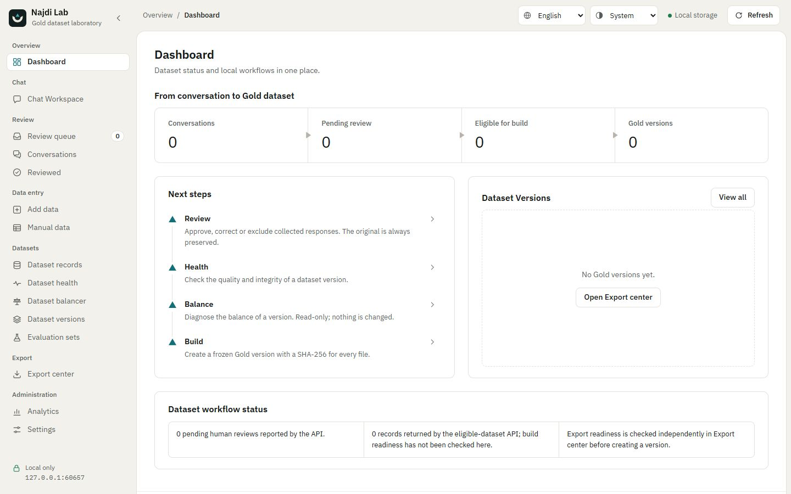 |
| Chat, Arabic, light, 1440 | 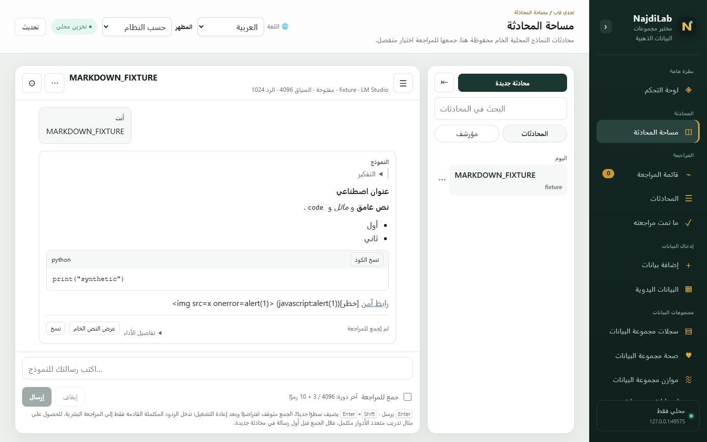 | 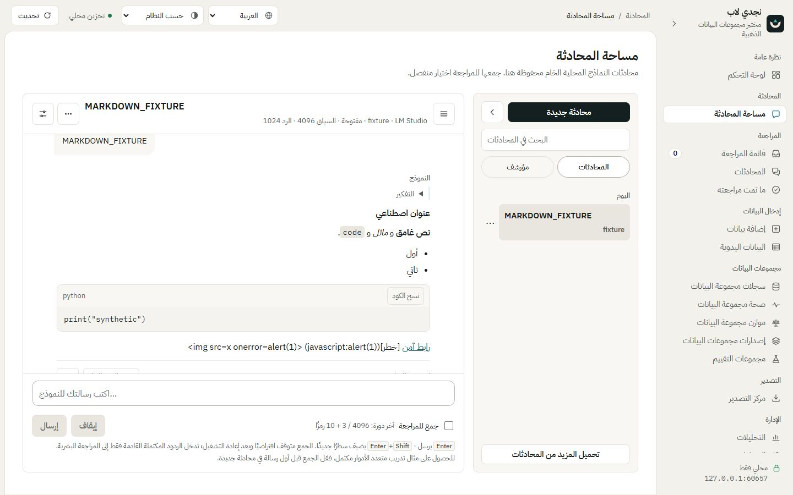 |
| Review queue, Arabic, dark, 1440 | 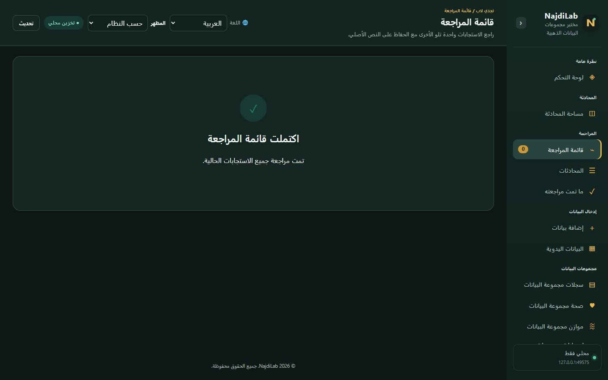 | 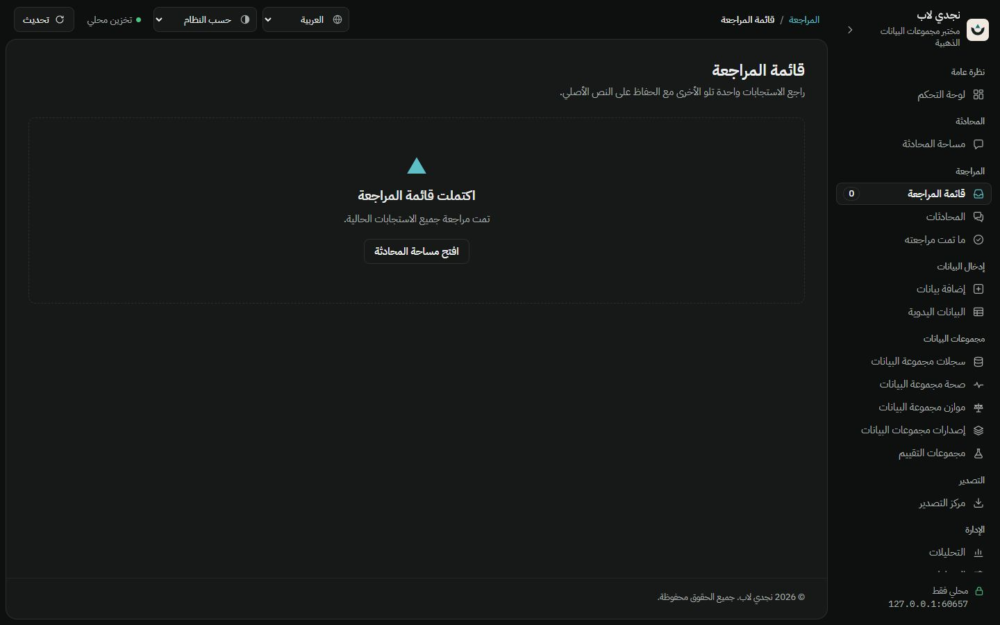 |
| Settings, English, light, 1440 | 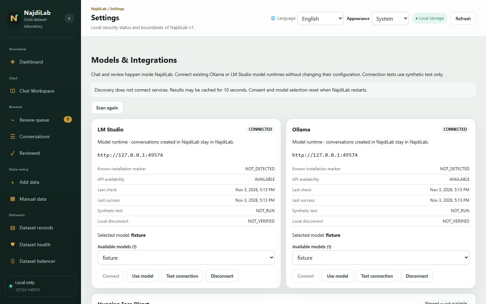 | 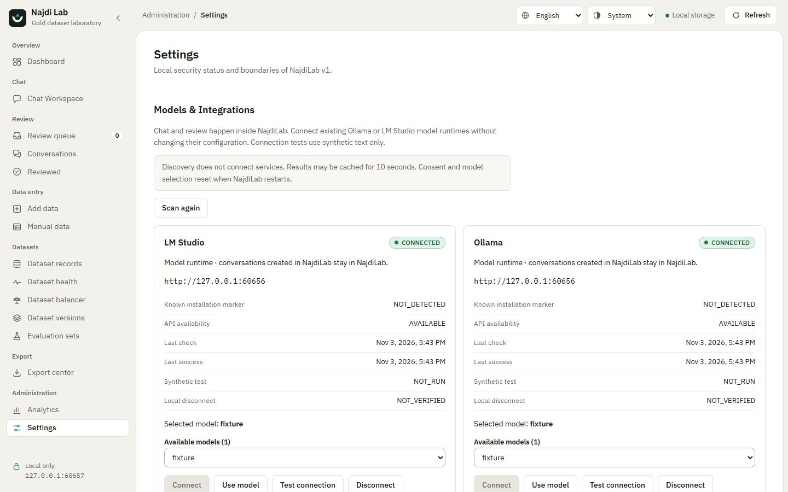 |
| Chat, English, light, tablet 820 | 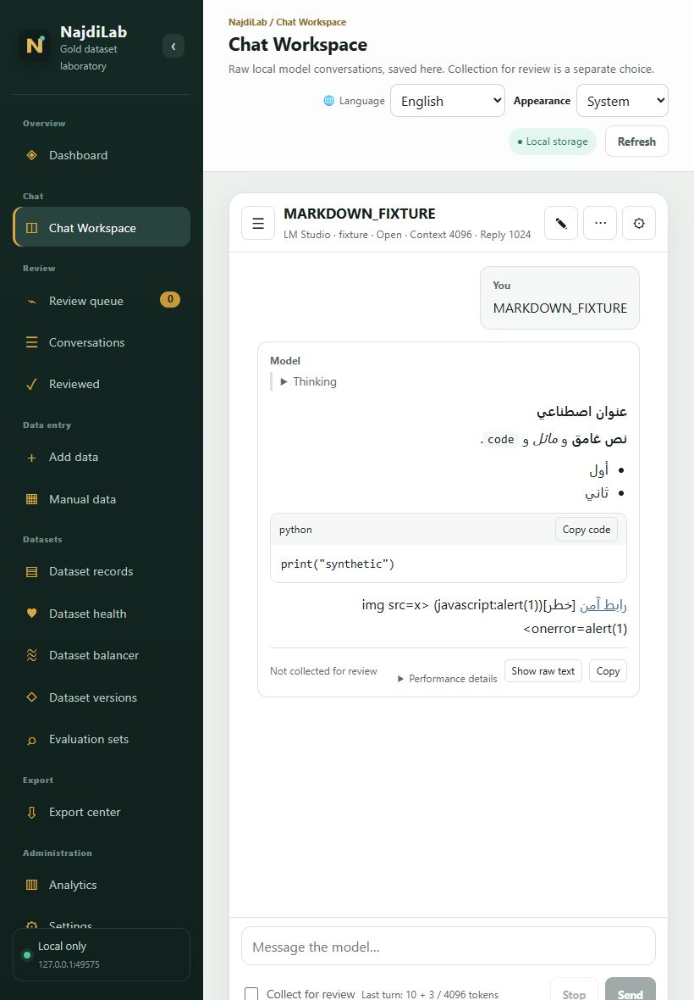 | 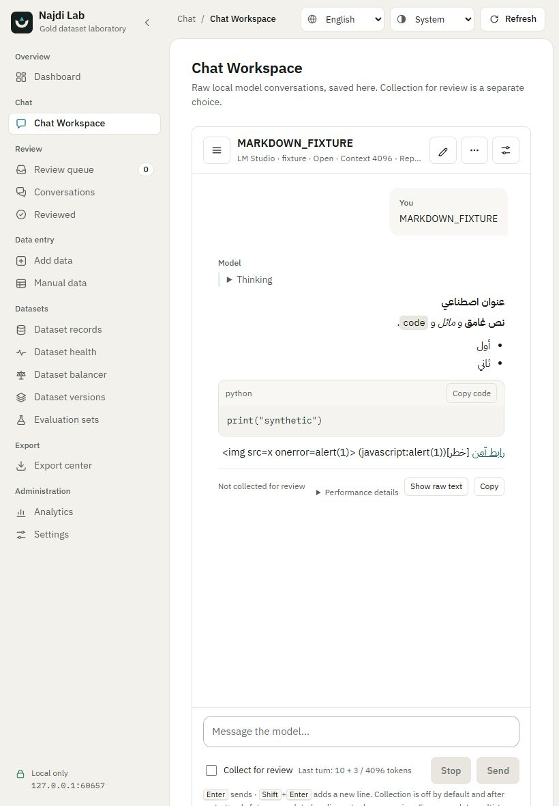 |
| Dashboard, Arabic, dark, phone 390 | 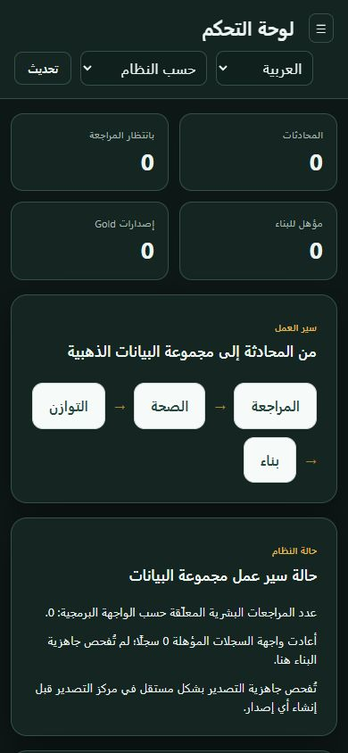 | 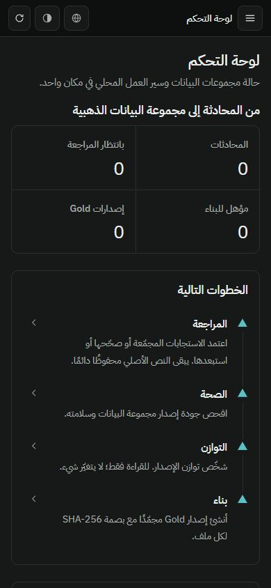 |
| Dashboard, Arabic, dark, 200 % zoom | 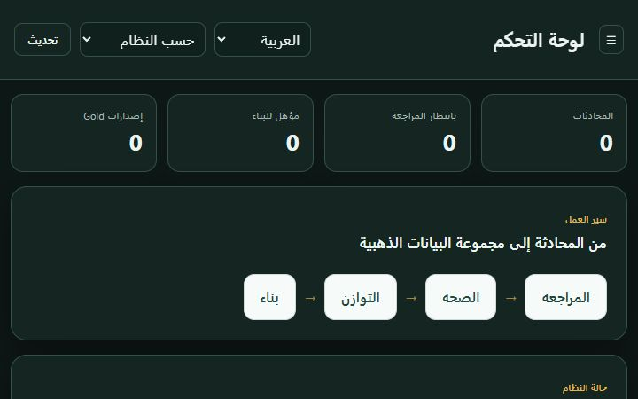 | 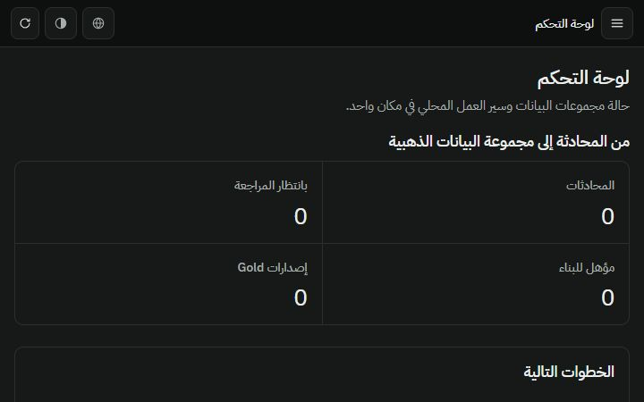 |
| New chat dialog, English, light, 400 % zoom | 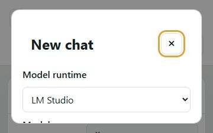 | 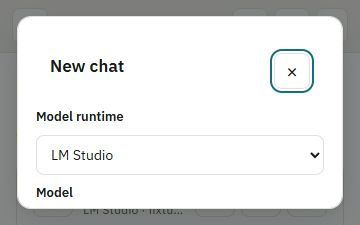 |

## 9. Test results (Windows 11, Python 3.12.10, Node 26.10.0, Chrome)

All runs on the final tree. "Pre-existing" means the same result on an untouched `git archive HEAD` copy (`d8486ed`) on this machine.

| Check | Command | Result |
|---|---|---|
| Python | `python -m pytest -q tests` | **749 passed, 54 skipped, 1 failed**. The failure, `test_chat_v2_stream.py::test_browser_disconnect_mid_stream_stops_the_turn_and_saves_nothing`, is pre-existing (fails identically on `HEAD`); it is backend stream timing, untouched by this work. |
| Public builder | `python -m pytest -q public_source/tests/test_builder.py` | **12 passed** (new files classified in `public_source/policy.json`). |
| Node | `node --test tests/*.test.cjs` | **49 passed, 0 failed** |
| Keyboard, names, 200 %/400 % zoom | `node tests/a11y-browser.cjs` | **13 passed, 0 failed** |
| Arabic RTL / English LTR | `node tests/i18n-browser.cjs` | **10 passed, 0 failed** (it caught a breadcrumb translation bug during the work, now fixed) |
| Review restrictions | `node tests/review-restrictions-browser.cjs` | **12 passed, 0 failed** |
| Chat enhancements (PR #21 port, Arabic and mobile chat) | `node tests/chat-enhancements-browser.cjs` | **PASS** |
| Chat browser | `node tests/chat-browser.cjs` | **FAIL, pre-existing**: stops at "no GPU estimate, no preset" because this PC has a GPU; identical on `HEAD`. Its later steps did not run. |
| axe-core WCAG 2 A/AA + overflow | `node tests/ux-audit.cjs` | **212 states: 0 violations, 0 overflowing states** (before: 0 and 0) |
| Skill gate | `inspect.mjs --app` on Dashboard, Chat, Review, Settings, Conversations, Dataset health at 1440/768/390 | **0 FAIL** on all six; 1 WARN (`hero-void`) on Review and Conversations, which is the honest empty state of the synthetic fixture (no queue, no selection) |
| Skill lint | `lint.mjs --app` on `najdi.css`, `theme.css`, `index.html` | **0 FAIL**, 31 WARN: monospace for IDs (allowed on app screens), `box-shadow`/`backdrop-filter` declarations that *remove* effects or style focus rings and floating dialogs, and legacy `.eyebrow` markup that the new layer renders as a subline under its heading |

Not run: real screen readers, Firefox/Safari, Linux CI (GitHub Actions were not triggered, as instructed), real models.

## 10. Remaining limitations

- Running English prose and stored values still say "NajdiLab" (for example "NajdiLab adds no system prompt", the `NajdiLab manual entry` source value, the `X-NajdiLab-CSRF` header, "NajdiLab Native"). The identity (wordmarks, title, breadcrumb, footer) uses "Najdi Lab" / "نجدي لاب". Renaming prose touches stored data and API names and was left for an explicit decision.
- English integration rows still show raw codes (`NOT_DETECTED`, `NOT_RUN`); Arabic shows translations. A humanised English vocabulary needs catalog changes in both languages.
- The legacy stylesheets still exist under the new layer (now token-only). Folding them into `najdi.css` is a follow-up refactor; it was not needed for behaviour.
- Owner visual approval, real screen readers, other browsers and Windows high-contrast mode were not tested.
- Two checks fail on this machine **before and after** the redesign (verified against an untouched `git archive HEAD` copy): `tests/chat-browser.cjs` assumes a fixture without a GPU (this PC has an RTX 5070, so presets unlock), and `test_chat_v2_stream.py::test_browser_disconnect_mid_stream_stops_the_turn_and_saves_nothing` (Windows socket timing). Because `chat-browser.cjs` stops at its first assertion, its later steps did not run here; `chat-enhancements-browser.cjs` covers the chat UI and passes.

## 11. Rollback

The redesign is a set of commits on `update-project`; nothing outside the repository changed (no migration, no data, no settings).

```bash
git revert <redesign commit sha>
```

To compare or restore single files, the previous versions are in the parent commit: `git checkout <parent sha> -- static/ app/server.py tests/test_theme_support.py`. Removing `static/najdi.css`, `static/fonts/` and `static/brand/` and restoring `static/index.html`, `static/theme.css` and the legacy stylesheets returns the previous look; `app/server.py`'s extra MIME line is harmless either way.
