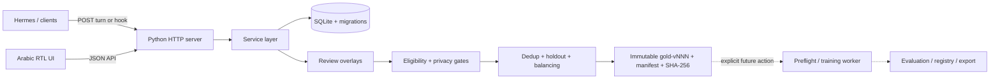

# Historical project status and engineering record

For reconciled current status see [PROJECT_STATUS](../PROJECT_STATUS.md). Earlier AWAITING APPROVAL / no-v009 / draft statements below are preserved snapshots superseded by later recorded evaluation/review/freeze evidence.

Preserved from the pre-English README. Sections record successive phases and can describe different points in time. Later dated evidence supersedes earlier readiness statements; no historical approval authorizes a new action. Local datasets, reports, models and runtime evidence referenced here are private operational artifacts and are not bundled with a source-only clone. The current entry point is the [README](../README.md).

# NajdiLab

NajdiLab is a local platform for reviewing training data, building Gold datasets, validating data integrity, preparing and running fine-tuning, and later evaluating and releasing models.

NajdiLab reviews Arabic and Saudi/Najdi conversation data, measures quality, balances datasets and produces reproducible versions. Raw responses remain unchanged; review is a separate audited overlay.

## Project Status

| Phase | Status |
|---|---|
| Phase 1 — Dataset Review & Integrity | COMPLETE |
| Phase 2-A — Training Control Plane | COMPLETE |
| Phase 2-B — Runtime & Smoke Execution | COMPLETE |
| Phase 2-C — Production Training | COMPLETE |
| Phase 3 — Evaluation & Model Comparison | AWAITING APPROVAL |
| Phase 4 — Merge / GGUF / Ollama / Deployment | NOT STARTED |

Phase 2-C recovery completed. The first production attempt stopped after one optimizer step because `max_steps=0` was passed literally to Transformers. The canonical Job value is now `null`, converted to `-1` only at the Trainer boundary, and a pre-training plan check blocks mismatches before optimizer work.

## Current Approved Dataset

`gold-v008-split-clean` is Frozen: 30 training records (12 SFT, 18 multi-turn), 24 evaluation records, loss masks 30/30, Evaluation Integrity CLEAN, Balancer BALANCED, conversation leakage 0, exact-target overlap 0, and exact duplicates 0. Warnings: `conversation_concentration` and `context_concentration`.

## Workflow and principles

`Collect → Review → Gold → Health → Balance → Dataset Version → Base Model → Preflight → Train → Evaluate → Blind Compare → Approve → Export → Deploy`

- Raw messages are immutable and review is an overlay.
- Gold is the source of truth; existing versions are never overwritten.
- Evaluation-only records never enter training.
- Training and experiments cannot mutate Gold or raw data.
- Sensitive, excluded, ignored, deleted, and archived records are gated out.
- Expensive or destructive operations require explicit user action.

## Architecture



`app/server.py` serves the API and static UI. `app/service.py` contains business rules and export orchestration. `app/db.py` configures SQLite and applies ordered migrations. `app/clean_export.py` contains cleaning and training-record safeguards.

`app/dataset_platform.py` is the reusable Phase 1 read/service layer. It inventories version directories, calculates health, verifies hashes and provenance, separates locked evaluation files, detects conversation and exact-target leakage, and calls the trusted `select_v007_windows.py` selection logic for candidate-only Keep/Drop plans. The frontend only renders these results.

`app/dataset_balancer.py` is the independent, testable, read-only analysis layer. `GET /api/v1/dataset-versions/{version}/balance` returns its structured report, and `/datasets/balancer?version=gold-v008-split-clean` renders the same data inside the platform. Thresholds and character-length buckets are explicit constants; recommendations never apply changes.

`app/training_control.py` implements Phase 2-A. `/api/v1/training/quality-gate`, `/preflight`, `/runtime-check`, `/models`, and `/jobs` expose validation and persistent job configuration only. Jobs are stored atomically under `training/jobs/<job-id>/job.json`; the model registry is `training/models.json`. READY always revalidates the current dataset fingerprint and requires explicit warning acknowledgement. No API starts a workload.

`app/runtime_control.py` implements Phase 2-B. The runtime registry is `training/runtimes.json`; runtime snapshots and worker state live under `training/runtime/<runtime-id>/`. Runtime checks are explicit, allowlisted, and timeout-bound. A result expires after 600 seconds and a worker heartbeat after 90 seconds. Frozen data is copied through a temporary WSL staging directory, hash-verified, and atomically committed with `staging-manifest.json`. Execution Gate combines job/dataset/staging checks with model, runtime, CUDA/GPU/Unsloth, filesystem, worker, and VRAM evidence. Dry Run invokes the generic adapter in `--validate-only` mode and writes `execution-manifest.json` without loading the model or training.

Smoke and production attempts are isolated under `training/jobs/<job-id>/attempts/` on Windows and `<runtime-root>/runs/<job-id>/<attempt-id>/` in WSL. Full Training requires a dedicated production Job, fresh Full Dry Run, and five-minute cryptographically random single-use token. Only its SHA-256 is persisted; it is bound to Job, Dataset, staged data, Model, Runtime, and execution-manifest fingerprints. Browser confirmation alone cannot authorize execution.

## Training Workflow and Safety

`Frozen Dataset → Quality Gate → Preflight → Training Job → Dataset Staging → Runtime Check → Worker → Execution Gate → Dry Run → Authorization → Full Training → Adapter Validation → Evaluation → Merge → GGUF → Ollama`

Evaluation and later stages require separate workflows and are never automatic. Frozen sources are immutable and SHA-256 checked; training reads only verified WSL staging. Commands use an executable plus argument array, `shell=False`, environment allowlist, isolated output paths, worker lock, runtime/heartbeat freshness, VRAM checks, cancellation, and permanent attempt history.

## Current Runtime

Latest recovery check: Python 3.13.15; PyTorch 2.12.1+cu132; Torch CUDA 13.2; Unsloth 2026.9.12; Transformers 5.5.0; PEFT 0.21.1; bitsandbytes 0.50.2; Accelerate 1.15.0; NVIDIA GeForce RTX 5070 with 12227 MiB and 10709 MiB free. VRAM was `LIKELY_SAFE`; missing optional pip remains non-blocking.

## Smoke Validation

Development Job `train-20261005-001`, `attempt-001`, passed 2/2 steps with losses 3.76117205619812 and 3.4544284343719482, no NaN/Inf, exit code 0. `attempt-002` was cancelled before optimizer work and remains for audit.

## Production Training

Production Job `train-20261006-001`, `attempt-001`, failed after step 1 (loss 3.76117205619812; exit code 1) because `max_steps=0` reached Transformers. Its `checkpoint-1` is retained for audit and marked `NON_RESUMABLE` with reason `trainer_plan_mismatch_due_to_max_steps_zero`; server-side resume is blocked. Old Dry Run, manifest, authorization, and runtime evidence were invalidated without deletion.

## Phase 2-C Recovery

After regression tests, a fresh Runtime Check, staging verification, Execution Gate, Full Dry Run, execution manifest, and single-use authorization, `attempt-002` ran from scratch with two epochs and 8/8 optimizer steps. It completed with losses `3.76117205619812`, `3.4544284343719482`, `3.43569016456604`, `2.8512065410614014`, `2.3774726390838623`, `2.347696542739868`, `2.506972551345825`, and `2.5481550693511963`. First/final/min/max/mean loss: `3.76117205619812` / `2.5481550693511963` / `2.347696542739868` / `3.76117205619812` / `2.9103492498397827`. No NaN/Inf occurred. Elapsed adapter time was 51.812s (61.529s controller elapsed); peak allocated/reserved VRAM was 4976.4/5806.0 MiB. Checkpoints were created at steps 4 and 8. The final adapter is `<runtime-root>/runs/train-20261006-001/attempt-002/artifacts/adapter`; Adapter Validation is `PASS`. Phase 3 remains `NOT STARTED`.

## API Summary

API groups cover Dataset/Health/Balancer, Training Control and Jobs, Runtime/Worker/Staging, Execution Gate/Dry Run, Full Training Authorization, attempts, bounded logs/metrics, cancellation, and adapter validation.

## Technology stack

- Python 3.11+ standard library: `http.server`, `sqlite3`, `unittest`.
- SQLite with foreign keys, WAL, explicit transactions, and SQL migrations.
- HTML5, CSS, and browser JavaScript; no frontend framework or build step.
- Training utilities have optional ML imports such as Transformers/Unsloth; these are not web-app requirements.

## Repository structure

- `app/`: server, database helpers, business rules, export cleaning.
- `static/`: RTL interface, branding, favicon, browser logic.
- `migrations/`: ordered schema changes; never edit an applied migration.
- `tests/`: unit and HTTP tests.
- `scripts/`: audit, balancing, loss-mask, backup, training, evaluation tools.
- ``: architecture, schema, integration, export, phase audit.
- `data/`: live SQLite database. `exports/`: immutable Gold versions.
- `reports/`, `checkpoints/`, `backups/`: generated artifacts.

## Requirements, configuration, and running

The web app requires Python 3.11+ and no third-party packages.

| Variable | Purpose | Default |
|---|---|---|
| `NAJDILAB_PYTHON` | Python executable used by launch scripts | detected `python`/`python3` |
| `NAJDILAB_PORT` | local HTTP port | `8770` |
| `NAJDILAB_NO_DEMO` | `1` disables demo seeding | demo enabled |

Windows:

```powershell
cd C:\path\to\NajdiLab
.\run.ps1
```

Linux/WSL:

```bash
cd /path/to/najdilab
chmod +x run.sh scripts/backup.sh
./run.sh
```

Open `http://127.0.0.1:8770`. The server rejects non-loopback addresses. Do not write to one SQLite database concurrently from Windows and WSL; keep the app and database in one filesystem and exchange immutable exports or backups.

## Integrations, GPU, and model runtimes

Hermes sends local `post_llm_call` events to `POST /api/v1/hermes-hook`; see `hermes-integration.md`. OpenClaw has no implemented connector yet. GPU/CUDA and Ollama are not required by the web app. Training and serving are separate explicit workflows; NajdiLab currently does not start Ollama, merge adapters, or deploy models.

## Dataset lifecycle, health, and balancing

Assistant responses enter pending review. Approval preserves the original; corrections store a separate complete replacement. Eligibility/privacy gates create candidates. Export applies exact-duplicate priority, deterministic evaluation holdout, multi-turn balancing, structural validation, atomic directory creation, a manifest, and SHA-256 hashes. Near duplicates are reported, never silently deleted.

`scripts/select_v007_windows.py` is the deterministic low-overlap selector used for v007 work. `scripts/validate_training_masks.py` reuses the training encoder and verifies that only the final target assistant span receives loss. New UI workflows must call shared module logic rather than duplicate these rules.

Historical `gold-v004`, `gold-v005-clean`, `gold-v006-clean`, and `gold-v007-balanced` content must remain untouched. Every new build receives a new version directory.

## Training, evaluation, registry, export, and roadmap

Training scripts remain controlled operator tools. The existing v007 scripts contain dataset-specific constants and are references only. `scripts/najdilab_training_adapter.py` is the generic contract: it validates arguments/data without GPU work and runs the real Unsloth/LoRA/masked-training pipeline only in two-step Smoke mode. Full Training, automatic scoring, blind comparison, merge/export, GGUF, and Ollama integration are not enabled.

Model export/deployment, knowledge bases, and routing are roadmap items. Their foundation will store plans and audit records first; no action may implicitly merge, quantize, register with Ollama, or deploy.

## Testing, backup, and troubleshooting

```powershell
python -m unittest discover -s tests -v
.\scripts\backup.ps1
```

The suite covers Phase 1 through Phase 3.8, including recovery/authorization protections, Human Review semantics, leakage controls, authoritative tool execution, Native Tool-Use masks, fresh-holdout isolation, remediation coverage, RTL review UI safeguards, and Freeze gates. The verified 2026-10-07 run completed 146 tests with zero failures after the Phase 3.8 UI integration. Backups are timestamped ZIP files made with SQLite's backup API.

- Port unavailable: stop the other local instance or set `NAJDILAB_PORT`.
- Python missing: set `NAJDILAB_PYTHON` to Python 3.11+.
- Migration failure: preserve the database and restore a verified backup; never delete live data as a fix.
- Empty training set: inspect review, eligibility, evaluation, exclusion, privacy, archive, ignore, and delete gates.
- Optional ML import failure: install that script's dependencies in its training environment; the web app does not manage them.

## Development and data safety

Add migrations with the next numeric filename and make them additive. Run the full suite before and after every phase. Update this README and relevant docs each phase. Never edit raw data or historical Gold output in place. Dataset versions and application releases are separate.

Known limitations are the two dataset concentration warnings and missing optional pip. The next step is human review of the completed Phase 3 comparison and an explicit Approval Gate decision. Merge, GGUF, Ollama, and deployment remain prohibited until approval.

## Phase 3 Benchmark

The deterministic Base and Adapter benchmarks completed over all 24 locked evaluation records with seed 3407, `do_sample=false`, and `max_new_tokens=384`. Base output SHA-256 is `d5b75d39cc3f50f3e808b517a639bad2756e65a00a42adc51dd684b898a8de17`; Adapter output SHA-256 is `4cd86833a84a6dd5795172f17a57d4b7d6ed1cfd3c02c360022488e0a5b50662`. Automatic Gold-string similarity increased from `0.1363` to `0.2128`: Adapter improved on 15 records and regressed on 9. This metric is diagnostic only and is not a quality verdict. The human final decision is `REJECT`; the adapter is not approved for promotion, and Phase 4A remains blocked.

## Phase 3 — Evaluation & Human Approval

NajdiLab provides a resumable, case-by-case Human Review for the same 24 locked benchmark records. Each case shows the full prompt, Gold response, Base output, and Adapter output, with an optional blind A/B view. The reviewer must choose Adapter Win, Tie, or Base Win; severity, Critical Fail, error tags, notes, and 13 dimension scores are optional. Critical Fail covers material factual errors or hallucinations, ignored essential constraints, dangerous tool behavior, broken responses, severe repetition/context failure, unsafe behavior, or severe regressions.

Progress, Text/Tool breakdowns, winner × severity, win and regression rates, Adapter-relative regressions, Base failures, tie-critical cases, and tag frequencies are persisted atomically in `human-review.json`. An Adapter regression means `BASE_WIN`; an Adapter major regression additionally requires `severity=MAJOR`, while an Adapter critical regression requires `BASE_WIN` plus `severity=CRITICAL` or `critical_fail=true`. Severity on `ADAPTER_WIN` describes a Base failure and never an Adapter regression; critical ties are reported separately.

The diagnostic recommendation policy retains its original thresholds but applies them only to Adapter-relative failures: recommend approval when Adapter wins exceed Base wins and there are no Adapter critical or critical-tool regressions; recommend rejection when Base wins exceed Adapter wins or there are at least two Adapter critical regressions; otherwise recommend retraining. Automated similarity and this recommendation remain diagnostic only. After 24/24 reviews, the gate still requires an explicit human `APPROVE`, `NEEDS_RETRAINING`, or `REJECT`. Only `APPROVE` marks Phase 4A `READY`; it never starts Merge automatically. Source benchmark, Dataset, Base Model, and Adapter fingerprints are revalidated before approval.

## Phase 3.5 — Failure Analysis & Remediation Planning

The human final decision is `REJECT`; adapter `train-20261006-001/attempt-002` is preserved as rejected evidence and Phase 4A remains blocked. The reproducible failure-analysis stage reads the completed Human Review, analyzes only the 14 `BASE_WIN` cases, and writes `failure-analysis.json` and `failure-analysis.md`. It never copies evaluation prompts, Gold answers, or Base/Adapter outputs into remediation material.

All 24 Phase 3 cases remain holdout evaluation data. Exact content, near-duplicates, and trivial paraphrases are prohibited from future training. The proposed `gold-v009-remediation-draft` is a specification only and has not been created. Any future run must use newly authored, materially different training cases, preserve the old holdout as a regression benchmark, and add a separately sourced untouched holdout.

## Phase 3.6 — Remediation Readiness Audit

Phase 3.6 is complete. The production evidence for `train-20261006-001/attempt-002` confirms that only `sft.jsonl` (12 records) and `multi_turn.jsonl` (18 records) were staged and trained. Direct Language and Preference/DPO files are validated dataset assets but contributed no gradient updates; there is no configured DPO/ORPO stage. At the time of that audit, Native structured tool-use was not supported; Phase 3.7 subsequently implemented and gated that support without changing attempt-002 or its evidence.

The Phase 3 tool benchmark is text-only and does not register or execute tools. Before tool remediation data is authored, NajdiLab needs a versioned capability registry, schema injection, first-class tool-call/result serialization, controller-enforced authoritative results, and execution-backed evaluation. Base and Adapter used identical deterministic generation settings (`do_sample=false`, `max_new_tokens=384`), so the comparison remains fair; the absence of a repetition penalty, extra stop conditions, a generation timeout, and tool-call stopping may amplify degeneration and must be tested prospectively rather than rewriting benchmark history.

The readiness plan proposes 28 minimum or 36 recommended unique records using overlap-aware coverage, not the sum of per-cluster estimates. The recommended set is 12 SFT, 16 Multi-turn, and 8 native tool-use records; only the first two formats are trainable today, and the tool portion remains blocked pending platform work. Preference pairs count as zero effective examples for the next SFT run unless a separate gated preference-optimization stage is implemented. No records or v009 dataset were created. Phase 4A remains blocked and the rejected Adapter remains immutable evidence.

## Phase 3.7 — Tool Runtime & Generation Hardening

Phase 3.7 is complete. NajdiLab now has a fingerprinted capability registry, runtime-filtered model-visible tools, schema validation, controller-authoritative execution events, canonical native Ministral serialization, first-class Native Tool-Use record validation, deterministic tool-aware loss masks, trainer/staging/preflight integration, execution-trace benchmark verdicts, configurable generation diagnostics, and a severe-repetition detector. Full details are in `tool-runtime-contract.md` and the Phase 3.7 JSON/Markdown reports.

The existing Ministral template natively supports `[AVAILABLE_TOOLS]`, `[TOOL_CALLS]…[ARGS]…`, and `[TOOL_RESULTS]…[/TOOL_RESULTS]`; no parallel syntax was introduced. Tool calls and final assistant prose are supervised, while system/user content and authoritative tool outputs are masked. Training preflight blocks missing or stale registry/mask evidence and reports unsupported tools, malformed calls, and orphan results. Direct Language and Preference/DPO remain non-gradient assets, and no DPO/ORPO stage was added.

Future generation candidate settings are deterministic decoding, 256 maximum new tokens, a mild 1.05 repetition penalty, tokenizer EOS, validated tool-call stopping, and a 60-second controller timeout. These are prospective settings that still require paired development evaluation; historical Phase 3 remains unchanged. Both Phase 3.7 readiness gates pass, but this does not authorize data creation or training. Phase 4A remains blocked, no v009 exists, and no retraining has started.

## Phase 3.8 — Remediation Dataset & Fresh Holdout Construction

Phase 3.8 created and immediately sealed `datasets/eval/fresh-remediation-holdout-v001` as `FROZEN_EVAL_ONLY`: 14 text cases, 6 controller/tool cases, and 4 general-sanity cases. Its quality gate reports zero exact, normalized, conversation, or configured near-duplicate overlap with Phase 3, zero training records, and capability-contract compatibility. It was created before any remediation training record and is excluded from the training review interface.

`datasets/gold-v009-remediation-draft` is a non-frozen derived draft whose parent is the unchanged `gold-v008-split-clean`. It inherits 12 SFT, 18 Multi-turn, 12 Direct Language, and 10 Preference assets, then adds exactly 12 SFT, 16 Multi-turn, and 8 Native Tool-Use remediation records. Direct Language and Preference remain non-gradient assets. All coverage targets are met; contamination against both Phase 3 evidence and the new holdout is zero; Native Tool-Use validation passes; and native loss-mask validation is 8/8 with authoritative tool results masked.

The Phase 3.8 review queue is integrated into the Arabic RTL application at `/evaluation/remediation-review`; after completion, Phase 3.9 applies exactly the seven human-requested edits, regenerates derived representations, and records immutable before/after evidence under `reports/phase39`. Phase 3.9A reports six inherited-record detector matches separately and evaluates only new remediation candidates for contamination; that effective gate is PASS. The focused **Verify edits** page shows only those seven records at 0/7 initially. Tool results and calls remain read-only during edits, and Fresh Holdout answers are never exposed.

Phase 3.9B is complete with 7/7 post-edit approvals. The existing filesystem-backed Dataset Platform catalog discovers managed versions under `datasets/` as well as immutable exports under `exports/`, with duplicate version IDs rejected. Phase 3.10 regenerated diagnostics from the final content, proved 66/66 supervision coverage across SFT, Multi-turn, and Native Tool-Use, separated Freeze Readiness from the stricter Training Quality Gate, and atomically froze `gold-v009-remediation-draft`. Retraining has not started.

## Phase 3.11 — WSL Native Tool-Use Compatibility

The production WSL adapter now implements the Phase 3.7/3.10 Native Tool-Use contract. Validate-only checks the paired Native file and capability registry, frozen-manifest binding, schemas, complete consumption, Ministral serialization, and token-level masks before model loading. The actual Round 2 Dry Run passes with 66 records (24 SFT, 34 Multi-turn, 8 Native), zero optimizer steps, and no training attempt. `train-20261007-001` remains READY; Smoke and Full Training are not started.

The application shell is Arabic-first (`lang=ar`, `dir=rtl`), with the desktop sidebar on the right and the mobile drawer opening from the right. Navigation is grouped by data, training, evaluation, export, and system tasks; technical identifiers remain LTR and visually isolated. Phase 3 and Phase 3.8 are separate navigation destinations. Freeze remains disabled until 36/36 are reviewed, no `REJECT` remains unresolved, contamination stays clear, and Dataset Health passes. Current status is `WAITING_HUMAN_REVIEW`; no retraining, benchmark, DPO/ORPO, or Phase 4 work started.
