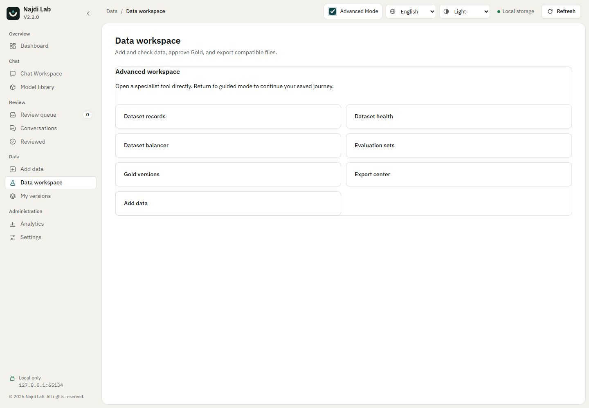

# Archived Advanced Workspace

Historical / Archived Documentation

The last development candidate supporting the guided and independent-tool presentations together was V2.2.0 on 2026-11-06 at `8753463f27009f8574614294e8e45425142d5706`. V2.3.0 uses the four-stage Guided Wizard as its official data workspace.

The original workspace gave experienced operators direct access to manual records, dataset Health, Balance, Evaluation, Gold version details and exports. A visible mode switch changed the presentation while preserving the shared selection and draft. Keeping that switch made the user choose a presentation before completing the same data task. The official workflow now puts entry, correction, approval and export in one continuous workspace.

The preserved interface lives in `static/advanced-workspace.html`, `static/advanced-workspace.js` and `static/advanced-workspace.css`. The default shell requests none of these assets. Historical diagnostic URLs load the specialist panels on demand. Developer restoration explicitly reinstates the old launcher and switches inside a temporary synthetic static tree.

- [Architecture and source map](ARCHITECTURE.md)
- [Preserved features and limits](FEATURES.md)
- [Tested restoration procedure](RESTORE_GUIDE.md)
- [Current V2.3.0 user guide](../../user-guide.md)

## Selected historical screenshots

These are unmodified PNG captures from the previous synthetic Chromium acceptance. They display V2.2.0 and the archived mode switch. They were visually inspected for private information and contain the launcher, product labels and a loopback address. Their provenance and byte hashes are recorded in `screenshots/provenance.json`.

This archive supports future development and component reuse. Repository visibility, source licensing, data rights and redistribution approvals retain their existing governance.
