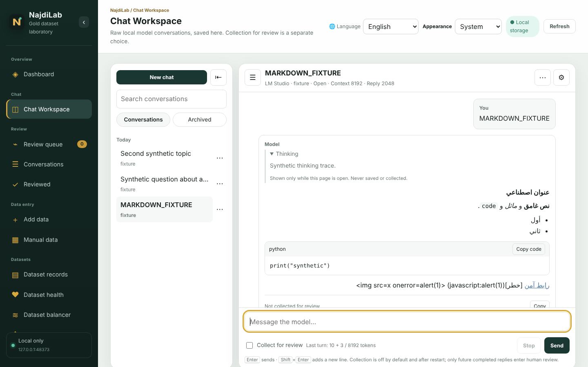
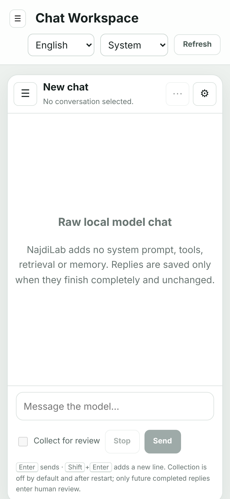
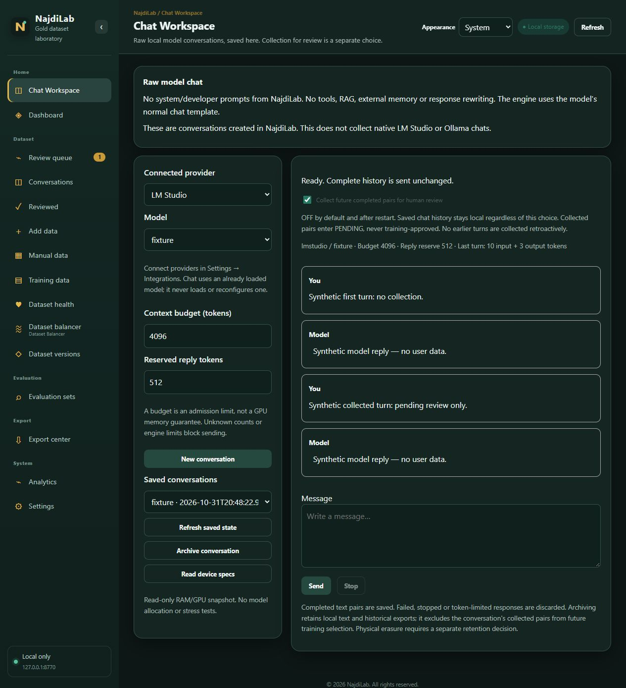

# Interface screenshots

## Chat Experience V2 (branch `feature/chat-experience-v2`, synthetic fixture)

Regenerate with `node tests/readme-screenshots.cjs` (needs Chromium and `puppeteer-core`). The script only starts `tests/chat_browser_fixture.py`, a disposable server with a synthetic engine and an empty temporary database; it never connects to an installed instance. These images are interface evidence, not acceptance with installed models.

## Earlier capture

This is an actual synthetic-engine Chat capture, not evidence of acceptance with installed LM Studio/Ollama models. Separate collection sends completed consented pairs to pending human review. Follow the [current workflow](user-guide.md) and [Chat contract](chat-workspace.md), rather than inferring current behavior from old navigation screenshots.

The separately built Core has its own [actual fictional-workshop screenshots](../public_source/docs/screenshots.md). Prior full-platform screenshots and training diagrams are removed from the active working source. Their creation methods, hashes and rights uncertainty are preserved as provenance facts in [asset provenance](asset-provenance.md), not supported operating procedures.
