# Current interface screenshots

Current Documentation — V2.3.0 development candidate

The PNGs below are unmodified captures of the running application in actual Chromium, with disposable synthetic records and isolated exports. Their source version, language, theme, dimensions, capture times and SHA256 are recorded in [provenance.json](assets/screenshots/v2.3.0/provenance.json). Desktop captures display the product version in the sidebar. The mobile navigation capture displays V2.3.0 explicitly. Other mobile captures show the normal collapsed navigation and are bound to the same checked source version by provenance.

The README uses four selected images. This guide contains the wider acceptance set. Gold and Unsloth handoff remain separate, and screenshot counts represent the actual synthetic fixture. The old Advanced Mode presentation has [its own historical archive](legacy/advanced-workspace/README.md).

## Dashboard

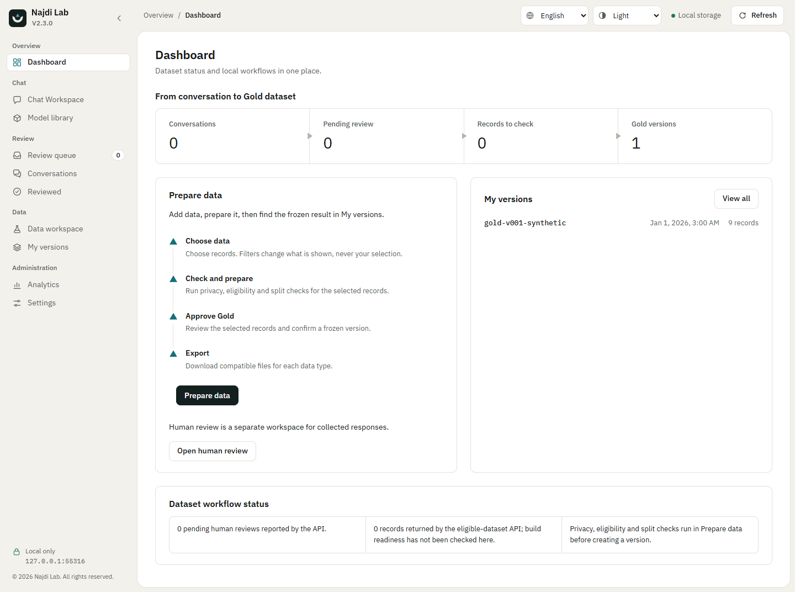

## Wizard — Data and manual entry

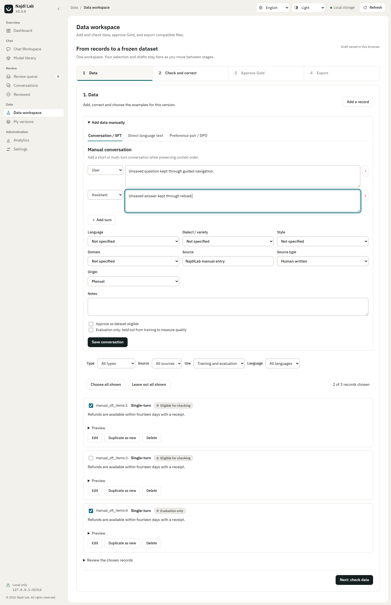

## Wizard — Check and correct with a blocker

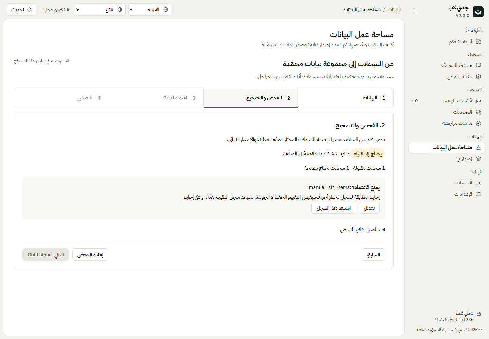

## Wizard — Successful checks

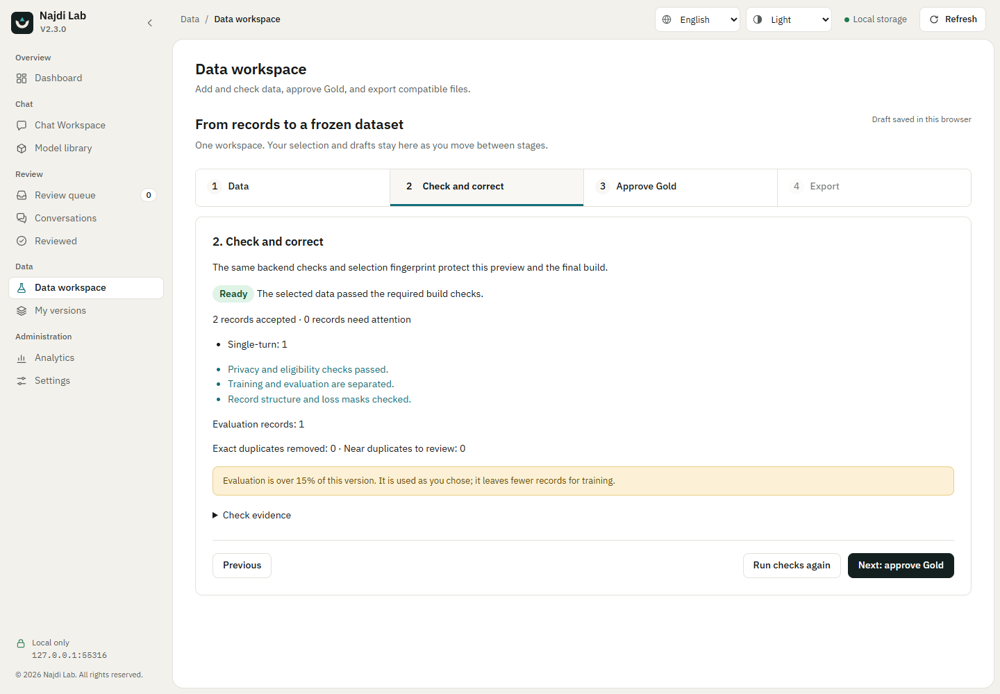

## Wizard — Approve Gold

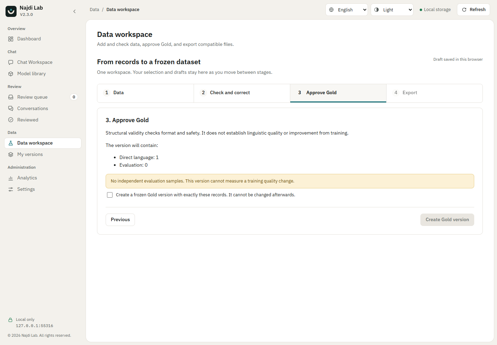

## Wizard — Export

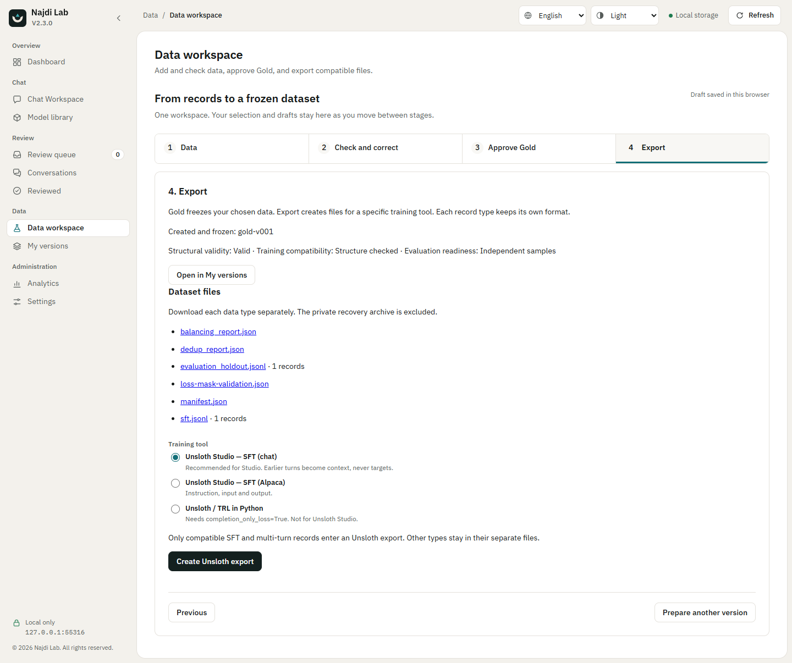

## Edit a manual record

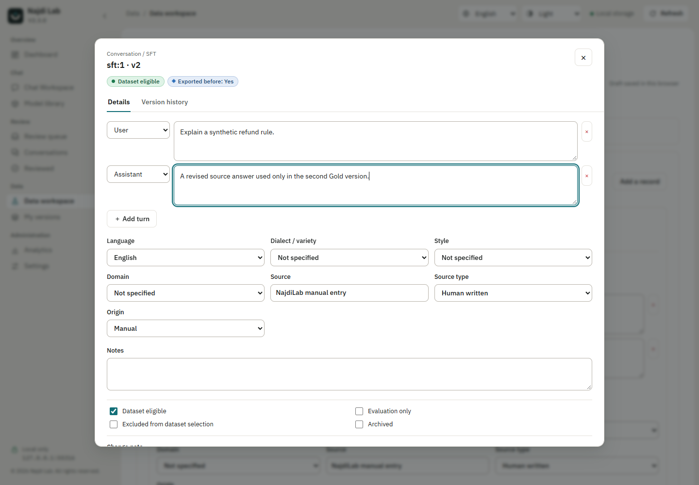

## Gold versions

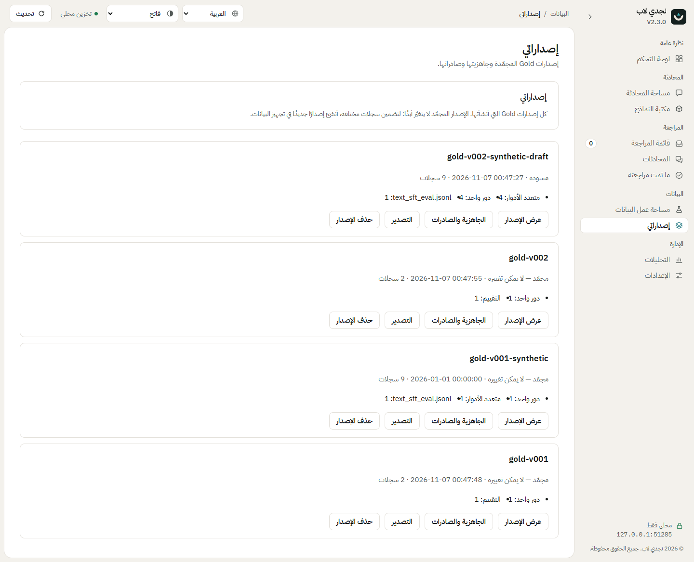

## Permanent deletion preview

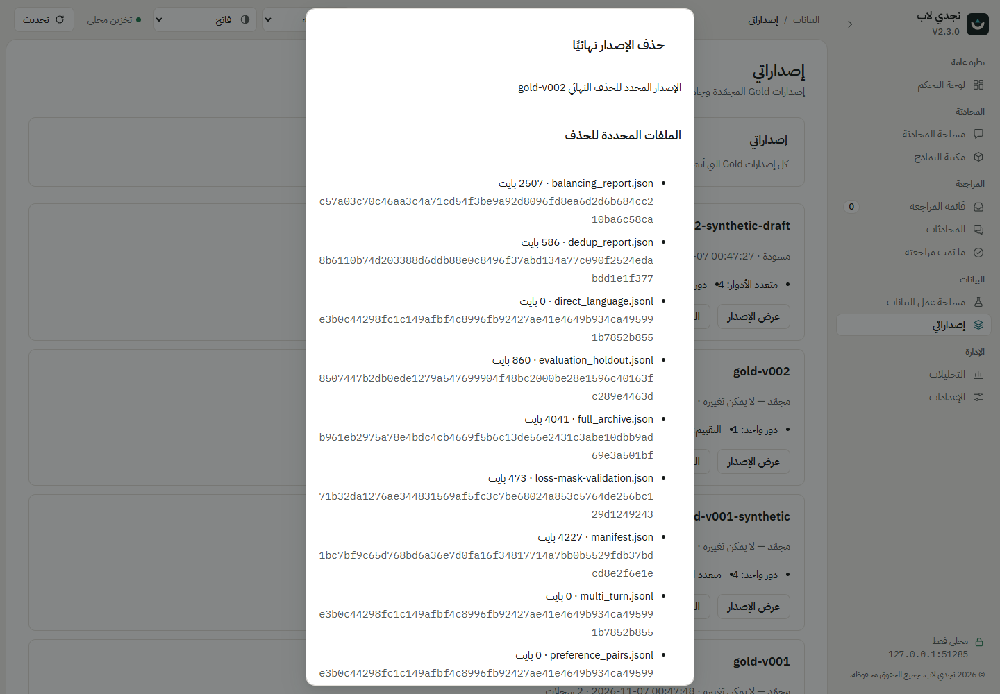

## Arabic mobile data workspace

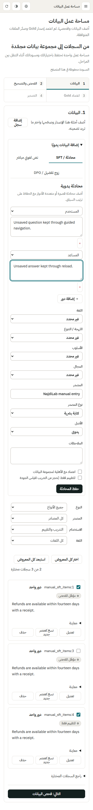

## Mobile product/version identification

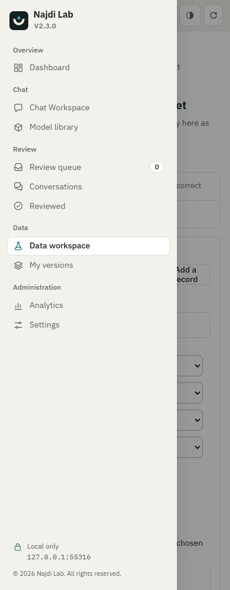

## Arabic Dark export

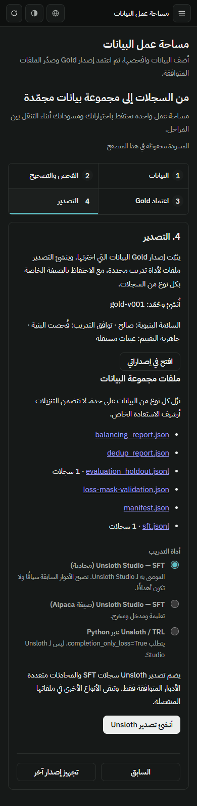

## Visual inspection and scope

Review covers alignment, spacing, clipping, long technical hashes, natural Arabic, independent content direction and actual enabled/disabled actions. The stage rail becomes two rows on a phone. Manual fields stack inside the same panel and can be collapsed after entry. Check blockers retain Edit/Exclude actions and keep approval disabled. The deletion plan scrolls within its native dialog. The confirmation screenshot records its top after scrolling there to inspect the version and file set.

Light/Dark and 320/390/1440px are checked in the full browser matrix. No bitmap composition, retouching or simulated UI is used. PNG publication copies the captured bytes. These images demonstrate synthetic UI behavior. Real model quality, rights and production acceptance retain their separate gates.

## Reproduction

Install the browser test prerequisites in [developer setup](developer-setup.md), then run both language journeys and publish the fixed selected set.

```powershell
$env:NODE_PATH=(Resolve-Path '.test-tmp/browser-tools/node_modules').Path
$env:NAJDILAB_BROWSER_EXECUTABLE='C:\Program Files\Google\Chrome\Application\chrome.exe'
node --test --test-concurrency=1 tests/guided-workspace-browser.cjs
python scripts/publish_documentation_screenshots.py
python -m pytest -q tests/test_v230_documentation.py
python scripts/check_docs.py
```

The publisher rejects a capture index without the V2.3.0 UI attestation. The [documentation audit](development/V230_DOCUMENTATION_AUDIT.md) records image replacement and link results. Previous Chat/redesign captures remain historical evidence in their dated records and [asset provenance](asset-provenance.md). The separate Core profile has its own [screenshots](../public_source/docs/screenshots.md).
