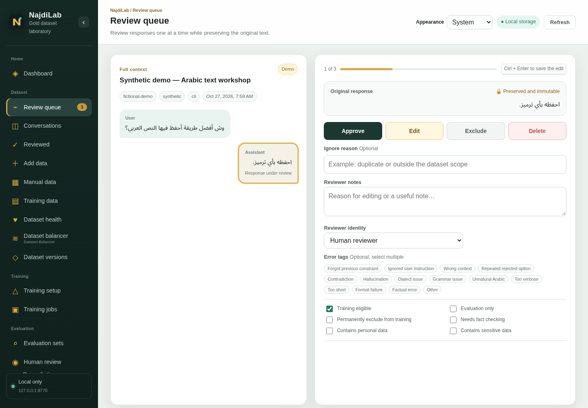
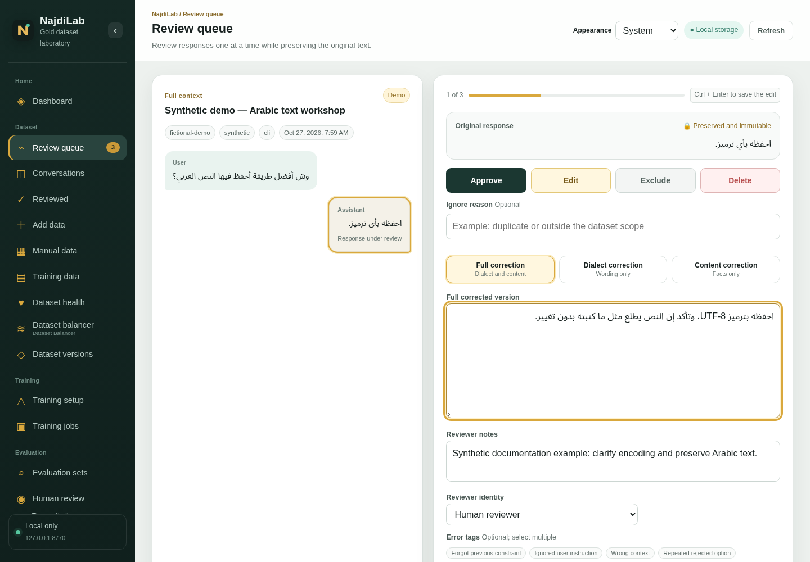
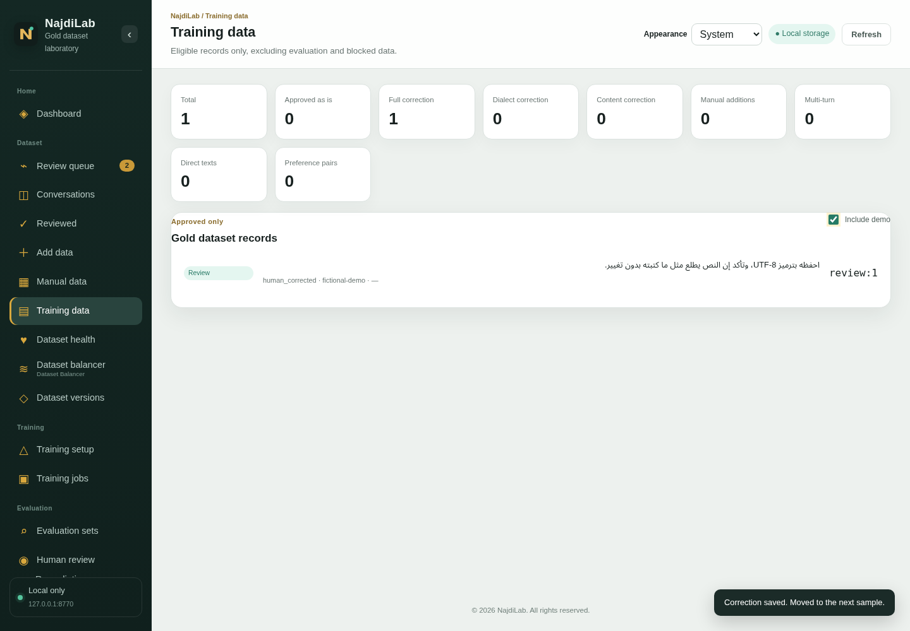
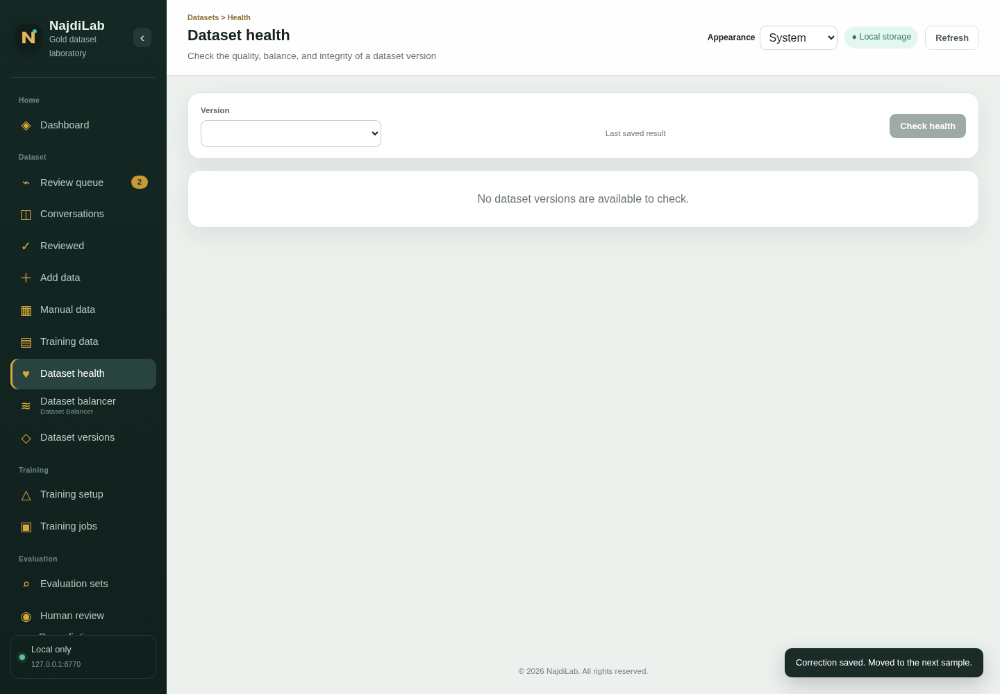
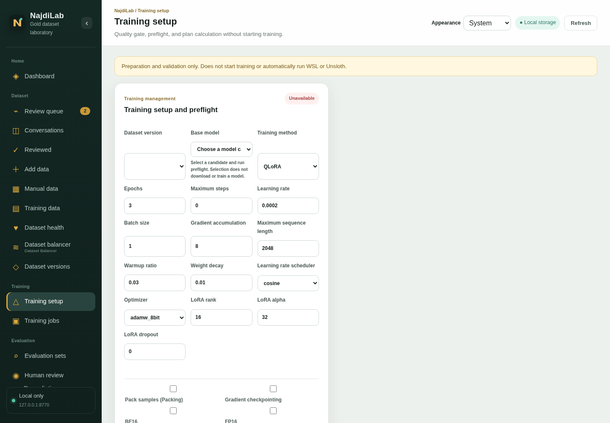
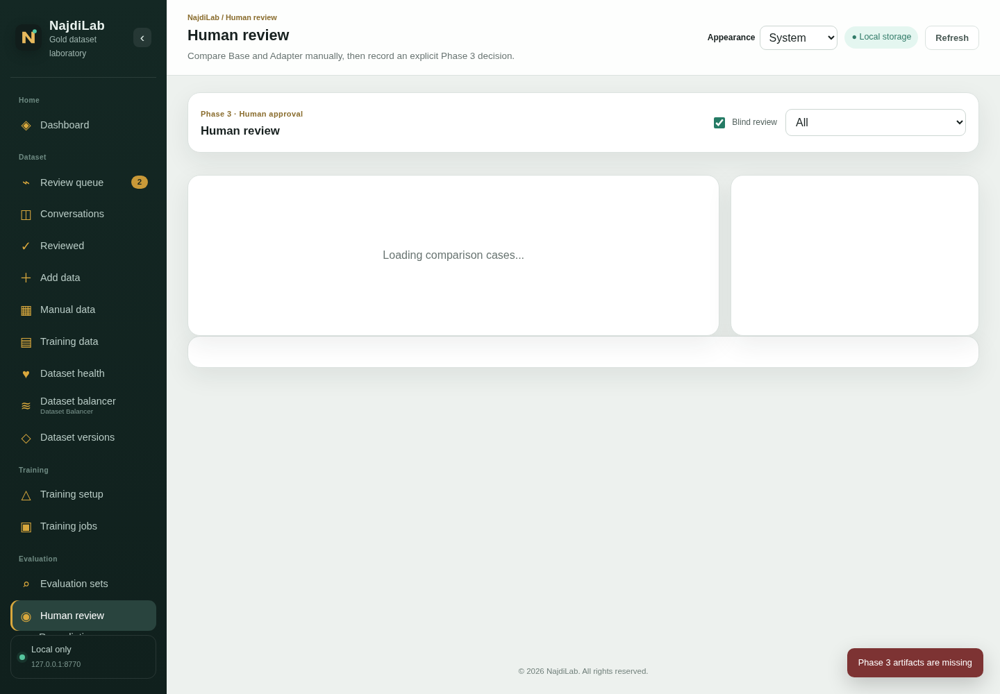

# Application screenshot gallery

All new images below are **actual application screenshots using fictional synthetic data**, captured from an isolated source-only Linux checkout on 2026-10-27 at 1440 × 1000. No UI/mock API responses were substituted. No private corpus, original correction, Gold artifact, checkpoint, model or runtime was loaded. The disposable instance was stopped after capture. Text/correction steps are reproduced in the [user guide](user-guide.md); rights and hashes are in the [asset register](asset-provenance.md).

## Dashboard — demonstrated

Three fictional turns are queued; unavailable historical status remains UNKNOWN. This is the main navigation/workflow overview, not evidence of completed historical training. The UI's footer copyright statement is rendered application text, not confirmation of legal ownership.

## Conversation review — demonstrated

The question asks how to preserve Arabic text. Its intentionally weak answer is reviewed separately; the original is visibly locked. The synthetic model/provider/title are fictional. No identifiable person is represented.

## Correction overlay — demonstrated

Full correction was selected; the reviewer entered a new response and a synthetic note, then saved it. The save controls/remaining flags lie below the shown viewport. Database verification confirmed the original remains unchanged and the correction is separate. This is not an original research decision or model evaluation.

## Training data / dataset preparation — demonstrated

After saving, the Training data screen shows one eligible corrected record with **Include demo** selected. The UI calls this list “Gold dataset records”; the screenshot does **not** show a built/frozen Gold version. Dataset-version creation/export was not performed.

## Dataset health — actual empty state

Quality checks are implemented but unavailable in this fresh instance until a version exists. No quality score or passing historical check was fabricated. Read [quality/training guidance](dataset-and-training.md) before checking a real candidate.

## Training configuration — actual unconfigured state

Configuration fields exist, but preparation is unavailable without dataset/model/runtime evidence. Displayed defaults are UI values, not recommended training hyperparameters. No preflight, model acquisition, WSL probe, Smoke or Full Training was started.

## Evaluation / human review — actual missing-artifact state

The source-only instance has no historical comparison evidence. The retained loading placeholder plus error message is an observed limitation, not a completed evaluation. Do not invent results to populate it. Historical private evidence remains outside the showcase.

## Existing preview preserved

The prior [synthetic Arabic interface crop](images/english-ui-arabic-record.jpg) remains unchanged and linked from README. Its earlier verification is historical. New PNGs are lossless browser captures with no EXIF metadata; no external fonts/icon pack were added by this task. Reproduce with a new checkout and synthetic examples, never by attaching a private database. See [visual verification](visual-documentation-verification.md) for environment, scripts and limitations.
