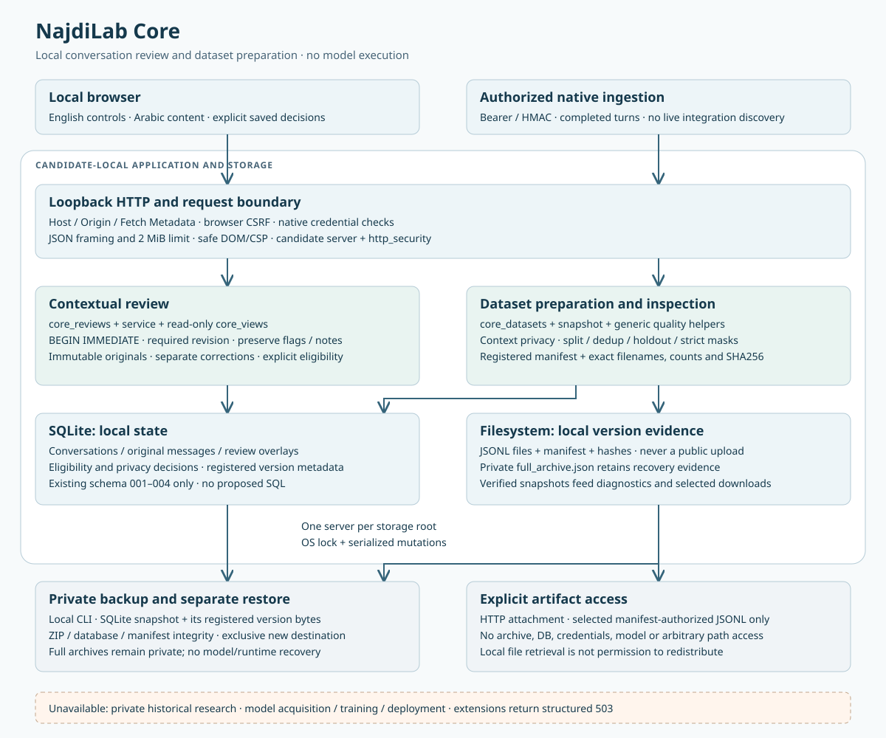
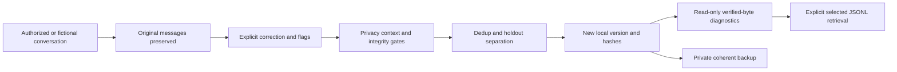

# NajdiLab Core architecture

The [editable SVG](images/core-architecture.svg) is generated by [standard-library source](generate_architecture.py). Solid arrows show verified relationships; the separate dashed unavailable strip is not an execution pipeline. Cards group functions, not independent network services. On a narrow screen open/zoom the SVG or read the text below. The original full-platform diagrams remain preserved in the private engineering repository and do not describe this reduced profile.

## Runtime boundary

A loopback Python HTTP server serves a framework-free browser interface and authenticated completed-turn ingestion. Shared request checks run before routing: exact Host/Origin/Fetch Metadata, JSON framing/size, CSRF for browser mutations and bearer/HMAC for native ingest. Static paths stay under the candidate's static root; user values use text nodes/value, not HTML interpolation.

The server acquires a nonblocking OS advisory lock for its own storage root. A different port cannot start another Core server over the same DB. Supported HTTP mutations are serialized; SQLite review transactions provide atomic stale-token comparison and write. This is a trusted local operator model, not protection from arbitrary direct database/filesystem writers, multi-user RBAC or public hosting.

## Module and data responsibilities

| Built module | Responsibility |
|---|---|
| app/server.py | Candidate routing, validation, request errors, selected attachments, startup and single-instance guard |
| app/core_reviews.py | Mandatory revision, BEGIN IMMEDIATE compare/merge/write, strict flag/text types, safe lifecycle and fresh revision |
| app/core_views.py | Read-only review listing/detail with mode=ro |
| app/service.py, app/db.py | Preserved generic ingestion, original messages, overlays, SQLite and existing migrations |
| app/core_datasets.py | Candidate privacy/context gates, existing split/dedup rules, fixed-version manifest/hash validation and read-only diagnostics |
| app/core_snapshot.py, app/dataset_quality.py | Verified in-memory bytes adapted to the generic quality reader; no temporary diagnostic writes |
| app/core_artifacts.py | Fixed allowed JSONL names, verified snapshot bytes, no arbitrary filesystem delivery |
| app/core_storage.py | Regular local storage checks and one-server lock; no private directory discovery |
| app/extensions.py | Explicit structured unavailable boundary; no automatic loader |
| scripts/backup.py, scripts/restore_backup.py | Coherent private SQLite/registered-version backup and exclusively new validated restore |

SQLite stores originals, overlays, flags and version metadata. Dataset JSONL, manifests and the private recovery archive are filesystem files; they are not all stored inside SQLite. Generic source is reused unchanged; new wrappers are candidate-specific. Mapping from engineering sources to these built paths is explicit in the reviewed builder policy.

## Review-to-version workflow

Preparation requires enough reviewed records for the candidate's current holdout policy. Flagged earlier context cannot re-enter a later target silently. Conflicts, stale source/masks, unsupported direct/preference workflows or missing split evidence block. Original/frozen research is never loaded to make a gate pass. No training or deployment arrow exists.

## Integrity, recovery and limitations

A required expected_updated_at is checked in the same SQLite write transaction as state changes. Omitted fields persist; explicit restrictive flags force training ineligible. A fresh monotonic timestamp makes simultaneous clients conflict rather than overwrite. Restores do not confer eligibility/consent. Existing schema lacks full append-only event history; proposed migrations remain absent.

Version inspection checks registered manifest equality and exact regular-file inventory/counts/hashes before using memory snapshots. Strict assistant-only masks and actual evaluation_holdout.jsonl checks apply. A local prepared version is not rights-cleared. Private full archives contain all local recovery records and are excluded from HTTP downloads.

Backup snapshots SQLite first and collects only that snapshot's registered immutable version bytes. Restore validates before claiming a new private destination; no overwrite or history rewrite. Bounded sizes and unsupported external writers are documented in the [README](../README.md). HMAC replay freshness, asserted reviewer identity, no automatic PII detection and generic migration-loader debt remain limitations.

## Maintenance

After a code change, update this page/SVG only when source relationships change. Regenerate the SVG with `python docs/generate_architecture.py` inside the candidate, validate XML and render visually. Recheck labels, arrows, contrast, desktop/narrow layouts and provenance. Keep original diagrams and historical evidence in the engineering repository; do not silently relabel them as Core screenshots. No license or publication permission is implied by these assets.
