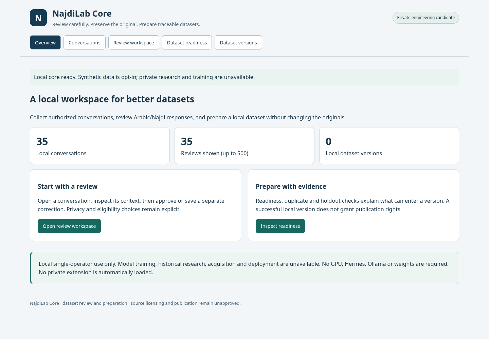
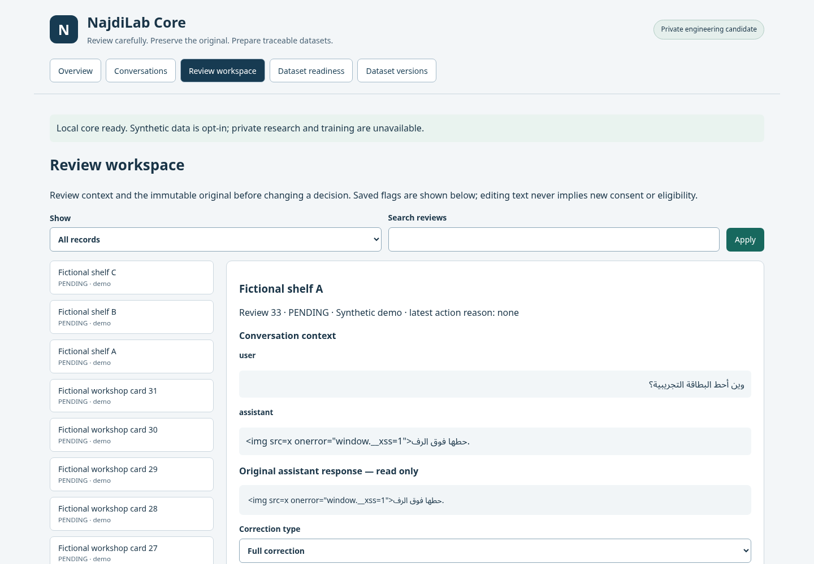
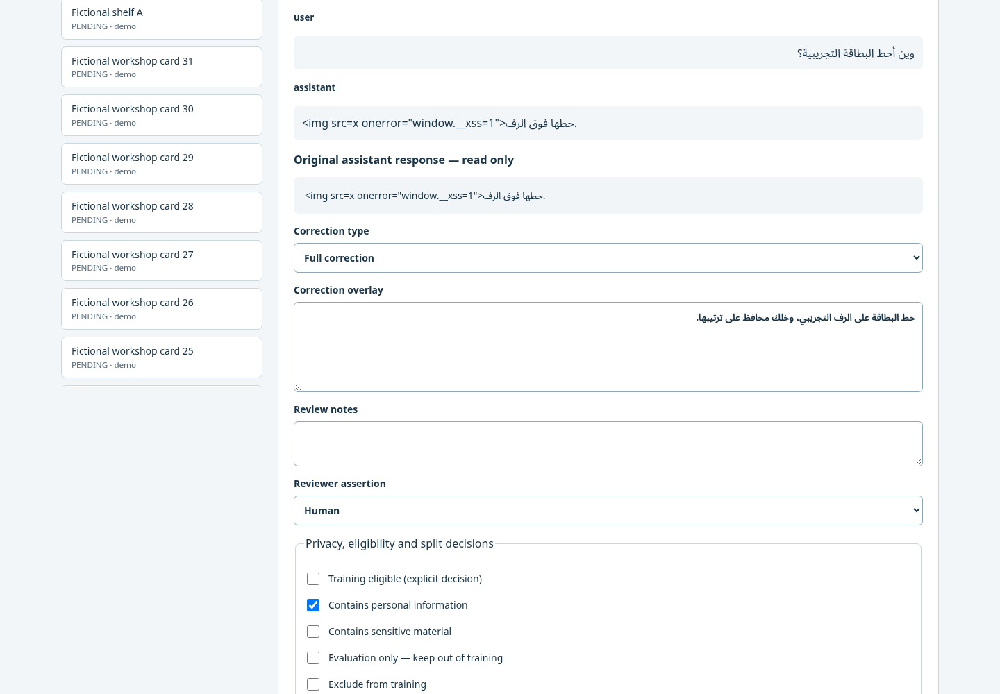
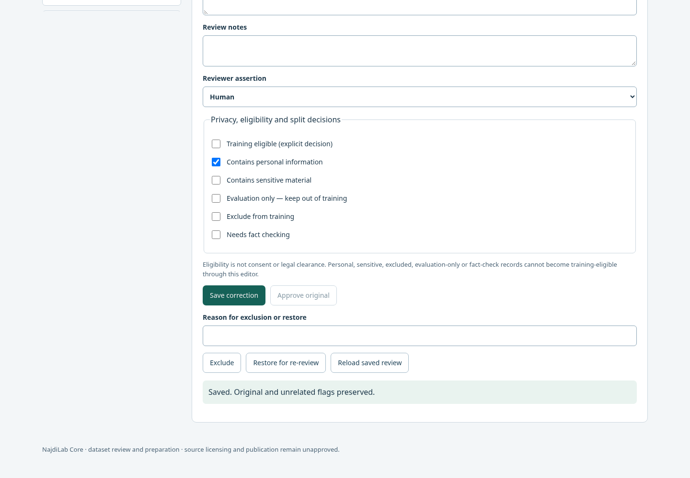
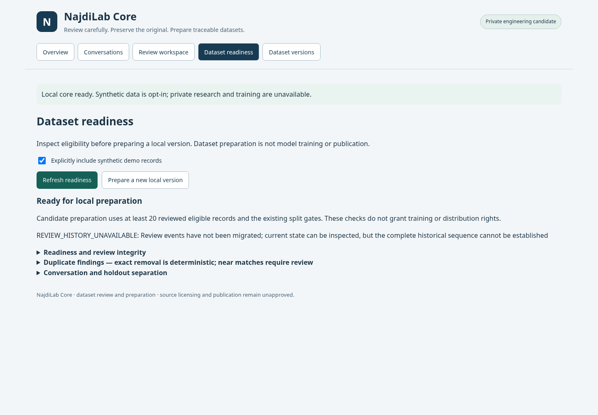
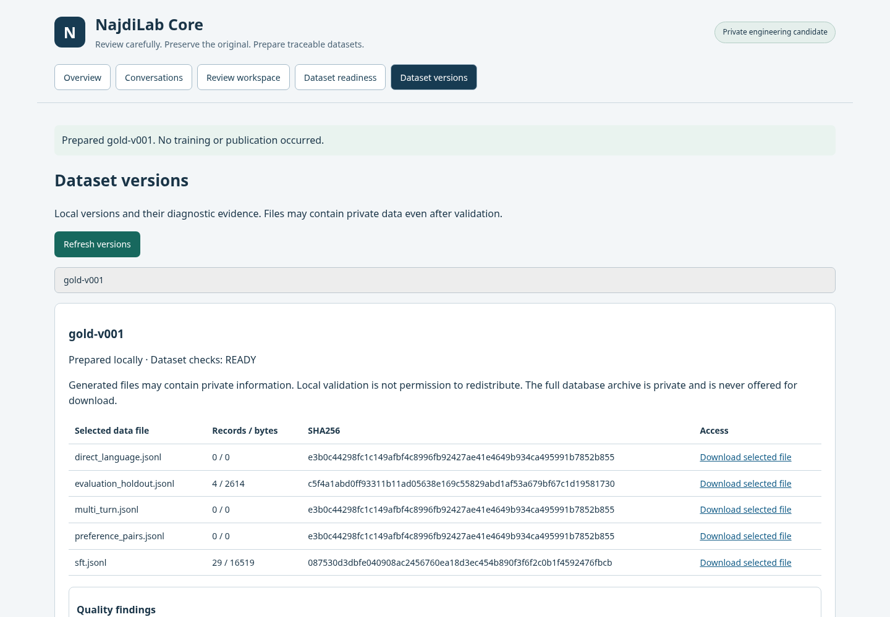
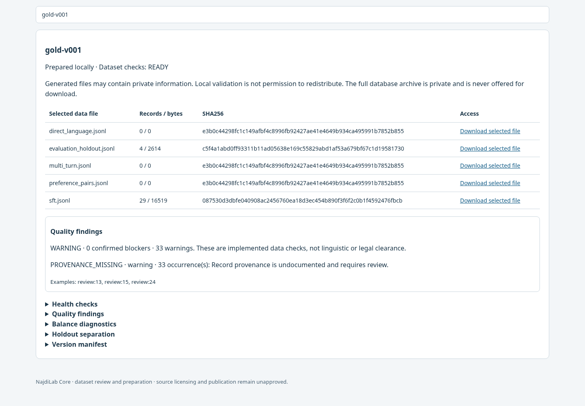
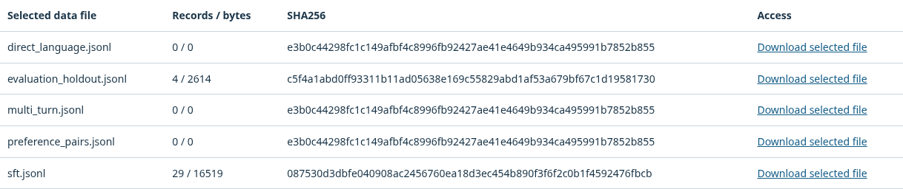

# Actual NajdiLab Core interface

These are real Chromium captures of the exact Core candidate in disposable Cloud storage, using only independently fictional Arabic card-workshop examples. No fake API responses, model runs or original research were substituted. Native HTML-like test text is intentionally inert. Creation method: AI-assisted browser automation of the actual UI, not AI-generated dashboard art. UI/source and redistribution rights remain owner-confirmation gates.

## Overview

Implemented local overview. Counts come from the actual synthetic database; no historical training status appears.

## Conversation and review context

Implemented context inspection. HTML-like content in the original is displayed as literal text, never executed.

## Correction editor

Implemented unsaved editing. Flags are loaded and changed deliberately; original text is not editable.

## Saved decision

Implemented persistence. The privacy flag is a fictional demonstration, not information about an actual person. API/DB checks verified originals remained unchanged.

## Dataset readiness

Implemented gates and opt-in demo inclusion. The initial pending state blocks; a sufficient reviewed fixture passes without weakening privacy, split or holdout rules.

## Dataset version

Implemented local version inspection, not training, freezing original research or public release.

## Quality findings

Implemented read-only findings. No model accuracy or research result is fabricated. A lack of confirmed blockers does not certify linguistic quality, consent or redistribution rights.

## Selected artifact access

Implemented retrieval; actual downloaded bytes matched the manifest. Full archives, database, credentials, backup and model paths were rejected. No file is uploaded or shared automatically.

## Provenance and maintenance

All eight PNGs are lossless browser captures without external artwork, fonts or icon packs bundled into the candidate. System fonts are rendered by the browser/OS, not distributed here. Seven viewport captures are 1440×1000; artifact access is an actual table-element capture (1256×255) to avoid duplicating a viewport; desktop and 390px layout are exercised separately, with mobile details requiring scrolling. The SVG is a separate editable technical illustration. Hashes and exact tested commit/manifest are recorded in the engineering repository's Phase5 verification and rights report.

To reproduce, install the separately documented browser tools and run `node tests/browser.cjs .` in a disposable exact candidate. Set NAJDILAB_SCREENSHOT_DIR to a new private output directory to capture the same actual workflow. Review every image for data accuracy/privacy before selecting it for any distribution. Never attach an original research DB to generate showcase material. Preserve older full-platform screenshots in the original private repository.
